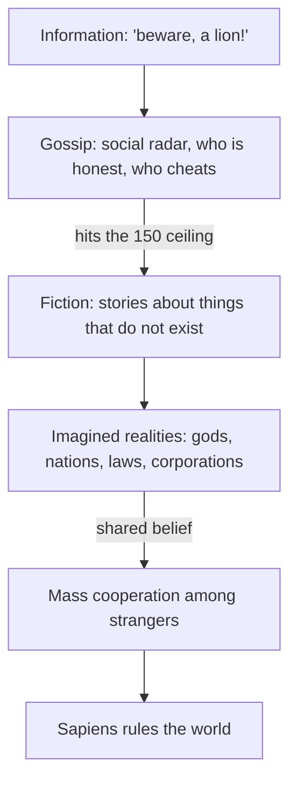

> *Source: Sapiens: A Brief History of Humankind by Yuval Noah Harari (HarperCollins, 2015), Chapter 2 "The Tree of Knowledge", PDF pp. 27–47 (printed pp. unknown)*

# 02: ต้นไม้แห่งความรู้

## แก่นความคิด

บทนี้ตอบคำถามที่บทแรกทิ้งค้างไว้ ราว 70,000 ปีก่อนมีอะไรเปลี่ยนไปจนลิงชายขอบตัวหนึ่งกลายเป็นสปีชีส์ที่ครองดาวเคราะห์ทั้งดวง คำตอบทำให้ไม่สบายใจโดยตั้งใจ ไม่ใช่สมองที่ใหญ่ขึ้น ไม่ใช่เครื่องมือที่คมขึ้น และไม่ใช่แม้แต่ภาษาพูด เพราะนกแก้วก็เลียนคำทุกคำที่เราออกเสียงได้ สิ่งที่ Sapiens ได้มาแต่ผู้เดียวคือภาษาที่ชี้ไปยังสิ่งที่ไม่มีอยู่จริง วิญญาณ เทพเจ้า ชนชาติ บริษัท สิทธิ พอคนจำนวนมากเชื่อสิ่งประดิษฐ์เดียวกันอย่างจริงใจ คนแปลกหน้าที่ไม่เคยพบกันก็ไว้ใจกันได้ ร่วมมือกันได้ และสร้างได้ในขนาดที่สัตว์อื่นไม่มีทางเข้าใกล้

บทนี้ไล่ลงไปทีละชั้น ทฤษฎีภาษาสองข้อที่ฟังขึ้น ทั้งข้อที่ว่าภาษาแบ่งปันข้อมูลเกี่ยวกับโลก และข้อที่ว่าภาษาเกิดขึ้นเพื่อนินทาในสังคม ล้วนจำเป็นแต่ยังไม่พอ ชั้นที่ชี้ขาดคือชั้นที่สาม วาจาเรื่องสิ่งที่กุขึ้น ซึ่งเปิดทางให้มนุษย์ก่อ imagined realities ขึ้นมา เพื่อพิสูจน์ว่านี่ไม่ใช่นิทานเรื่องเผ่าโบราณ แฮรารีทดสอบกับวัตถุสมัยใหม่ที่สุดที่หยิบถึงมือ บริษัทผลิตรถ Peugeot บริษัทแบบนี้ไม่มีตัวตนทางกายภาพเลย ต่อให้บดรถทุกคันเป็นเศษเหล็กและพนักงานทุกคนทยอยตายจากไป บริษัทยังอยู่ แต่ลายเซ็นของผู้พิพากษาคนเดียวก็สลายบริษัทได้ ทั้งที่บริษัทประสานคนแปลกหน้า 200,000 คนให้ทำงานร่วมกัน เครื่องจักรที่ผลิตรถ Peugeot คือเครื่องจักรเดียวกับที่สร้างเผ่าแรกขึ้นมา นั่นคือเรื่องเล่าเรื่องหนึ่งที่ทุกคนตกลงจะเชื่อและลงมือทำตาม

บทนี้ให้แนวคิดแม่บทของทั้งเล่ม ทุกอย่างที่ตามมา ทั้งการเพาะปลูก จักรวรรดิ เงิน ศาสนา ทุนนิยม และวิทยาศาสตร์ ล้วนเป็นประวัติศาสตร์ช่วงต่อของ imagined realities และของการต่อสู้เพื่อทำให้คนนับล้านเชื่อสิ่งเหล่านั้น บทนี้ยังลากเส้นแบ่งระหว่างชีววิทยากับประวัติศาสตร์ขึ้นใหม่ ยีนกำหนดสนาม เรื่องเล่าเป็นตัวตัดสินการแข่งขัน ยึดความต่างข้อนี้ไว้ แล้ว Sapiens ส่วนที่เหลือจะอ่านออกเป็นทำนองเดียวที่แปรไปตลอดทั้งเล่ม

## แนวคิดหลัก

### ภาพจริงที่คนร่วมกันสร้าง (imagined realities)

สิ่งที่มีอยู่เพียงในจินตนาการร่วมของคนหมู่มาก ทั้งเทพเจ้า ชนชาติ เงิน สิทธิของมนุษย์ กฎหมาย และบริษัท นักวิชาการเรียกสิ่งเหล่านี้ว่า fiction, social construct หรือ imagined realities ตัว imagined reality ไม่ใช่คำโกหก คนโกหกรู้ความจริงอยู่แก่ใจ แต่ imagined reality คือสิ่งที่ทุกคนเชื่ออย่างจริงใจ และตราบที่ความเชื่อนั้นยังอยู่ สิ่งนี้ก็ออกแรงกับโลกได้จริง เพราะคนนับล้านแชร์ร่วมกันได้ imagined realities จึงเป็นฐานเดียวที่เรารู้จักสำหรับความร่วมมือครั้งใหญ่ของคนแปลกหน้า พอสิ่งเหล่านี้เกิดขึ้น ก็สร้างสภาพจริงคู่ที่เราอาศัยอยู่ตั้งแต่นั้นมา ครึ่งที่จินตนาการขึ้นตอนนี้ถือชะตาของครึ่งที่เป็นวัตถุไว้ในมือ

### การนินทากับเพดาน 150 คน

ภาษาในฐานะเรดาร์สังคม การอยู่รอดขึ้นกับว่าเรารู้ไหมว่าใครซื่อสัตย์และใครโกง วงพเนจรขยายขนาดได้ด้วยการแลกเปลี่ยนนินทาแบบนี้ นี่คือความสามารถที่ถูกดูหมิ่นมาเสมอ แต่จริง ๆ แล้วจำเป็นต่อความร่วมมือในหมู่คนจำนวนมาก แต่นินทามีเพดานที่วัดได้ราว 150 คน ต่ำกว่านั้นความสนิทสนมและชื่อเสียงค้ำกลุ่มไว้ได้ สูงกว่านั้นก็ค้ำไม่ไหว เพดานนี้ทำให้ข้อโต้แย้งของบทเป็นเรื่องเชิงปริมาณ เกิน 150 คนไปมีแต่ fiction เท่านั้นที่มัดคนแปลกหน้าเข้าด้วยกัน และอธิบายสิ่งประดิษฐ์ที่มาทีหลังได้อย่างเงียบ ๆ ทั้งกษัตริย์ ประมวลกฎหมาย และการเขียน

### fiction ทางกฎหมายกับบริษัทจำกัด

ข้อพิสูจน์ของบทว่า fiction ไม่ใช่เศษตกค้างจากยุคดึกดำบรรพ์ คือบริษัท Peugeot SA ถือครองทรัพย์สิน เสียภาษี และขึ้นศาลได้ ทั้งที่ไม่มีรถ พนักงาน ผู้จัดการ หรือผู้ถือหุ้นคนใดประกอบกันเป็นบริษัท และผู้พิพากษาคนเดียวก็เพิกถอนได้โดยไม่ต้องแตะโลกกายภาพเลย บริษัทเกิดขึ้นเพราะความจำเป็น ความเสี่ยงบีบคั้นการประกอบการจนผู้คนต้องจินตนาการบริษัทที่แยกจากเจ้าของขึ้นมา ความย้อนแย้งยังอยู่ในชื่อ corporation ซึ่งมาจาก *corpus* (ร่างกาย) และชี้ตรงไปยังสิ่งที่นิติบุคคลแบบนี้ไม่มีเสียเลย

### เลนเร็วของวิวัฒนาการทางวัฒนธรรม

ผลตอบแทนของความร่วมมือที่ตั้งอยู่บนเรื่องเล่า แค่แก้เรื่องเล่า สังคมก็เปลี่ยนตามได้ในเวลาไม่กี่ปี ไม่ต้องรอเป็นพันปี สัตว์อื่นต้องรอการเปลี่ยนแปลงทางพันธุกรรม ลิงชิมแปนซีไล่ตัวผู้ที่เป็นจ่าฝูงออกไม่ได้ด้วยการลงคะแนน เครื่องมือของ *Homo erectus* แทบไม่เปลี่ยนเลยตลอดเกือบสองล้านปี Sapiens เปลี่ยนระบบการเมืองห้าระบบภายในชั่วชีวิตของชาวเบอร์ลินคนหนึ่ง และชนชั้นสูงที่ถือพรหมจรรย์อย่างนักบวชคาทอลิกก็ขัดกับ natural selection อย่างเปิดเผย คริสตจักรยืนยาวอยู่ได้ด้วยเรื่องเล่าที่ส่งต่อกันมา ไม่ใช่ด้วยยีน นี่คือกลไกเบื้องหลังการแบ่งชีววิทยากับประวัติศาสตร์ ยีนกำหนดพารามิเตอร์ของสนาม ประวัติศาสตร์คือการแข่งขัน และ Cognitive Revolution คือจุดที่ประวัติศาสตร์ประกาศอิสรภาพจากชีววิทยา

## ถ้อยคำน่าจดจำ

> "There are no gods in the universe, no nations, no money, no human rights, no laws, and no justice outside the common imagination of human beings." (PDF p. 35)
>
> แปลว่า ในจักรวาลนี้ไม่มีเทพเจ้า ไม่มีชนชาติ ไม่มีเงิน ไม่มีสิทธิของมนุษย์ ไม่มีกฎหมาย และไม่มีความยุติธรรมใด ๆ อยู่นอกจินตนาการร่วมของมนุษย์

> "Unlike lying, an imagined reality is something that everyone believes in, and as long as this communal belief persists, the imagined reality exerts force in the world." (PDF p. 39)
>
> แปลว่า ต่างจากการโกหก imagined reality คือสิ่งที่ทุกคนเชื่อ และตราบที่ความเชื่อร่วมนี้ยังดำรงอยู่ imagined reality ก็ออกแรงกับโลก

> "The Cognitive Revolution is accordingly the point when history declared its independence from biology." (PDF p. 44)
>
> แปลว่า Cognitive Revolution จึงเป็นจุดที่ประวัติศาสตร์ประกาศอิสรภาพจากชีววิทยา

## ความเชื่อมโยง

- [[Book/Sapiens_TH/01_An_Animal_of_No_Significance|01 สัตว์ที่ไร้ความสำคัญ]] ตอบคำถามที่บทแรกทิ้งค้างไว้ว่าอะไรทำให้ลิงชายขอบกลายเป็นสปีชีส์ที่ครองโลก
- [[Book/Sapiens_TH/03_A_Day_in_the_Life_of_Adam_and_Eve|03 หนึ่งวันในชีวิตของอาดัมกับอีฟ]] บทนี้ปิดท้ายด้วยคำสัญญาว่าจะพาไปดูว่าผู้คนของมนุษย์สิงโต (lion-man) ใช้ชีวิตกันอย่างไร บทถัดไปทำตามสัญญานั้น
- [[Book/Sapiens_TH/06_Building_Pyramids|06 สร้างปิรามิด]] กลไก imagined realities ในระดับรัฐ คนแปลกหน้าร่วมมือกันข้ามทศวรรษบนเรื่องเล่าของกษัตริย์ที่มีชีวิต
- [[Book/Sapiens_TH/07_Memory_Overload|07 ความจำล้นเกิน]] การก้าวข้ามกำแพง 150 คน การเขียนมาถึงตอนที่เรื่องเล่ากับความจำแบกข้อมูลของสังคมไว้ไม่ไหวแล้ว
- [[Book/Sapiens_TH/08_There_Is_No_Justice_in_History|08 ไม่มีความยุติธรรมในประวัติศาสตร์]] ความยุติธรรมและสิทธิของมนุษย์ที่บทนี้ประกาศว่าเป็นเรื่องจินตนาการ ไปเจออำนาจจริงที่นั่น
- [[Book/Sapiens_TH/10_The_Scent_of_Money|10 กลิ่นของเงิน]] เงินที่บทนี้จัดไว้ในหมู่สิ่งที่มีอยู่เพียงในจินตนาการร่วม กลายเป็น fiction ใหญ่ที่ทำให้การค้าระหว่างคนแปลกหน้าเป็นไปได้
- [[Book/Sapiens_TH/Sapiens - Overview|ภาพรวม Sapiens]] เส้นทางอ่าน แผนที่บท และทางเดินต่าง ๆ

## ข้อคิดที่ได้

พลังพิเศษของ Sapiens คือ fiction ที่แชร์กันได้ เชื่อเรื่องเดียวกันกับคนแปลกหน้ามากพอ แล้วความร่วมมือก็ไม่มีขีดจำกัดตามธรรมชาติ นี่คือเหตุผลที่เราครองโลกได้ ขณะที่ลิงใหญ่สายอื่นทำไม่ได้
