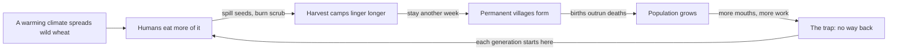

> *Source: Sapiens: A Brief History of Humankind by Yuval Noah Harari (HarperCollins, 2015), Chapter 5 "History's Biggest Fraud", PDF pp. 84–104 (printed pp. unknown)*

# 05: การฉ้อโกงครั้งใหญ่ที่สุดในประวัติศาสตร์

## แก่นความคิด

เรื่องเล่ามาตรฐานเดินอย่างนี้ วันหนึ่งบรรพบุรุษของเราฉลาดพอจะถอดรหัสความลับของธรรมชาติ เพาะปลูกข้าวสาลีและเลี้ยงแกะ แล้วก็ยินดีแลกชีวิตเร่ร่อนอันโหดร้ายกับความสะดวกสบายของการตั้งถิ่นฐานแบบทำฟาร์ม บทที่ 5 รื้อเรื่องเล่านั้นลง แฮรารีจงใจตั้งข้อโต้แย้งที่ชวนอื้อฉาว Agricultural Revolution ไม่ใช่ก้าวกระโดดไปข้างหน้า แต่เป็นการฉ้อโกงครั้งใหญ่ที่สุดในประวัติศาสตร์ ชาวนาทำงานหนักกว่าคนเก็บของป่าล่าสัตว์ กินแย่กว่า และตายจากความอดอยาก โรคภัย และความรุนแรงบ่อยกว่า ส่วนพืชที่พวกเขารับใช้กลับเป็นผู้ชนะตัวจริงของข้อตกลงนี้ การทำให้เชื่องเดินผิดทาง พืชต่างหากที่ทำให้เราเชื่อง

เพื่อให้กรอบคิดใหม่นี้ติดแน่น แฮรารีมอบเครื่องมือทางความคิดสองชิ้นที่เขาจะหยิบกลับมาใช้ซ้ำตลอดทั้งเล่ม ชิ้นแรกคือ wheat's-eye view (มุมมองจากสายตาของข้าวสาลี) การตัดสินการปฏิวัติด้วยสกุลเงินทางวิวัฒนาการ คือจำนวนสำเนาของ DNA ไม่ใช่ความสุขของมนุษย์ แล้วดูว่าสองอย่างนี้ห่างกันแค่ไหน ชิ้นที่สองคือ luxury trap (กับดักความฟุ่มเฟือย) ทางเลือกเล็ก ๆ ที่สมเหตุสมผลและมองแค่ระยะสั้น ซึ่งทบกันจนกลายเป็นความทุกข์ที่ไม่มีทางออก เพราะไม่มีขั้นตอนไหนเลยที่เป็นก้าวถึงตาย ทั้งสองอย่างอธิบายได้ไม่ใช่แค่เยริโคโบราณ แต่รวมถึงกล่องอีเมลของเราเองด้วย

## โครงสร้างข้อโต้แย้ง

- **จุดตั้งต้นกับ wheat's-eye view** ตลอด 2.5 ล้านปีที่ผ่านมา ทุกสายพันธุ์มนุษย์เลี้ยงตัวเองด้วยการเก็บของป่าและล่าสัตว์ ราว 10,000 ปีก่อน การทดลองนี้เริ่มในลิแวนต์ จีน และอเมริกากลาง วันนี้กว่า 90% ของแคลอรีที่เรากินยังมาจากพืชที่มนุษย์ทำให้เชื่องระหว่าง 9500 ถึง 3500 ปีก่อนคริสตกาล เมื่อหนึ่งหมื่นปีก่อน ข้าวสาลีเป็นแค่หญ้าป่าธรรมดา ๆ วันนี้ครอบคลุมพื้นที่ 2.25 ล้านตารางกิโลเมตร วิธีของข้าวสาลีไม่ใช่การเลี้ยงมนุษย์ให้กินดี แต่คือการสั่งการแรงงานของมนุษย์ ถางทุ่ง กำจัดวัชพืชใต้แดดเผา ลากน้ำ ขนมูลสัตว์ ร่างกายที่วิวัฒน์มาเพื่อปีนต้นแอปเปิลและวิ่งไล่ละมั่งจ่ายราคาเป็นกระดูกสันหลัง หัวเข่า คอ และอุ้งเท้า คำว่า domesticate มาจาก *domus* (บ้าน) และสปีชีส์ที่อาศัยอยู่ในบ้านก็คือเรา

- **สิ่งที่ข้าวสาลีไม่เคยให้** ไม่ใช่อาหารที่ดีกว่า ธัญพืชขาดแร่ธาตุ ย่อยยาก และทำลายฟัน ไม่ใช่ความมั่นคง ชาวนาพึ่งพาอาหารหลักเพียงอย่างเดียว ฝนแล้งครั้งเดียวก็ฆ่าชาวนาเป็นล้าน ๆ ไม่ใช่สันติภาพ ทุ่งนาและยุ้งฉางเดินจากไปไม่ได้ ชาวนาจึงอยู่และสู้ งานศึกษาสังคมเกษตรแบบง่าย ๆ ระบุว่าราว 15% ของการตายมาจากความรุนแรง วิวัฒนาการลงบัญชีด้วยสำเนาของ DNA ราว 13,000 ปีก่อน โอเอซิสเยริโครองรับคนได้มากที่สุดแค่กลุ่มเร่ร่อนหนึ่งร้อยคน ถึง 8500 ปีก่อน ที่นั่นกลายเป็นหมู่บ้านแออัดที่เต็มไปด้วยโรคภัยของคนหนึ่งพัน

- **luxury trap** ไม่มีอะไรเกิดขึ้นในทันที คนเก็บของป่าล่าสัตว์เจริญรุ่งเรืองในตะวันออกกลาง 50,000 ปีโดยไม่ต้องมีเกษตรกรรม จากนั้นภูมิอากาศที่อุ่นขึ้นเปิดทางให้ข้าวสาลีป่าแผ่ขยาย และมนุษย์ก็กินมากขึ้น ค่ายเก็บเกี่ยวขยายจากไม่กี่สัปดาห์เป็นหมู่บ้านถาวร ชาวนาทูเฟียน (12,500–9500 ปีก่อนคริสตกาล) ยังเป็นนักล่าเก็บของป่า แต่สร้างบ้านหินและบดธัญพืชป่า ลูกหลานของพวกเขาเริ่มหว่านไถ กำจัดวัชพืช และทีละก้าว คนเก็บของป่าก็กลายเป็นชาวนา ทุกขั้นดูเหมือนสามัญสำนึก พอทบกันเข้า การปรับปรุงเล็ก ๆ กลับกลายเป็นหินโม่ผูกคอ พอแผนย้อนกลับมาเล่นงาน ทางออกก็หายไปแล้ว การเปลี่ยนแปลงคืบเข้ามาทีละรุ่น และจำนวนประชากรที่เพิ่มขึ้นได้เผาเรือทิ้ง

- **เกอเบคลีเทเป** วิทยาศาสตร์ชอบคำอธิบายทางเศรษฐกิจที่เย็นชา แต่เกอเบคลีเทเป (ขุดค้นตั้งแต่ปี 1995 ในตุรกีตะวันออกเฉียงใต้) ทำให้เรื่องซับซ้อนขึ้น ชั้นดินที่เก่าที่สุดไม่มีบ้านเลย มีเพียงวงล้อมขนาดมหึมาของเสาหินแกะสลักหนักถึงเจ็ดตันและสูงห้าเมตร สร้างราว 9500 ปีก่อนคริสตกาลโดยคนเก็บของป่าล่าสัตว์ แรงกดดันทางวัฒนธรรม บางทีน่าจะเป็นศาสนา หนักพอจะดึงคนเก็บของป่าหลายพันคนจากหลายกลุ่มให้ร่วมมือกันข้ามปี ห่างออกไปสามสิบกิโลเมตร ข้าวสาลีสายพันธุ์ einkorn กลายเป็นพืชที่มนุษย์เพาะปลูกเป็นครั้งแรก วิหารอาจเกิดขึ้นก่อน และหมู่บ้านก่อตัวขึ้นรอบ ๆ วิหารนั้น เกษตรกรรมอาจเริ่มต้นเพื่อเลี้ยงศาสนสถาน ไม่ใช่เพื่อให้ท้องอิ่ม

- **เหยื่อของการปฏิวัติ** ปศุสัตว์ตอบแทนมนุษย์ด้วยเนื้อ นม ไข่ และขนสัตว์ ในแง่ DNA ข้อตกลงนี้ชนะขาด แกะราวหนึ่งพันล้านตัว หมูหนึ่งพันล้านตัว วัวมากกว่าหนึ่งพันล้านตัว และไก่มากกว่า 25,000 ล้านตัว แต่ความสำเร็จทางวิวัฒนาการเป็นหน่วยวัดที่ไม่ครบถ้วน ไก่ที่อาจมีชีวิตอยู่ได้สิบสองปีกลับถูกฆ่าตอนอายุไม่กี่สัปดาห์ วัวตัวผู้ที่ควรได้เดินอยู่ตามทุ่งหญ้ากลับลากไถใต้แส้ ลูกวัวนมถูกฆ่าตั้งแต่แรกเกิด ช่องว่างระหว่างความสำเร็จระดับสปีชีส์กับความทุกข์ของปัจเจกคือบทเรียนสำคัญที่สุดของบทนี้ และเป็นรูปแบบของทุกสิ่งที่จะตามมา อำนาจส่วนรวมสูงขึ้น จ่ายด้วยความทุกข์ของปัจเจก

## แนวคิดหลัก

### กับดักความฟุ่มเฟือย (luxury trap)

กลไกที่ทำให้การฉ้อโกงเกิดขึ้นได้ การปฏิวัติไม่เคยเป็นการตัดสินใจครั้งเดียว แต่เป็นบันไดของก้าวเล็ก ๆ ที่สมเหตุสมผล (กินธัญพืชที่อุดมสมบูรณ์นี้ให้มากขึ้น หว่านให้ลึกลงอีกหน่อย อยู่ต่ออีกสัปดาห์เพื่อรอเก็บเกี่ยว) แต่ละก้าวทำให้ชีวิตดีขึ้นตามความเข้าใจของคนที่เลือก แล้วทบกันเป็นวิถีชีวิตที่ไม่มีใครตั้งใจเลือก ของฟุ่มเฟือยกลายเป็นของจำเป็นและออกลูกเป็นภาระผูกพันใหม่ พอค่าใช้จ่ายปรากฏชัด ประชากรก็เพิ่มไปแล้วและชีวิตเดิมก็เอื้อมไม่ถึงแล้ว คำอุปมาสมัยใหม่ของบทนี้ ทั้งบัณฑิตจบใหม่ที่ทำงานหนักเกินตัวและกล่องอีเมล แสดงว่ากับดักยังเปิดอยู่

### ความสำเร็จเชิงวิวัฒน์กับความทุกข์ของปัจเจก

สกุลเงินของวิวัฒนาการคือสำเนาของ DNA ไม่ใช่ความสุข สปีชีส์หนึ่งประสบความสำเร็จแบบเดียวกับบริษัท คือดูจากยอดคงเหลือของสำเนา และ 1,000 สำเนาย่อมชนะ 100 เสมอ ตัดสินแบบนี้ การปฏิวัติก็รุ่งโรจน์ แกะหนึ่งพันล้านตัว ไก่ 25,000 ล้านตัว ชาวบ้านแออัดหนึ่งพันคน ในที่ที่ครั้งหนึ่งคนเก็บของป่าที่แข็งแรงหนึ่งร้อยคนเคยเร่ร่อนอยู่ ตัดสินในฐานะประสบการณ์ของปัจเจก กลายเป็นความพินาศ ช่องว่างนี้คือเลนส์หลักของทั้งเล่ม ทุกยุคของอำนาจส่วนรวมที่ตามมาจะต้องตอบคำถามเดียวกัน คือแลกมาด้วยความทุกข์ของปัจเจกข้างในเท่าไร

### เกอเบคลีเทเปกับสมมติฐานวิหารเกิดก่อน

ศาสนสถานบนยอดเนินในตุรกีตะวันออกเฉียงใต้ สร้างราว 9500 ปีก่อนคริสตกาลโดยคนเก็บของป่าล่าสัตว์ เป็นวงล้อมขนาดมหึมาของเสาหินแกะสลักหนักถึงเจ็ดตัน ซึ่งต้องใช้คนเก็บของป่าหลายพันคนจากหลายกลุ่มร่วมมือกันข้ามปี เป็นหลักฐานว่าความเชื่อที่ซับซ้อนและมีระเบียบเกิดขึ้นก่อนเกษตรกรรม ข้าวสาลีสายพันธุ์ einkorn กลายเป็นพืชที่มนุษย์เพาะปลูกเป็นครั้งแรกห่างออกไปสามสิบกิโลเมตร และนั่นบอกว่าวิหารเกิดก่อนและหมู่บ้านโตขึ้นรอบ ๆ วิหาร เกษตรกรรมอาจเริ่มเพื่อเลี้ยงศาสนสถาน ไม่ใช่เพื่อให้ท้องอิ่ม

## ถ้อยคำน่าจดจำ

> "The Agricultural Revolution was history's biggest fraud." (PDF p. 87)
>
> แปลว่า Agricultural Revolution คือการฉ้อโกงครั้งใหญ่ที่สุดในประวัติศาสตร์

> "We did not domesticate wheat. It domesticated us." (PDF p. 88)
>
> แปลว่า เราไม่ได้ทำให้ข้าวสาลีเชื่อง ข้าวสาลีต่างหากที่ทำให้เราเชื่อง

> "One of history's few iron laws is that luxuries tend to become necessities and to spawn new obligations." (PDF p. 94)
>
> แปลว่า กฎเหล็กไม่กี่ข้อของประวัติศาสตร์คือความฟุ่มเฟือยมีแนวโน้มกลายเป็นความจำเป็นและออกลูกเป็นภาระผูกพันใหม่

## ความเชื่อมโยง

- [[Book/Sapiens_TH/03_A_Day_in_the_Life_of_Adam_and_Eve|03 หนึ่งวันในชีวิตของอาดัมกับอีฟ]] ชีวิตนักล่าเก็บของป่าที่บทนี้ตัดสินว่าเป็นข้อตกลงที่ดีกว่า ปรากฏอยู่ในบทนั้นทั้งความมั่งคั่งและราคาที่ต้องจ่าย
- [[Book/Sapiens_TH/06_Building_Pyramids|06 สร้างปิรามิด]] ศาสนาที่เกิดก่อนอนุสาวรีย์ในเกอเบคลีเทเปเป็นภาพล่วงหน้าของ imagined order ที่ระดมส่วนเกินของสังคมเกษตร
- [[Book/Sapiens_TH/13_The_Secret_of_Success|13 ความลับของความสำเร็จ]] ไม่มีใครวางแผน Agricultural Revolution บทที่ 13 ยกความมืดบอดนั้นขึ้นเป็นหลักทั่วไปว่าประวัติศาสตร์ทั้งหมดคาดเดาไม่ได้
- [[Book/Sapiens_TH/19_And_They_Lived_Happily_Ever_After|19 แล้วพวกเขาก็อยู่ด้วยกันอย่างมีความสุขตลอดไป]] คำถามปิดท้ายของบทนี้ อำนาจส่วนรวมซื้อความสุขของปัจเจกได้ไหม กลายเป็นการตรวจสอบความมั่งคั่งสมัยใหม่ครั้งสุดท้ายของหนังสือ
- [[Book/Sapiens_TH/Sapiens - Overview|ภาพรวม Sapiens]] เส้นทางอ่าน แผนที่บท และทางเดินต่าง ๆ

## ข้อคิดที่ได้

เกษตรกรรมไม่ใช่ชัยชนะที่ปลดปล่อยเรา แต่เป็นกับดักที่เลี้ยงคนได้มากขึ้นด้วยอาหารที่แย่ลง และไม้บรรทัดวัดตัวจริงของเกษตรกรรมคือสำเนาของ DNA ไม่ใช่ความสุข
