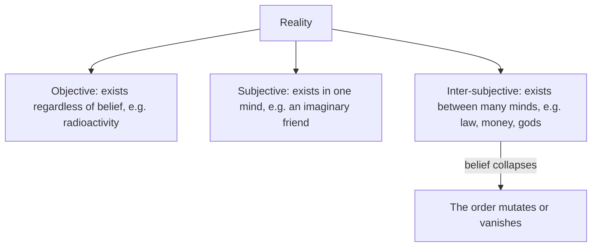

> *Source: Sapiens: A Brief History of Humankind by Yuval Noah Harari (HarperCollins, 2015), Chapter 6 "Building Pyramids", PDF pp. 105–126 (printed pp. unknown)*

# 06: สร้างปิรามิด

## แก่นความคิด

Agricultural Revolution ไม่ได้เปลี่ยนแค่ว่ามนุษย์กินอะไร แต่เปลี่ยนว่ามนุษย์เชื่อฟังใคร บทที่ 5 แสดงกับดักที่ล็อกชาวนาไว้กับชีวิตที่หนักกว่าที่คนเก็บของป่าล่าสัตว์เคยรู้จัก บทที่ 6 ติดตามส่วนเกินที่ชาวนาเหล่านั้นผลิตขึ้น ส่วนแบ่งที่ผู้ปกครอง นักบวช และข้าราชการช้อนออกจากผลเก็บเกี่ยวทุกครั้ง แล้วถามว่าส่วนนั้นจ่ายไปเพื่ออะไร คำตอบคืออารยธรรมตัวเอง วัง สงคราม ศิลปะและปรัชญา เมืองและจักรวรรดิที่มีคนเป็นล้าน แต่อาหารลำพังไม่เคยยึดสังคมขนาดนั้นไว้ด้วยกันได้ มนุษย์วิวัฒน์มาเพื่อร่วมมือกันในกลุ่มเล็ก ๆ และเกษตรกรรมไม่กี่พันปีไม่ได้ปลูกสัญชาตญาณเรื่องความร่วมมือระดับมวลชนให้เรา กาวที่ยึดคนแปลกหน้าหนึ่งล้านคนไว้ด้วยกัน แฮรารีแย้งว่า คือสารเดียวกับที่ครั้งหนึ่งทำให้คนเก็บของป่าล่าสัตว์ไม่กี่ร้อยคนแลกเปลือกหอยกัน คือตำนานร่วม (shared myth) ที่เติบโตเต็มที่

บทนี้คือจุดที่แฮรารีตั้งชื่อ นิยาม และผ่าแนวคิดนั้นออกมาดูทีละส่วน ปิดข้อโต้แย้งที่เริ่มไว้ในบทที่ 2 ว่า fictive language คือกลเม็ดที่ทำให้ Sapiens ร่วมมือกันได้ในจำนวนที่ไม่เคยมีมาก่อน และตรงนี้เองที่แนวคิดนี้พิสูจน์ว่าตัวเองเป็นโครงรับน้ำหนักของทุกอาณาจักรและทุกจักรวรรดิ บทนี้ยังสร้างชุดเครื่องมือทางภววิทยาของหนังสือ ทั้ง objective, subjective และ inter-subjective ที่จะเอาไปใช้กับเงิน จักรวรรดิ ศาสนา และชาติต่อมา

## โครงสร้างข้อโต้แย้ง

- **เกษตรกรรมย่อพื้นที่ และส่วนเกินเปลี่ยนว่าใครได้กิน** คนเก็บของป่าล่าสัตว์ท่องไปทั่วพื้นที่หลายสิบตารางกิโลเมตร ชาวนาใช้เวลากลางวันในทุ่งเล็ก ๆ และกลางคืนในที่พักแคบ ๆ อนาคตมาถึงในรูปผู้คุมงาน ชาวนาต้องผลิตให้มากกว่าที่กินและสะสมเสบียงสำรอง ทุกที่ ผู้ปกครองและชนชั้นสูงผุดขึ้นมากินอาหารที่ชาวนาสละให้ ส่วนเกินเหล่านั้นหล่อเลี้ยงการเมือง สงคราม ศิลปะ และปรัชญา จนถึงยุคใหม่ตอนปลาย มนุษย์กว่า 90% เป็นชาวนา และชนกลุ่มน้อยเล็ก ๆ ที่พวกเขาเลี้ยงดูคือนักแสดงของประวัติศาสตร์ลายลักษณ์

- **บันไดเลื่อนของขนาด** เยริโคเมื่อราว 8500 ปีก่อนคริสตกาล มีคนอยู่อาศัยไม่กี่ร้อยคน ชาตัลฮูยึกมีประชากร 5,000–10,000 คนเมื่อ 7000 ปีก่อนคริสตกาล เมืองที่มีคนหลายหมื่นปรากฏในวงพระจันทร์เสี้ยวอุดมสมบูรณ์ระหว่างสหัสวรรษที่ห้าและที่สี่ก่อนคริสตกาล ปี 3100 ก่อนคริสตกาล หุบเขานิลตอนล่างรวมกันเป็นอาณาจักรอียิปต์แรก ราว 2250 ปีก่อนคริสตกาล ซาร์กอนมหาราชสร้างจักรวรรดิแรกคือแอกкад ปี 221 ก่อนคริสตกาล ราชวงศ์ฉินรวมจีนและเก็บภาษีจากราษฎร 40 ล้านคน โรมตอนรุ่งเรืองที่สุดเก็บภาษีจากคนมากถึง 100 ล้านคน แต่การเลี้ยงราษฎรหนึ่งล้านคนไม่ได้สอนวิธีแบ่งที่ดินและน้ำ หรือวิธีตัดสินข้อพิพาท ปัญหารากเป็นเรื่องชีววิทยา มนุษย์วิวัฒน์มาหลายล้านปีในกลุ่มคนไม่กี่สิบคน และไม่กี่พันปีก็ไม่พอจะวิวัฒน์สัญชาตญาณเรื่องความร่วมมือระดับมวลชน

- **ตำราศักดิ์สิทธิ์สองเล่ม กลเม็ดเดียว** เพื่อแสดงว่าตำนานพยุงจักรวรรดิไว้ได้อย่างไร แฮรารีหยิบประมวลกฎหมายฮัมมูราบีราว 1776 ปีก่อนคริสตกาล กับคำประกาศอิสรภาพอเมริกันปี 1776 คริสต์ศักราชขึ้นมาวิเคราะห์ ประมวลกฎหมายฉบับนั้นวางตัวเองเป็นความยุติธรรมที่เทพเจ้าตรัสไว้ แล้วตีราคามนุษย์ออกเป็นสองเพศและสามชนชั้น คำประกาศยืนยันว่ามนุษย์ทุกคนเกิดมาเท่าเทียมกัน ทั้งสองอ้างหลักการที่เป็นสากลและเป็นนิรันดร์ แฮรารีบอกว่าผิดทั้งคู่ ความยุติธรรมสากลมีอยู่แต่ในจินตนาการที่อุดมสมบูรณ์ของ Sapiens ความเท่าเทียมเป็นตำนานไม่น้อยไปกว่าชนชั้น วิวัฒนาการขับเคลื่อนด้วยความแตกต่าง ชีววิทยาไม่รู้จักพระผู้สร้าง ไม่รู้จักสิทธิ และไม่รู้จักเสรีภาพ ต่อข้อโต้แย้งว่าถ้าเชื่อในความเท่าเทียม สังคมก็เสถียร แฮรารีตอบว่า ถูกต้อง นั่นแหละคือ imagined order

- **ความเชื่อคือสัญญาบำรุงรักษา** imagined order เปราะบางในที่ที่ระเบียบธรรมชาติไม่เปราะบาง แรงโน้มถ่วงจะทำงานพรุ่งนี้ไม่ว่ามีใครเชื่อหรือไม่ แต่ตำนานหายไปพร้อมกับผู้เชื่อคนสุดท้าย การพยุงระเบียบหนึ่งให้มีชีวิตอยู่ต้องใช้ความพยายามต่อเนื่อง ทั้งการบังคับด้วยกองทัพ ตำรวจ ศาล และคุก และผู้เชื่อที่จริงใจ นักบวชคนเดียวทำงานแทนทหารร้อยคนได้บ่อยครั้งและถูกกว่า ชนชั้นสูงเองก็ต้องเชื่อ คนที่มองโลกในแง่ร้ายจนสุดโต่งจะไม่โลภด้วยซ้ำ และคนพวกนี้ไม่สร้างจักรวรรดิ

## แนวคิดหลัก

### ระเบียบในจินตนาการ (imagined order)

ระเบียบทางสังคมของชุมชนขนาดใหญ่ทุกแห่ง ไม่ได้อาศัยสัญชาตญาณที่ฝังลึกหรือความรู้จักกันเป็นส่วนตัว แต่อาศัยความเชื่อในตำนานร่วม เราเชื่อในระเบียบหนึ่งไม่ใช่เพราะเป็นความจริงเชิงวัตถุ แต่เพราะการเชื่อทำให้เราร่วมมือกันได้จริง imagined order ไม่ใช่แผนชั่วร้ายและไม่ใช่ภาพลวงที่ไร้ประโยชน์ แต่เป็นทางเดียวที่มนุษย์จำนวนมากจะร่วมมือกันได้

### ความจริงระหว่างอัตวิสัย (inter-subjective reality)

ภววิทยาสามชั้นของแฮรารี ปรากฏการณ์ objective มีอยู่โดยไม่ขึ้นกับความเชื่อของมนุษย์ กัมมันตภาพรังสีอันตรายมานานก่อนมารี กูรี ปรากฏการณ์ subjective มีอยู่เพียงในสำนึกของปัจเจกคนเดียว เพื่อนในจินตนาการของเด็กหายไปเมื่อเด็กเลิกเชื่อ ปรากฏการณ์ inter-subjective มีอยู่ในเครือข่ายการสื่อสารที่เชื่อมสำนึกหลาย ๆ ดวงเข้าด้วยกัน กฎหมาย เงิน เทพเจ้า และชาติ ถ้าคนส่วนใหญ่เลิกเชื่อในดอลลาร์ ปรากฏการณ์นั้นก็กลายพันธุ์หรือหายไป

### การแปลเป็นภาษาชีววิทยา

วิธีของแฮรารีในการเปิดโปง imagined order คือเขียนประโยคศักดิ์สิทธิ์ของระเบียบนั้นใหม่เป็นภาษาชีววิทยา คำว่า "ถูกสร้าง" กลายเป็น "วิวัฒน์มา" คำว่า "ถูกสร้างมาเท่าเทียมกัน" กลายเป็น "วิวัฒน์มาต่างกัน" เพราะวิวัฒนาการตั้งอยู่บนความแตกต่าง คำว่า "ได้รับจากพระผู้สร้าง" กลายเป็น "เกิดมา" เพราะมีเพียงกระบวนการวิวัฒนาการที่มืดบอดและไร้จุดหมาย ในชีววิทยาไม่มีสิทธิ มีแต่อวัยวะ ความสามารถ และคุณลักษณะ

## ถ้อยคำน่าจดจำ

> "History is something that very few people have been doing while everyone else was ploughing fields and carrying water buckets." (PDF p. 108)
>
> แปลว่า ประวัติศาสตร์คือสิ่งที่คนเพียงหยิบมือทำ ขณะที่คนอื่น ๆ ไถนาและหาบน้ำ

> "When we break down our prison walls and run towards freedom, we are in fact running into the more spacious exercise yard of a bigger prison." (PDF p. 126)
>
> แปลว่า เมื่อเราทุบกำแพงคุกของเราลงและวิ่งไปสู่เสรีภาพ อันที่จริงเรากำลังวิ่งเข้าสู่ลานออกกำลังกายที่กว้างกว่าของคุกที่ใหญ่กว่า

## ความเชื่อมโยง

- [[Book/Sapiens_TH/02_The_Tree_of_Knowledge|02 ต้นไม้แห่งความรู้]] fictive language ที่ทำให้ Sapiens ร่วมมือกันได้เป็นครั้งแรก เติบโตตรงนี้เป็น imagined order ที่ยึดจักรวรรดิไว้ด้วยกัน
- [[Book/Sapiens_TH/05_Historys_Biggest_Fraud|05 การฉ้อโกงครั้งใหญ่ที่สุดในประวัติศาสตร์]] ส่วนเกินที่ล็อกชาวนาไว้ในบทที่ 5 มาที่นี่เพื่อเลี้ยงชนชั้นสูงและเป็นทุนให้ imagined order ทุกแบบ
- [[Book/Sapiens_TH/07_Memory_Overload|07 ความจำล้นเกิน]] ระเบียบขนาดนี้โตเกินความจำของมนุษย์ บังคับให้ต้องประดิษฐ์ที่เก็บข้อมูลภายนอก
- [[Book/Sapiens_TH/08_There_Is_No_Justice_in_History|08 ไม่มีความยุติธรรมในประวัติศาสตร์]] การตีราคามนุษย์เป็นชั้น ๆ ของฮัมมูราบีเป็นภาพล่วงหน้าของข้ออ้างในบทที่ 8 ว่าความยุติธรรมเองก็เป็นเพียงจินตนาการ
- [[Book/Sapiens_TH/10_The_Scent_of_Money|10 กลิ่นของเงิน]] บทนี้เอ่ยชื่อเงินในฐานะหนึ่งในตัวขับเคลื่อน inter-subjective ของประวัติศาสตร์
- [[Book/Sapiens_TH/Sapiens - Overview|ภาพรวม Sapiens]] เส้นทางอ่าน แผนที่บท และทางเดินต่าง ๆ

## ข้อคิดที่ได้

ปิรามิดทุกหลังที่มนุษย์เคยสร้าง ทั้งจากหินและจากตัวบทกฎหมาย ตั้งอยู่บนตำนานร่วม งานจริงของอารยธรรมจึงไม่ใช่การก่อสร้าง แต่คือการเชื่อ
