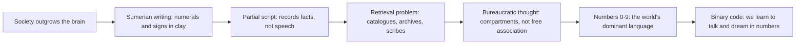

> *Source: Sapiens: A Brief History of Humankind by Yuval Noah Harari (HarperCollins, 2015), Chapter 7 "Memory Overload", PDF pp. 127–140 (printed pp. unknown)*

# 07: ความจำล้นเกิน

## แก่นความคิด

เดินเข้าไปในสนามโรงเรียนไหนก็ได้ แล้วคุณจะเล่นฟุตบอลกับคนแปลกหน้าสิบคนที่ไม่เคยพบมาก่อนได้ วิวัฒนาการให้ขาไว้เตะ ให้ปากไว้ด่า แต่ไม่มี gene สำหรับฟุตบอล กฎของเกมอยู่ในหัวเราเป็นชุดความคิดชุดเดียวกัน เป็นจินตนาการล้วน แต่ใช้ร่วมกัน อาณาจักร คริสตจักร และเครือข่ายการค้าเดินด้วยกลเม็ดเดียวกันเป๊ะ โดยมีความต่างร้ายแรงอยู่ข้อเดียว กฎฟุตบอลเรียบง่ายพอจะใส่ลงในสมองเดียวข้างเพลงและรายการของที่ต้องซื้อ ส่วนคู่มือการทำงานของสังคมขนาดใหญ่นั้นใหญ่กว่าจิตของใครคนใดคนหนึ่งมาก คอขวดนั้นคือ **memory overload** และเป็นหัวเรื่องของบทนี้ ข้อเสนอหลักของแฮรารีคือ ก่อน Sapiens จะดูแลเมือง อาณาจักร และจักรวรรดิได้ เราต้องประดิษฐ์วิธีเก็บและประมวลข้อมูลที่อยู่ภายนอกสมองขึ้นมาก่อน

เรื่องนี้สำคัญเพราะบทนี้เป็นบานพับระหว่าง imagined order ของบทก่อน ๆ กับอาณาจักรจริงที่เต็มไปตลอดเล่มที่เหลือ ไม่มีจักรวรรดิใดเก็บภาษี นับ หรือแจกจ่ายส่วนเกินทางเกษตรได้โดยไม่มีชั้นข้อมูลรองรับ และบทนี้ยังฝังความกังวลที่ลึกที่สุดของหนังสือไว้ ทุกระบบที่เราสร้างขึ้นเพื่อคิดนอกหัวของเรา สุดท้ายก็ปั้นหัวนั้นใหม่

## โครงสร้างข้อโต้แย้ง

- **ปัญหา และทำไมผึ้งไม่ต้องมีทนาย** ลูกสุนัขมีนิสัยเล่นซุกซนแบบตะลุมบอนฝังอยู่ใน gene วัยรุ่นมนุษย์ไม่มี gene สำหรับฟุตบอล แต่กลับเล่นกับคนแปลกหน้าได้เพราะทุกคนเรียนรู้กฎชุดเดียวกันที่เป็นจินตนาการ สังคมมดและผึ้งเสถียรเพราะข้อมูลเข้ารหัสอยู่ในจีโนม มนุษย์ต่างออกไป เพราะระเบียบทางสังคมของเราอยู่ในจินตนาการ จึงคัดลอกลง DNA ไม่ได้ กฎหมาย จารีต และขั้นตอนต่าง ๆ ต้องอาศัยความพยายามอย่างมีสำนึกคอยพยุงไว้ ไม่อย่างนั้นระเบียบก็พัง

- **ข้อบกพร่องสามข้อของสมองและทางหนีของชาวสุเมเรียน** สมองใช้เป็นฐานข้อมูลของจักรวรรดิไม่ได้ด้วยสามเหตุ หนึ่ง ความจำมีขอบเขต สอง ความตาย ข้อมูลหายเกลี้ยงภายในไม่ถึงศตวรรษ สาม ความเชี่ยวชาญเฉพาะด้าน วิวัฒนาการปรับสมองให้เก็บข้อมูลพืช สัตว์ และสังคม ไม่ใช่ตัวเลข พอสังคมซับซ้อนเกิดขึ้น ข้อมูลชนิดใหม่ที่ไม่เคยมีมาก่อนก็กลายเป็นสิ่งจำเป็น การเก็บภาษีจากคนหลายแสนคนต้องใช้ข้อมูลหลายล้านบิต ชาวสุเมเรียนแห่งเมโสโปเตเมียตอนใต้คือกลุ่มแรกที่ฝ่าคอขวดนี้ได้ ระหว่าง 3500 ถึง 3000 ปีก่อนคริสตกาล พวกเขาประดิษฐ์การเขียน ระบบประมวลข้อมูลที่รวมสัญลักษณ์สองชนิดซึ่งกดลงบนดินเหนียว คือตัวเลขกับสัญลักษณ์สำหรับคน สัตว์ สินค้า และวันที่ ระบบนี้เก็บข้อมูลได้มากกว่าที่สมองใดจะจำได้

- **ลงชื่อ คูชิม และปัญหาการค้นคืน** การเขียนสุเมเรียนยุคแรกจำกัดอยู่แค่ข้อเท็จจริงกับตัวเลข ข้อความที่เก่าที่สุดเป็นเอกสารเศรษฐกิจจืดชืด เช่นแผ่นดินเหนียวที่จารึกว่า ข้าวบาร์เลย์ 29,086 หน่วย รับมาใน 37 เดือน ลงชื่อ คูชิม ถ้าคูชิมเป็นคนที่มีตัวตนจริง เขาอาจเป็นปัจเจกคนแรกในประวัติศาสตร์ที่เรารู้ชื่อจริงของเขา ที่เป็นเช่นนี้เพราะการเขียนยุคแรกเป็น partial script ที่แทนข้อมูลได้เฉพาะบางชนิด ไม่ใช่ full script ที่พูดออกมาได้ทุกเรื่อง ปัญหาใหม่คือการค้นคืน คุณจะทำอะไรกับแผ่นดินเหนียวนับพันแผ่น การจารึกเอกสารยังไม่พอ คุณต้องมีบัญชีรายการ การทำสำเนา วิธีค้นคืน และบรรณารักษ์จู้จี้จุกจิก การประดิษฐ์ระบบเหล่านี้ยากกว่าการประดิษฐ์การเขียนเสียอีกมาก

- **โรงเรียนอาลักษณ์กับภาษาของตัวเลข** อาลักษณ์เรียนบัญชีรายการ พจนานุกรม ปฏิทิน แบบฟอร์ม และตาราง ซึ่งเป็นเทคนิคจัดการข้อมูลที่สมองไม่คุ้นเคยเลย สมองเก็บทุกอย่างด้วยการเชื่อมโยงเสรี เซ็นสัญญาจำนองก็ทำให้นึกถึงบ้านหลังแรกของตัวเอง แล้วก็นึกถึงจระเข้ แล้วก็นึกถึงวากเนอร์ ระบบราชการต้องการลิ้นชักหนึ่งสำหรับสัญญาจำนอง อีกลิ้นชักสำหรับทะเบียนสมรส และลิ้นชักที่สามสำหรับทะเบียนภาษี คนที่ทำงานในระบบนี้ต้องปรับโปรแกรมความคิดของตัวเองใหม่ให้เหมือนตู้เอกสาร นี่คือผลกระทบสำคัญที่สุดของการเขียน วิธีที่มนุษย์คิดค่อย ๆ เปลี่ยนไป การแยกเป็นช่อง ๆ เข้ามาแทนที่การเชื่อมโยงเสรี ลูกหลานใหม่ล่าสุดของการเขียนคือ binary code ดันตรรกะนี้ไปอีกขั้น เพราะคอมพิวเตอร์เข้าใจวิธีที่ Homo sapiens พูดและฝันได้ยาก เราจึงสอน Homo sapiens ให้พูดและฝันด้วยตัวเลข

## แนวคิดหลัก

### การเขียนในฐานะระบบประมวลข้อมูลภายนอก

การเขียนคือวิธีเก็บข้อมูลผ่านสัญลักษณ์ที่เป็นวัตถุ ไม่ใช่การบันทึกคำพูดตั้งแต่ต้นกำเนิด ระบบสุเมเรียนกดสัญลักษณ์สองชนิดลงบนดินเหนียว คือตัวเลขกับภาพสัญลักษณ์ สร้างขึ้นโดยเจตนาให้จัดการข้อมูลทางคณิตศาสตร์ที่ภาษาพูดรับไว้ไม่ได้ ความสำคัญอยู่ที่โครงสร้าง ข้อมูลที่เก็บในดินเหนียวไม่ตายไปพร้อมเจ้าของอีกต่อไป และสังคมก็ข้ามเพดานขนาดที่สมองกำหนดไว้ได้เสียที

### สองแบบของอักษร (full script, partial script)

full script แทนภาษาพูดได้ครบถ้วนไม่มากก็น้อยและแสดงอะไรก็ได้ ส่วน partial script จัดการได้เพียงข้อมูลบางชนิด เช่นตัวเลขสุเมเรียน สัญกรณ์คณิตศาสตร์ โน้ตดนตรี และ quipus ข้อที่สวนสามัญสำนึกของบทนี้คือ partial script ต่างหากที่ขับเคลื่อนเครื่องจักรของอารยธรรม ไม่ใช่ full script เพราะบัญชีภาษีและระบบราชการเกิดมาพร้อมกับ partial script และยังเชื่อมติดกับระบบนั้นอยู่จนทุกวันนี้

### ความคิดแบบราชการ (bureaucratic thought)

วิธีคิดที่การเก็บข้อมูลภายนอกเรียกร้อง สมองค้นคืนด้วยการเชื่อมโยงเสรี หอจดหมายเหตุต้องการการแยกหมวดหมู่อย่างเข้มงวด บันทึกแต่ละชิ้นอยู่ในลิ้นชักของตัวเอง คนที่ดูแลระบบแบบนี้ต้อง "ปรับโปรแกรม" ตัวเองใหม่ให้คิดเหมือนตู้เอกสาร แนวคิดนี้พาข้อเสนอที่กล้าหาญที่สุดของบทมาด้วย ผลกระทบสำคัญที่สุดของการเขียนคือผลต่อความคิด เทคโนโลยีการเก็บข้อมูลเขียนนักคิดคนนั้นขึ้นมาใหม่

## ถ้อยคำน่าจดจำ

> "Bees don't need lawyers, because there is no danger that they might forget or violate the hive constitution." (PDF p. 128)
>
> แปลว่า ผึ้งไม่ต้องมีทนาย เพราะไม่มีความเสี่ยงที่พวกมันจะลืมหรือฝ่าฝืนรัฐธรรมนูญของรัง

> "It is telling that the first recorded name in history belongs to an accountant, rather than a prophet, a poet or a great conqueror." (PDF p. 131)
>
> แปลว่า มีนัยสำคัญว่าชื่อแรกที่มีบันทึกไว้ในประวัติศาสตร์เป็นของนักบัญชี ไม่ใช่ศาสดา กวี หรือผู้พิชิตผู้ยิ่งใหญ่

> "Writing was born as the maidservant of human consciousness, but is increasingly becoming its master." (PDF p. 139)
>
> แปลว่า การเขียนเกิดมาเป็นสาวใช้ของสำนึกมนุษย์ แต่กำลังกลายเป็นนายของมันมากขึ้นทุกที

## ความเชื่อมโยง

- [[Book/Sapiens_TH/02_The_Tree_of_Knowledge|02 ต้นไม้แห่งความรู้]] ฟุตบอลกับคนแปลกหน้าคือภาพขยายของข้อค้นพบในบทที่ 2 ว่าความจริงร่วมในจินตนาการทำให้ Sapiens จำนวนมากร่วมมือกันได้
- [[Book/Sapiens_TH/05_Historys_Biggest_Fraud|05 การฉ้อโกงครั้งใหญ่ที่สุดในประวัติศาสตร์]] Agricultural Revolution ที่บทนี้โทษว่าบีบให้ตัวเลขต้องเข้ามาอยู่ในสมองที่ไม่ได้ออกแบบมารองรับ คือ "การฉ้อโกง" เดียวกันที่ส่วนเกินสร้างภาระเรื่องภาษีและการจดบันทึก
- [[Book/Sapiens_TH/06_Building_Pyramids|06 สร้างปิรามิด]] imagined order ที่ต้องพยุงด้วยความพยายามอย่างมีสำนึก ได้ระบบเก็บข้อมูลจากการเขียนซึ่งทำให้ระเบียบนั้นอยู่ยืนยาวกว่าเจ้าของ
- [[Book/Sapiens_TH/08_There_Is_No_Justice_in_History|08 ไม่มีความยุติธรรมในประวัติศาสตร์]] ข้อกำหนดสามสิบเชเขลที่ฮัมมูราบีต้องสอนลูกชาย กลับมาเป็นตัวอย่างเปิดบทที่ 8 เรื่องความพลการของความยุติธรรมในจินตนาการ
- [[Book/Sapiens_TH/20_The_End_of_Homo_Sapiens|20 จุดจบของ Homo Sapiens]] สาวใช้ที่กลายเป็นนายในรูป binary code คือร่างแรกของความกังวลปิดท้ายเล่มว่าสิ่งที่เราสร้างอาจแทนที่เราในสักวัน
- [[Book/Sapiens_TH/Sapiens - Overview|ภาพรวม Sapiens]] เส้นทางอ่าน แผนที่บท และทางเดินต่าง ๆ

## ข้อคิดที่ได้

จักรวรรดิต้องนับได้ก่อนจึงจะเป็นสิ่งที่จินตนาการได้ และการเขียนซึ่งเกิดมาเป็นบัญชีข้าวบาร์เลย์ก็ลงเอยด้วยการออกแบบจิตใจที่ประดิษฐ์การเขียนขึ้นมาใหม่
