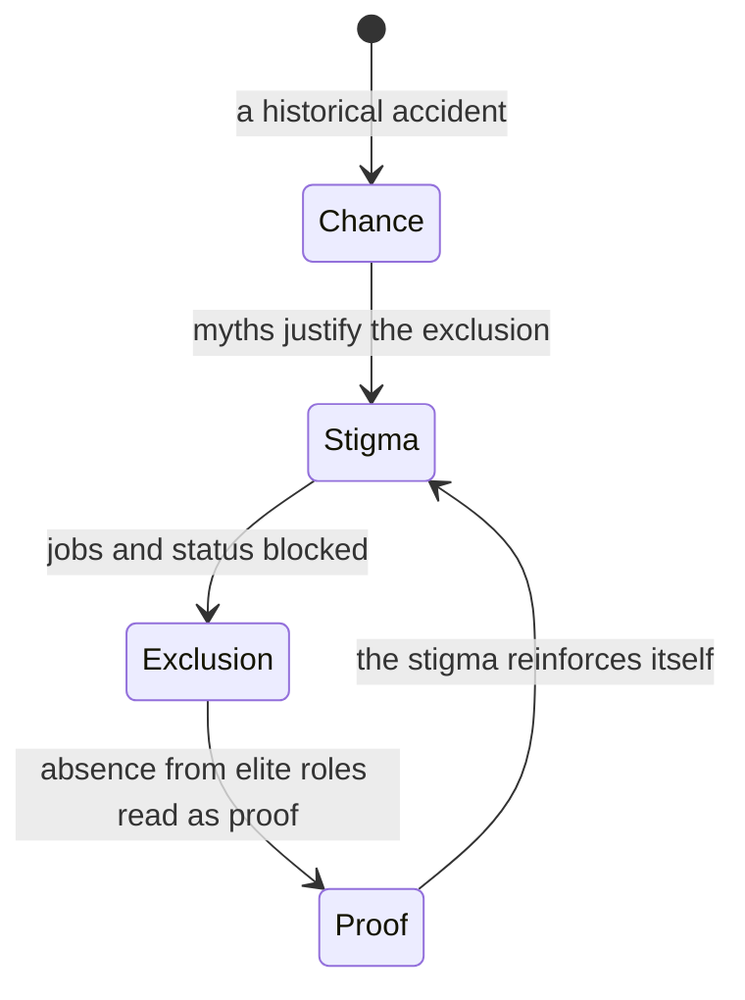

> *Source: Sapiens: A Brief History of Humankind by Yuval Noah Harari (HarperCollins, 2015), Chapter 8 "There Is No Justice in History", PDF pp. 141–167 (printed pp. unknown)*

# 08: ไม่มีความยุติธรรมในประวัติศาสตร์

## แก่นความคิด

บทนี้ชำระบัญชีทางศีลธรรมกับ imagined order ที่บทก่อน ๆ ยกย่องว่าเป็นเครื่องยนต์ของอารยธรรม แล้วเริ่มจากคำถามที่ Agricultural Revolution ทิ้งไว้ คือมนุษย์แปลกหน้าหลายล้านคนร่วมมือกันในเครือข่ายขนาดใหญ่ได้อย่างไร ในเมื่อเราไม่มีสัญชาตญาณทางชีววิทยาสำหรับเรื่องนี้เลย คำตอบคือ imagined order บวก script ซึ่งทำงานได้จริง แต่เป็นพรที่ชวนสงสัย ระเบียบพวกนั้นไม่เคยเป็นกลาง แต่ละระเบียบแบ่งผู้คนออกเป็นกลุ่มสมมติที่ซ้อนกันเป็นชั้น ชั้นบนได้สิทธิพิเศษ ชั้นล่างได้การเลือกปฏิบัติและการกดขี่ ประมวลกฎหมายของฮัมมูราบีกับคำประกาศอิสรภาพอเมริกันคือหลักฐานชิ้นเอก ทั้งสองฉบับประกาศความยุติธรรมพร้อมกับสถาปนาความเป็นทาส การกดคนให้อยู่ใต้อำนาจ และการปกครองของคนรวย

และนี่ไม่ใช่ข้อบกพร่องที่แก้ทิ้งได้ สังคมซับซ้อนดูเหมือน**จำเป็น**ต้องมี imagined hierarchy เพราะลำดับชั้นทำให้คนแปลกหน้าประสานงานกันได้โดยไม่ต้องรู้จักกันเลย สิ่งที่ต่างกันมีเพียงสองอย่าง คือ fiction ตัวไหนเป็นตัวจัดอันดับคน (วรรณะในอินเดีย เชื้อชาติในอเมริกา ชนชั้นในแทบทุกที่) และจุดเริ่มต้นที่เป็นเรื่องบังเอิญจะแข็งตัวเป็นระบบตายตัวได้อย่างไรผ่าน "วงจรอุบาทว์" ที่ป้อนตัวเอง จากนั้นบทหันมาที่เพศสภาพ ลำดับชั้นเดียวที่ปรากฏในทุกสังคมเท่าที่รู้จัก เป็นสากลเกินกว่าจะเป็นเรื่องบังเอิญ

## โครงสร้างข้อโต้แย้ง

- **เครือข่ายคนหมู่มากต้องพึ่ง fiction และ fiction ก็จัดอันดับคน** หลัง Agricultural Revolution imagined order กับ script ก็เข้ามาเติมช่องว่างในมรดกทางชีววิทยาของเรา แต่ระเบียบพวกนั้นกลับ "ไม่เป็นกลางและไม่ยุติธรรม" ("neither neutral nor fair") ทั้งคู่ ประมวลของฮัมมูราบีจัดวางผู้มีอำนาจ คนสามัญ และทาสไว้คนละชั้น ส่วนระเบียบอเมริกันปี 1776 แม้ประกาศความเสมอภาคของผู้ชายทุกคน ก็ยังจัดให้ผู้ชายอยู่เหนือผู้หญิง คนขาวอยู่เหนือคนดำและชาวอินเดียนแดง และคนรวยอยู่เหนือคนจน imagined hierarchy ทุกตัว "ปิดบังต้นกำเนิดอันเป็นเรื่องแต่งของตัวเอง แล้วอ้างว่าตนเป็นธรรมชาติและหลีกเลี่ยงไม่ได้" แต่ทั้งหมดนั้นคือสิ่งประดิษฐ์ ไม่มีความต่างทางชีววิทยาสักอย่างที่กั้นระหว่างทาสกับคนอิสระ หรือระหว่างสติปัญญาของเชื้อชาติหนึ่งกับอีกเชื้อชาติหนึ่ง

- **วงจรอุบาทว์ อินเดียกับอเมริกา** ทำไมสังคมหนึ่งจัดอันดับคนด้วยวรรณะ แต่อีกสังคมจัดด้วยเชื้อชาติ คำตอบมักเป็นเหตุบังเอิญครั้งเดียวที่ผลประโยชน์ของคนบางกลุ่มช่วยพยุงไว้ ระบบวรรณะน่าจะเริ่มตอนนักรบอินโดอารยันปราบอินเดียเหนือเมื่อราว 3,000 ปีก่อน แล้วตรึงประชากรไว้ในวรรณะตามอาชีพ ปิดตายด้วยข้อห้ามเรื่องการปะปน การแต่งงาน และการกินร่วมโต๊ะ ความเป็นทาสของชาวแอฟริกันเริ่มจากสถานการณ์ล้วน ๆ แอฟริกาอยู่ใกล้กว่าและถูกกว่า มีตลาดทาสอยู่แล้ว และชาวแอฟริกันมีภูมิคุ้มกันทางพันธุกรรมบางส่วนต่อมาลาเรียที่คร่าชีวิตแรงงานยุโรป ไม่มีใครอยากยอมรับว่าความเป็นทาสเป็นเพียงเรื่องเศรษฐกิจ คนจึงเกณฑ์ตำนานมาช่วยอธิบาย และตำนานพวกนั้นก็มีอายุยืนกว่าสถาบันทาส ในอะลาบามาหลังสงครามกลางเมือง การแก้ไขรัฐธรรมนูญฉบับที่สิบสามหยุดเครื่องจักรของการตีตราไม่ได้เลย เมื่อปี 1958 คลีนนอน คิง นักศึกษาผิวดำยื่นใบสมัครเข้า University of Mississippi เขาถูกส่งตัวเข้าโรงพยาบาลจิตเวช

- **ลำดับชั้นแม่บท เพศสภาพ** ทุกสังคมเท่าที่รู้จักแบ่งมนุษย์เป็นชายกับหญิง แทบทุกที่ผู้ชายได้เปรียบมาตั้งแต่ Agricultural Revolution กระดูกเสี่ยงทายของจีนเมื่อ 1200 ปีก่อนคริสตกาลบันทึกการคลอดของเลดี้หาวไว้ "ไม่เป็นมงคล เป็นผู้หญิง" ในระบบกฎหมายหลายแห่งผู้หญิงเคยเป็นทรัพย์สิน การข่มขืนคือการล่วงละเมิดทรัพย์สินของผู้ชายที่เป็นเจ้าของเธอ ชดใช้กันด้วยสินสอด จนถึงปี 2006 ยังมีห้าสิบสามประเทศที่ห้ามฟ้องสามีข้อหาข่มขืนภรรยา แก่นชีววิทยาที่แข็งอยู่เพียงอย่างเดียวคือผู้ชายไม่มีมดลูก รอบแก่นนั้นทุกสังคมพอกวัฒนธรรมซ้อนลงไปหลายชั้นโดยแทบไม่มีฐานทางชีววิทยารองรับ หลักง่าย ๆ ของแฮรารีที่ว่า "ชีววิทยาเปิดทาง วัฒนธรรมปิดกั้น" อธิบายเรื่องนี้ได้หมด

- **ทฤษฎีปิตาธิปไตยและการล้มลงของมัน** เพราะปิตาธิปไตยเกิดก่อนที่สองซีกโลกจะติดต่อกัน จึงเป็นวงจรอุบาทว์ที่เริ่มจากความบังเอิญไม่ได้ ต้องมีสาเหตุสากลบางอย่าง และเรายังหาสาเหตุนั้นไม่เจอ แฮรารีรื้อคำอธิบายมาตรฐานทั้งสามข้อ ข้อแรกคือ **กำลังกล้ามเนื้อ** สังคมกีดกันผู้หญิงจากงานที่ใช้กำลังเพียงเล็กน้อย ทั้งงานสมณะ กฎหมาย การเมือง ขณะที่งานหนักในไร่นายังตกเป็นของเธอ ข้อสองคือ **ความก้าวร้าวกับสงคราม** ผู้ชายเต็มกองทัพ แต่ทำไมคนคุมสงครามต้องเป็นผู้ชาย สงครามเป็นโครงการซับซ้อนของการจัดองค์กร ความร่วมมือ และการประนีประนอม ข้อสามคือ **ยีนของปิตาธิปไตย** วิวัฒนาการคัดเลือกผู้ชายที่ชอบแข่งขันกับผู้หญิงที่ว่านอนสอนง่าย อย่างนั้นหรือ แต่ในฝูงช้างกับโบโนโบ ตัวเมียที่ต้องพึ่งพาฝูงกับตัวผู้ที่ชอบแข่งขันกลับรวมตัวกันเป็นสังคมที่ตัวเมียปกครอง ข้อสรุปที่ซื่อสัตย์คือ ลำดับชั้นทางสังคมที่ทรงอิทธิพลที่สุดในประวัติศาสตร์ยังอธิบายไม่ได้

## แนวคิดหลัก

### imagined hierarchy กับการอ้างว่าตนเป็นธรรมชาติ

imagined order ไม่ได้แค่ประสานผู้คน แต่จัดอันดับพวกเขาด้วย ให้สิทธิพิเศษแก่ชั้นบนและวางภาระไว้ที่ชั้นล่าง กฎเหล็กของแฮรารีบอกว่า ลำดับชั้นแบบนี้ทุกตัวยืนกรานว่าตัวเองเป็นธรรมชาติและหลีกเลี่ยงไม่ได้ ไม่เคยยอมรับว่าตัวเองมีต้นกำเนิดจากการประดิษฐ์ ข้ออ้างนั้นคือผนังรับน้ำหนักของความอยุติธรรมทางสังคม ถ้าลำดับชั้นหนึ่งเป็นธรรมชาติ การตั้งคำถามกับลำดับชั้นนั้นก็ไร้ผลพอ ๆ กับการตั้งคำถามกับแรงโน้มถ่วง

### วงจรอุบาทว์

สถานการณ์บังเอิญทางประวัติศาสตร์กลายเป็นระบบสังคมตายตัวได้ เพราะแต่ละองค์ประกอบเสริมกันและกัน การตีตรากีดขวางความก้าวหน้า การหายไปของคนที่ถูกตีตราจากตำแหน่งชั้นสูง "พิสูจน์" ว่าการตีตรานั้นชอบธรรม "ข้อพิสูจน์" นั้นก็เปิดทางให้มีการเลือกปฏิบัติรอบใหม่ จนวงจรแข็งตัวเป็นกฎหมาย ตำนาน และรสนิยมทางความงาม ตัวอย่างคือวรรณะในอินเดียกับเชื้อชาติในอเมริกา และบทเรียนก็มืดมน ยิ่งเวลาผ่านไป วงจรแบบนี้ก็ยิ่งแย่ลง

### ชีววิทยาเปิดทาง วัฒนธรรมปิดกั้น (Biology enables, Culture forbids)

หลักง่าย ๆ ที่แฮรารีใช้แยกระหว่างชีววิทยาจริงกับตำนานทางชีววิทยา ชีววิทยารองรับความเป็นไปได้ไว้กว้าง ๆ ผู้หญิงมีลูกได้ ผู้ชายมีความสุขกับการมีเพศสัมพันธ์กับผู้ชายได้ วัฒนธรรมเป็นตัวตัดสินว่าความเป็นไปได้ข้อไหนจะเกิดจริง และข้อไหนจะถูกห้าม วัฒนธรรมปกป้องข้อห้ามของตัวเองด้วยคำว่า "ธรรมชาติ" แต่ในสายตาของชีววิทยา ไม่มีอะไรผิดธรรมชาติเลย แนวคิดเรื่องธรรมชาติของเราเองสืบทอดมาจากเทววิทยาศาสนาคริสต์ซึ่งมีพระเจ้าผู้ทรงจุดมุ่งหมาย ส่วนวิวัฒนาการไม่มีจุดมุ่งหมาย

## ถ้อยคำน่าจดจำ

> "Yet it is an iron rule of history that every imagined hierarchy disavows its fictional origins and claims to be natural and inevitable." (PDF p. 142)
>
> แปลว่า กฎเหล็กของประวัติศาสตร์ข้อหนึ่งคือ imagined hierarchy ทุกตัวปิดบังต้นกำเนิดอันเป็นเรื่องแต่งของตน แล้วอ้างว่าตนเป็นธรรมชาติและหลีกเลี่ยงไม่ได้

> "A good rule of thumb is 'Biology enables, Culture forbids.'" (PDF p. 154)
>
> แปลว่า หลักง่าย ๆ ที่ใช้ได้ดีคือ "ชีววิทยาเปิดทาง วัฒนธรรมปิดกั้น"

## ความเชื่อมโยง

- [[Book/Sapiens_TH/02_The_Tree_of_Knowledge|02 ต้นไม้แห่งความรู้]] บทนี้เปิดเผยว่า ความสามารถในการสร้าง fiction ที่ทำให้คนแปลกหน้าร่วมมือกันได้ คือเครื่องยนต์ของการจัดอันดับ การกดขี่ และโครงสร้างทางสังคมที่ "โหดร้ายและเป็นจริงอย่างยิ่ง" ("cruel – and very real")
- [[Book/Sapiens_TH/05_Historys_Biggest_Fraud|05 การฉ้อโกงครั้งใหญ่ที่สุดในประวัติศาสตร์]] บทนี้คือผลทางสังคมของการฉ้อโกงทางการเกษตร สังคมที่มีส่วนเกินสร้างชนชั้นนำขึ้น และ "อย่างน้อยตั้งแต่ Agricultural Revolution เป็นต้นมา" ผู้ชายก็ครองอำนาจทั่วทุกแห่ง
- [[Book/Sapiens_TH/06_Building_Pyramids|06 สร้างปิรามิด]] ประมวลของฮัมมูราบีกับระเบียบอเมริกันปี 1776 ที่ยกไว้เป็นตัวอย่างของ imagined order ในบทก่อน กลับมาเป็นหลักฐานชิ้นแรกของบทนี้ในเรื่องความอยุติธรรมที่จัดระบบขึ้น
- [[Book/Sapiens_TH/07_Memory_Overload|07 ความจำล้นเกิน]] บทนี้เปิดด้วยการระบุ imagined order กับ script ว่าเป็นสิ่งประดิษฐ์คู่แฝดเบื้องหลังเครือข่ายความร่วมมือขนาดใหญ่
- [[Book/Sapiens_TH/09_The_Arrow_of_History|09 ลูกศรของประวัติศาสตร์]] ความฉงนที่บทนี้จบลงด้วย ทำไมลำดับชั้นจึงเป็นสากลและมั่นคงนักถ้าลำดับชั้นตั้งอยู่บนตำนาน ได้ดันบทที่ 9 ให้ถอยออกไปถามว่าประวัติศาสตร์มีทิศทางหรือไม่
- [[Book/Sapiens_TH/Sapiens - Overview|ภาพรวม Sapiens]] เส้นทางอ่าน แผนที่บท และทางเดินต่าง ๆ

## ข้อคิดที่ได้

ไม่มีลำดับชั้นไหนเป็นธรรมชาติ ทุกอันเริ่มจากความบังเอิญและอยู่รอดได้ด้วยการโน้มน้าวให้เราเชื่อว่าลำดับชั้นนั้นหลีกเลี่ยงไม่ได้ นี่คือเหตุผลที่ประวัติศาสตร์ ไม่ใช่ชีววิทยา เป็นวิทยาศาสตร์เดียวที่อธิบายสังคมมนุษย์ได้ และเป็นคานงัดเดียวที่เปลี่ยนสังคมได้
