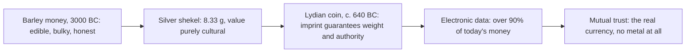

> *Source: Sapiens: A Brief History of Humankind by Yuval Noah Harari (HarperCollins, 2015), Chapter 10 "The Scent of Money", PDF pp. 179–194 (printed pp. unknown)*

# 10: กลิ่นของเงิน

## แก่นความคิด

เงินดูเหมือนเป็นสิ่งที่มีตัวตนแน่นหนาที่สุดในชีวิตเรา แต่ข้ออ้างหลักของบทนี้คือ เงินไม่เคยเป็นเรื่องของวัตถุเลย เหรียญ เปลือกหอยเบี้ย และไบต์ในคอมพิวเตอร์เป็นเพียงเครื่องแต่งกาย ตัวเงินเองคือข้อตกลง แฮรารีนิยามเงินว่าคืออะไรก็ตามที่ผู้คนยินดีใช้เป็นเครื่องมือแทนค่าสิ่งอื่นอย่างเป็นระบบในการแลกเปลี่ยน และยืนยันว่านี่ทำให้เงินเป็น **inter-subjective reality** เป็นจริงเพราะคนจำนวนมากพอจินตนาการขึ้นมาด้วยกัน เหมือนเทพเจ้า ชาติ และกฎหมาย เงินแปลงวัตถุเป็นจิตใจ คุณค่าไม่เคยอยู่ในเคมี สี หรือรูปทรงของวัตถุ แต่อยู่ในความเชื่อที่ใช้ร่วมกัน เงินไม่ต้องรอความก้าวหน้าทางเทคโนโลยีเลย เป็นการปฏิวัติทางจิตล้วน ๆ ที่เกิดซ้ำอย่างอิสระในหลายยุคหลายที่

จุดที่คมกว่าของบทนี้คือ เงินเป็น imagined order ตัวแรกที่เป็น**สากล** ภาษา กฎหมาย และศาสนายังอยู่แต่ในถิ่นของตน แต่ความเชื่อในทองคำข้ามทุกพรมแดน ชาวแอซเทกมองไม่ออกว่าเหตุใดใครจะกระหายโลหะที่อ่อนเกินกว่าจะทำเครื่องมือและหนักเกินกว่าจะกิน ศัตรูที่ฆ่ากันด้วยเรื่องความจริงสูงสุดกลับใช้เหรียญของกันและกันอย่างสบายใจ เงินของโรมันหมุนเวียนในตลาดที่ห่างจากกองทัพโรมันหลายพันกิโลเมตร วันนี้กว่าเก้าสิบเปอร์เซ็นต์ของเงินทั้งโลกไม่มีรูปกายเหลืออยู่เลย

เรื่องนี้สำคัญกับข้อโต้แย้งของหนังสือ เพราะเงินทำให้คนแปลกหน้านับล้านร่วมมือกันได้โดยไม่ต้องมีวัฒนธรรมร่วม เป็นโครงสร้างพื้นฐานเงียบ ๆ ที่รองรับเรื่องราวของตลาด จักรวรรดิ และอุตสาหกรรมทุกเรื่องที่ตามมา แต่แฮรารีไม่ยอมฉลองแบบง่าย ๆ ความสามารถแปลงทุกอย่างเป็นทุกอย่างแบบเดียวกันที่รวมมนุษยชาติไว้ก็กัดกร่อนเกียรติ ความภักดี และความรักด้วย เงินซึ่งถูกสาปมานับพันปีว่าเป็นรากของความชั่วทั้งมวล เป็นทั้งจุดสูงสุดของความอดกลั้นของมนุษย์ และตัวทำละลายของทุกชุมชนที่พยายามกันมันออกไป

## โครงสร้างข้อโต้แย้ง

- **โรคของหัวใจกับปัญหาที่ความมั่งคั่งสร้างขึ้น** เมื่อกอร์เตสบุกเม็กซิโกในปี 1519 ชาวแอซเทกสังเกตได้เร็วว่าคนแปลกหน้าพวกนี้หมกมุ่นกับโลหะสีเหลืองที่พวกเขาใช้เพียงทำเครื่องประดับ การซื้อขายปกติจ่ายด้วยเมล็ดโกโก้หรือผ้าทอเป็นม้วน เมื่อมีคนถามว่าทำไมทองจึงสำคัญนัก กอร์เตสพูดถึงโรคของหัวใจที่รักษาได้ด้วยทองเท่านั้น ความหมกมุ่นนี้ไม่ใช่ของสเปน แต่เป็นของแอฟริกา-เอเชีย สามศตวรรษก่อนหน้านั้น บรรพบุรุษของเขาทำสงครามศาสนาอันนองเลือดกับอาณาจักรมุสลิมในไอบีเรีย แต่คริสเตียนที่ชนะกลับผลิตเหรียญที่จารึกด้วยอักษรอาหรับลายพริ้วพร้อมคำปฏิญาณศรัทธาของมุสลิม แม้บิชอปคาทอลิกเองก็ออกเหรียญแบบนั้น และคริสเตียนผู้ยำเกรงพระเจ้าก็ใช้จ่ายกันอย่างสบายใจ พ่อค้ามุสลิมก็ตอบแทนน้ำใจด้วยการค้าขายเป็นฟลอรินฟลอเรนซ์กับดูแคตเวนิส คนที่เห็นด้วยกันเรื่องอื่นไม่ได้เลย กลับเห็นด้วยกันเรื่องเงินไปแล้ว

- **ความคิดที่สวมเครื่องแต่งกายต่าง ๆ กับความเชื่อใจในฐานะโรงกษาปณ์** เงินเปรียบเทียบคุณค่า แลกเปลี่ยนสินค้า และเก็บรักษาความมั่งคั่ง เครื่องแต่งกายที่เงินสวมมีแทบไม่จำกัด เปลือกหอยเบี้ยใช้เป็นเงินตรามานานราว 4,000 ปีทั่วแอฟริกา เอเชียใต้ เอเชียตะวันออก และโอเชียเนีย บุหรี่กลายเป็นเงินของเรือนจำและค่ายเชลยศึก วันนี้รูปแบบกลับกันแล้ว ปี 2006 เงินทั้งโลกมีมูลค่าราว 60 ล้านล้านดอลลาร์ แต่เหรียญกับธนบัตรรวมกันไม่ถึง 6 ล้านล้านดอลลาร์ ที่เหลือกว่าเก้าสิบเปอร์เซ็นต์มีอยู่เป็นข้อมูลอิเล็กทรอนิกส์เท่านั้น ทำไมต้องเอานาข้าวที่อุดมสมบูรณ์ไปแลกเปลือกหอยไร้ประโยชน์แค่กำมือเดียว เพราะชาวนาเชื่อใจว่าคนแปลกหน้าในจังหวัดถัดไปจะรับเปลือกหอยนั้นด้วย เงินคือระบบของความเชื่อใจกันและกัน และเป็นระบบที่แพร่หลายและมีประสิทธิภาพที่สุดเท่าที่เคยมีมา เครือข่ายความสัมพันธ์ทางการเมือง สังคม และเศรษฐกิจที่ยาวเหยียดเป็นตัวผลิตความเชื่อใจนั้น

- **จากเชเขลถึงลายเซ็นกับพระกิตติคุณของทองคำ** ความก้าวกระโดดนั้นคือเชเขลเงินของเมโสโปเตเมียโบราณ ซึ่งกำหนดไว้ที่ 8.33 กรัมของโลหะ ไม่ใช่เหรียญ การผลิตเหรียญจริง ๆ เริ่มราว 640 ปีก่อนคริสตกาล เมื่อกษัตริย์อาลิอัตเตสแห่งลิเดียตีเหรียญชุดแรก เป็นก้อนโลหะมีค่ามาตรฐานที่รอยประทับทำหน้าที่สองอย่าง คือประกาศปริมาณโลหะที่แน่นอน และระบุอำนาจที่รับประกันมัน รอยประทับคือลายเซ็นทางการเมือง เป็นคำพูดส่วนตัวของกษัตริย์ว่าแผ่นนั้นบรรจุสิ่งที่รอยประทับอ้างไว้ การปลอมแปลงจึงไม่ใช่กลโกงในสายตาของกฎหมาย แต่เป็นการหมิ่นพระบรมเดชานุภาพ เป็นการล่วงละเมิดอำนาจสูงสุด ปกติลงโทษด้วยการทรมานและประหาร ความมั่นใจของโรมันในดีนาริอัสวิ่งเร็วกว่ากองทัพ ในศตวรรษแรกหลังคริสตกาล เหรียญนี้เป็นที่ยอมรับในตลาดอินเดีย ทำไมทุกคนจึงมาบรรจบที่ทอง ไม่ใช่ข้าวบาร์เลย์หรือเปลือกหอยเบี้ย เพราะที่ใดการค้าเชื่อมสองภูมิภาค พ่อค้าจะเก็งกำไรส่วนต่างราคาจนคุณค่าเท่ากัน แค่ข้อเท็จจริงที่ว่าคนเมดิเตอร์เรเนียนอยากได้ทอง ก็พอทำให้ชาวอินเดียให้ค่ามันแล้ว ความเชื่อในเงินติดต่อได้แม้ข้ามความเกลียดชัง

## แนวคิดหลัก

### เงินในฐานะ inter-subjective reality

เงินคืออะไรก็ตามที่ผู้คนยินดีใช้เป็นเครื่องมือแทนค่าสิ่งอื่นอย่างเป็นระบบในการแลกเปลี่ยน เงินเป็นโครงสร้างทางจิต ไม่ใช่วัตถุ พลังของมันอยู่ในจินตนาการร่วม นี่คือเหตุผลที่เงินสวมเครื่องแต่งกายได้มากมาย (เปลือกหอยเบี้ย บุหรี่ ไบต์อิเล็กทรอนิกส์) และเป็นเหตุผลที่การประดิษฐ์มันไม่ต้องใช้เทคโนโลยีเลย

### ความเชื่อใจ วัตถุดิบของเงิน

เงินตราทุกสกุลผลิตจากความเชื่อใจ ความมั่นใจของชาวนาว่าคนแปลกหน้าถิ่นอื่นจะรับเปลือกหอยของเขา ความมั่นใจของพลเมืองซึ่งหยั่งรากอยู่ในเพื่อนบ้าน กษัตริย์ และนักบวชที่ต่างก็เรียกหาโทเคนเดียวกัน เพราะฐานรองของเงินเป็นเรื่องสังคม การเงินจึงเป็นการเมือง วิกฤตการณ์ตามการเมืองไปด้วย และตลาดแกว่งไปตามอารมณ์ของเทรดเดอร์

### พระกิตติคุณของทองคำ

ระบบความเชื่อที่พลิกทั้งโลก เมื่อการค้าเชื่อมสองภูมิภาค การเก็งกำไรส่วนต่างก็ทำให้สินค้าที่ขนย้ายได้มีคุณค่าเท่ากัน ความนับถือทองของวัฒนธรรมหนึ่งจึงทำให้อีกวัฒนธรรมให้ค่ามันด้วย ความเชื่อในเงินติดต่อได้ข้ามทุกเส้นแบ่งอื่น ๆ ผลลัพธ์คือเขตการเงินข้ามชาติเดียวที่รวมแอฟริกา-เอเชียเข้าด้วยกัน แล้วขยายไปทั้งโลก ความอดกลั้นของเงินเป็นของจริงแต่มีเงื่อนไข เงินไม่เรียกร้องอะไรจากเราเลยนอกจากให้เราเชื่อว่าคนอื่นเชื่อ

## ถ้อยคำน่าจดจำ

> "Because I and my companions suffer from a disease of the heart which can be cured only with gold." (PDF p. 179)
>
> แปลว่า เพราะข้าและสหายของข้าทนทุกข์จากโรคของหัวใจที่รักษาได้ด้วยทองเท่านั้น

> "Money is accordingly a system of mutual trust, and not just any system of mutual trust: money is the most universal and most efficient system of mutual trust ever devised." (PDF p. 187)
>
> แปลว่า เงินจึงเป็นระบบของความเชื่อใจกันและกัน และไม่ใช่ระบบความเชื่อใจแบบใดก็ได้ เงินคือระบบความเชื่อใจที่แพร่หลายและมีประสิทธิภาพที่สุดเท่าที่เคยมีมา

## ความเชื่อมโยง

- [[Book/Sapiens_TH/05_Historys_Biggest_Fraud|05 การฉ้อโกงครั้งใหญ่ที่สุดในประวัติศาสตร์]] ส่วนเกินจากการเกษตรสร้างเมืองและผู้เชี่ยวชาญเต็มเวลาขึ้น ปัญหาการแลกเปลี่ยนของคนเหล่านี้คือโจทย์ที่เงินเกิดขึ้นมาแก้
- [[Book/Sapiens_TH/07_Memory_Overload|07 ความจำล้นเกิน]] เงินข้าวบาร์เลย์กับตัวอักษรเกิดพร้อมกันในสุเมเรียนราว 3000 ปีก่อนคริสตกาล ในฐานะเทคโนโลยีบริหารคู่แฝด
- [[Book/Sapiens_TH/09_The_Arrow_of_History|09 ลูกศรของประวัติศาสตร์]] เขตการเงินเดียวเป็นหนึ่งในแรงที่ดัดประวัติศาสตร์ให้เบนไปทางการรวมเป็นหนึ่งของโลก
- [[Book/Sapiens_TH/11_Imperial_Visions|11 ภาพฝันของจักรวรรดิ]] บทนี้จบลงที่บทบาทของเหล็กกล้า และการพิชิตของกอร์เตสแสดงให้เห็นเงินกับจักรวรรดิรุกไปด้วยกัน
- [[Book/Sapiens_TH/16_The_Capitalist_Creed|16 ลัทธิทุนนิยม]] ความเชื่อใจในเงินซึ่งตอนนี้ส่วนใหญ่เป็นข้อมูลอิเล็กทรอนิกส์ล้วน ๆ คือฐานรองที่ศรัทธาแบบทุนนิยมต่อการเติบโตในอนาคตสร้างขึ้นมา
- [[Book/Sapiens_TH/Sapiens - Overview|ภาพรวม Sapiens]] เส้นทางอ่าน แผนที่บท และทางเดินต่าง ๆ

## ข้อคิดที่ได้

เงินพิชิตโลกไม่ใช่เพราะทองมีค่า แต่เพราะคุณค่าคืออะไรก็ตามที่ทำให้คนแปลกหน้าเชื่อได้ และความเชื่อใจเดียวกับที่รวมมนุษยชาติไว้ ก็เป็นสิ่งที่เรากลัวว่าจะกัดกร่อนมนุษยชาติ
