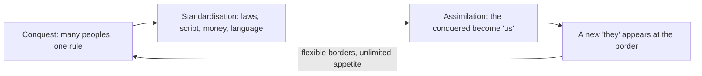

> *Source: Sapiens: A Brief History of Humankind by Yuval Noah Harari (HarperCollins, 2015), Chapter 11 "Imperial Visions", PDF pp. 195–215 (printed pp. unknown)*

# 11: ภาพฝันของจักรวรรดิ

## แก่นความคิด

แทบทุกคนที่ยังมีชีวิตอยู่ทุกวันนี้เป็นทายาทของจักรวรรดิใดจักรวรรดิหนึ่ง ทางวัฒนธรรม ทางภาษา และทางกฎหมาย แฮรารีเปิดบทด้วยการล้อมเมืองนูมันเทียของโรมัน ผู้รักชาติสเปนยังยกย่องชาวนูมันเทียเป็นวีรบุรุษผู้ต่อต้าน แต่เรื่องเล่าวีรกรรมนั้นเล่าด้วยภาษาสเปน ซึ่งเป็นภาษาของผู้พิชิต ภายใต้กฎหมายและสถาบันที่สืบทอดมาจากโรม ในโบสถ์ที่ประมุขสูงสุดประทับอยู่ที่กรุงโรม ชัยชนะครั้งนั้นสมบูรณ์จนผู้ชนะยึดเอาความทรงจำของฝ่ายที่พ่ายแพ้มาเป็นของตัวเอง

บทนี้ให้นิยามจักรวรรดิอย่างเย็นชา คือความหลากหลายทางวัฒนธรรมบวกพรมแดนที่ยืดหยุ่น ไม่ใช่ความโหดร้ายหรือขนาดดินแดน แล้วรื้อข้อกล่าวหาสมัยใหม่ทั้งสองข้อ ข้อแรกที่ว่าจักรวรรดิทำงานไม่ได้ ข้อที่สองว่าเป็นความชั่วล้วน ๆ จากนั้นแทนที่ความโกรธด้วยคำถามที่ยากกว่า ในเมื่อมรดกของจักรวรรดิถักทออยู่ในทุกวัฒนธรรมที่ยังเหลือรอด การชำระตัวเองให้บริสุทธิ์จากมรดกนั้นจะหมายความว่าอะไรกันแน่ จักรวรรดิเป็นเครื่องยนต์หลอมรวมที่ทรงพลังที่สุดในประวัติศาสตร์ และระเบียบที่กำลังก่อตัวในศตวรรษของเราก็เป็นเพียงภาพฝันของจักรวรรดิระลอกล่าสุด ภาพฝันที่สีสัน "อาจเป็นสีเขียวก็ได้" (may well be green)

## โครงสร้างข้อโต้แย้ง

- **การล้อมนูมันเทีย และอะไรที่นับเป็นจักรวรรดิ** ปี 134 ก่อนคริสตกาล โรมส่งสคิปิโอ ไอมิลิอานุส พร้อมทหาร 30,000 คนไปปราบเมืองเล็ก ๆ ของชาวเซลติเบเรียนอย่างนูมันเทีย ผ่านไปกว่าหนึ่งปี ชาวนูมันเทียเผาเมืองของตัวเองและฆ่าตัวตายกันเกือบหมดแทนที่จะยอมเป็นทาส นูมันเทียจึงมีชีวิตที่สองในฐานะสัญลักษณ์ เซร์บันเตสเขียนโศกนาฏกรรมเกี่ยวกับเมืองนี้ ซากปรักหักพังของเมืองกลายเป็นอนุสาวรีย์แห่งชาติในปี 1882 และการคารวะทั้งหมดนั้นจ่ายด้วยสกุลเงินของผู้ชนะ คือภาษาตระกูลโรมานซ์ที่สืบจากละตินของสคิปิโอ แบบแผนวรรณกรรมกรีกโรมัน กฎหมายและการเมืองที่สร้างบนรากฐานโรมัน จักรวรรดิต้องปกครองผู้คนจำนวนมากที่มีอัตลักษณ์ทางวัฒนธรรมต่างกัน และต้องมีพรมแดนที่ยืดหยุ่นพร้อมความอยากได้อย่างไม่จำกัด

- **จักรวรรดิทำงานได้จริงไหม และชั่วหรือเปล่า** คำวิจารณ์สมัยใหม่มีสองข้อ ข้อแรก จักรวรรดิไม่สามารถปกครองผู้คนที่พิชิตมาจำนวนมากได้อย่างมีประสิทธิผลในระยะยาว ข้อสอง ต่อให้ทำได้ก็ไม่ควรทำ เพราะจักรวรรดิเป็นเครื่องยนต์ของการทำลายและการขูดรีด ข้อแรกนั้นแฮรารีบอกว่าเป็น "เรื่องไร้สาระล้วน ๆ" (plain nonsense) จักรวรรดิเป็นรูปแบบการเมืองที่พบมากที่สุดในโลกมากว่า 2,500 ปี และเป็นรูปแบบที่มั่นคงด้วย การกบฏถูกปราบจนเป็นกิจวัตร จักรวรรดิส่วนใหญ่ล่มสลายเพราะการรุกรานจากภายนอกหรือการแตกแยกของชนชั้นนำภายในเท่านั้น ผู้คนที่พ่ายแพ้มักถูกย่อยอย่างช้า ๆ จนวัฒนธรรมของพวกเขาจางหายไป พอโรมล่มในปี ค.ศ. 476 ก็ไม่มีชาติของชาวนูมันเทีย เอทรัสกัน หรือแซมไนต์ใดคลานออกมาจากซากนั้น

- **ภาพฝันของจักรวรรดิแบบเมตตา และจุดที่ "พวกเขา" กลายเป็น "เรา"** จักรวรรดิอัคคาเดียของซาร์กอน (ราว 2250 ปีก่อนคริสตกาล) เป็นจักรวรรดิแห่งแรกที่เรารู้แน่ชัด และคำคุยโวของเขาที่ว่าพิชิตโลกได้กลายเป็นมรดกที่กษัตริย์อัสซีเรีย บาบิโลเนีย และฮิตไทต์หยิบมาอ้างสิทธิ์สืบต่อกันถึง 1,700 ปี ไซรัสมหาราชแห่งเปอร์เซีย (ราว 550 ปีก่อนคริสตกาล) เปลี่ยนสูตร เขาไม่ได้อ้างเพียงจะปกครองโลกทั้งใบ แต่จะปกครองเพื่อประชาชนทุกคนของโลกนั้นด้วย "เราพิชิตพวกเจ้าเพื่อประโยชน์ของพวกเจ้าเอง" (We are conquering you for your own benefit) อุดมการณ์ของจักรวรรดินับจากไซรัสเป็นต้นมาแตกหักกับความกลัวคนต่างถิ่นโดยสัญชาตญาณของวิวัฒนาการ และยืนยันความเป็นหนึ่งเดียวของโลกกับความรับผิดชอบต่อกัน จักรวรรดิหลอมวัฒนธรรมเล็ก ๆ จำนวนมากให้เหลือวัฒนธรรมใหญ่ไม่กี่วัฒนธรรม ด้วยเหตุผลเรื่องความสะดวกและความชอบธรรม ทว่าการกลืนวัฒนธรรมยังเจ็บปวดอยู่ ชั่วคนที่คาบเกี่ยวระหว่างการพิชิตกับการยอมรับสูญเสียวัฒนธรรมเดิมไปแล้ว แต่คนยังเรียกพวกเขาว่าคนป่าเถื่อน พ่อค้าชาวไอบีเรียที่พูดละตินได้สมบูรณ์แบบจนท่องเวอร์จิลขึ้นใจ แต่ไม่เคยได้ตำแหน่งในราชการสักครั้ง

- **วัฏจักรของจักรวรรดิ และจักรวรรดิโลกใบใหม่** ขบวนการต่อต้านลัทธิอาณานิคมในศตวรรษที่ 20 ต่อสู้ภายใต้ธงที่ตนเองก็เป็นมรดกของลัทธิจักรวรรดินิยมตะวันตก ทั้งการกำหนดชะตากรรมของตนเอง สังคมนิยม และสิทธิมนุษยชน จึงชวนให้จัดทุกจักรวรรดิไว้ในกลุ่ม "ตัวร้าย" เพราะส่วนใหญ่ถือกำเนิดจากเลือดและดำรงอยู่ด้วยการกดขี่ แต่ทุกวันนี้วัฒนธรรมส่วนใหญ่ตั้งอยู่บนมรดกของจักรวรรดิ ถ้าจักรวรรดิเลวร้ายตามนิยาม คำถามก็คือ "แล้วนั่นบอกอะไรเกี่ยวกับตัวเรา" (what does that say about us) การปกครองแบบ Raj ของอังกฤษแลกมาด้วยชีวิตนับล้าน แต่รัฐอินเดียสมัยใหม่ก็เกิดจากรากนั้น มนุษย์ส่วนใหญ่ใช้ชีวิตอยู่ในจักรวรรดินับตั้งแต่ราว 200 ปีก่อนคริสตกาล และคนส่วนใหญ่ก็คงจะทำเช่นนั้นอีก ต่างกันแค่ครั้งหน้าจะเป็นจักรวรรดิระดับโลกจริง ๆ ปกครองโดยไม่มีรัฐหรือกลุ่มชาติพันธุ์ใดกลุ่มเดียว คล้ายกับจักรวรรดิโรมันตอนปลาย ซึ่งมีชนชั้นนำหลายชาติพันธุ์ยึดโยงกันด้วยวัฒนธรรมและผลประโยชน์ร่วม

## แนวคิดหลัก

### จักรวรรดิกับนิยามเชิงการวิเคราะห์

ระเบียบการเมืองที่นิยามด้วยลักษณะสองประการ คือปกครองผู้คนจำนวนมากซึ่งมีวัฒนธรรมต่างกัน และมีพรมแดนที่ยืดหยุ่นพร้อมความอยากได้อย่างไม่จำกัด นิยามนี้จงใจไม่ผูกกับถิ่นกำเนิด รูปแบบการปกครอง ขนาดดินแดน หรือจำนวนประชากร เอเธนส์ ราชวงศ์ฮับส์บูร์ก อังกฤษยุคประชาธิปไตย และชาวแอซเทกจึงนับเป็นจักรวรรดิทั้งหมด นิยามนี้เปลี่ยน "จักรวรรดิ" จากคำหยาบเป็นหมวดหมู่เชิงวิเคราะห์

### ภาพฝันของจักรวรรดิ (imperial vision) กับการกลืนวัฒนธรรม

ข้ออ้างที่ไซรัสมหาราชเป็นผู้คิดขึ้นว่าจักรวรรดิปกครองโลกทั้งใบ **เพื่อประโยชน์ของผู้อยู่อาศัยทุกคน** การแปร "พวกเขา" ของฝ่ายที่พ่ายแพ้ให้กลายเป็น "เรา" อย่างช้า ๆ จักรวรรดิทำให้กฎหมาย อักษร ภาษา และเงินเป็นมาตรฐานเดียวกัน แพร่วัฒนธรรมลูกผสมออกไปในนามของประโยชน์ และสุดท้ายก็กลืนผู้อยู่ใต้ปกครองเข้าเป็นส่วนหนึ่งของตน ความโหดร้ายกระจุกอยู่ที่ชั่วคนหัวเลี้ยวหัวต่อ ซึ่งสูญเสียวัฒนธรรมเดิมไปแล้วแต่ยังเข้าไปอยู่ในวัฒนธรรมใหม่ไม่ได้

### มรดกของจักรวรรดิกับภาพลวงของวัฒนธรรมบริสุทธิ์

ไม่มีวัฒนธรรมใดที่ยังมีชีวิตอยู่ทุกวันนี้บริสุทธิ์ ทุกวัฒนธรรมล้วนเป็นมรดกของจักรวรรดิอย่างน้อยบางส่วน ความฝันที่จะตัดลัทธิจักรวรรดินิยมออกจากวัฒนธรรมจึงเป็นเรื่องเพ้อฝัน และในทางปฏิบัติยังทำให้จักรวรรดิเก่ากลายเป็นสิ่งศักดิ์สิทธิ์ไปพร้อมกับการประณามจักรวรรดิใหม่ ๆ (การเกลียดการปกครองแบบ Raj เท่ากับปกป้องมรดกของราชวงศ์โมกุล การกวาดล้างอิสลามเท่ากับทำให้ราชวงศ์เมารยะศักดิ์สิทธิ์) ประเด็นไม่ใช่ว่าจักรวรรดิใจดี แต่คือมรดกนั้นเป็นพาลิมเซสต์ (palimpsest เอกสารที่เขียนทับซ้ำจนชั้นเดิมยังเห็นราง ๆ) ที่ไม่มีใครลบออกได้สะอาด

### จักรวรรดิโลกใบใหม่

ชื่อที่แฮรารีใช้เรียกระเบียบที่กำลังก่อตัวรอบตัวเรา ไม่ใช่รัฐ แต่เป็นชนชั้นนำหลายชาติพันธุ์ของผู้เชี่ยวชาญ ผู้จัดการ นักกฎหมาย และนักวิชาการ ซึ่งยึดโยงกันด้วยวัฒนธรรมโลกและผลประโยชน์ร่วม ขณะที่รัฐอธิปไตยสูญเสียเอกราชที่แท้จริงไป ตำนานกำเนิดของระเบียบนี้จะเกี่ยวกับสิ่งแวดล้อม และพาข้อโต้แย้งเรื่องการหลอมรวมของทั้งเล่มมาถึงปัจจุบัน

## ถ้อยคำน่าจดจำ

> "The victory of Rome over Numantia was so complete that the victors co-opted the very memory of the vanquished." (PDF p. 196)
>
> แปลว่า ชัยชนะของโรมเหนือเมืองนูมันเทียสมบูรณ์ถึงขนาดที่ผู้ชนะยึดเอาความทรงจำของฝ่ายที่พ่ายแพ้ไปเป็นของตัวเอง

> "All human cultures are at least in part the legacy of empires and imperial civilisations, and no academic or political surgery can cut out the imperial legacies without killing the patient." (PDF p. 211)
>
> แปลว่า วัฒนธรรมมนุษย์ทุกวัฒนธรรมเป็นมรดกของจักรวรรดิและอารยธรรมจักรวรรดิอย่างน้อยบางส่วน และไม่มีศัลยกรรมทางวิชาการหรือทางการเมืองใดตัดมรดกนั้นออกได้โดยไม่ฆ่าคนไข้

## ความเชื่อมโยง

- [[Book/Sapiens_TH/09_The_Arrow_of_History|09 ลูกศรของประวัติศาสตร์]] บทที่ 9 ประกาศว่าประวัติศาสตร์กำลังเลื่อนไปสู่ความเป็นหนึ่งเดียว บทนี้แสดงให้เห็นว่าจักรวรรดิเป็นเครื่องยนต์ที่แรงที่สุดของการหลอมรวมนั้น
- [[Book/Sapiens_TH/10_The_Scent_of_Money|10 กลิ่นของเงิน]] เงินคือระเบียบสากลที่ไม่ต้องแปลงใครเลย ส่วนจักรวรรดิคือระเบียบที่แปลง ย่อย และกลืนผู้คนเข้าไป เป็นคู่หลอมรวมประจำภาคสาม
- [[Book/Sapiens_TH/12_The_Law_of_Religion|12 กฎของศาสนา]] จักรวรรดิเป็นพาหะของศาสนาสากล (พุทธศาสนาผ่านราชวงศ์เมารยะ คริสต์ศาสนาผ่านโรม อิสลามผ่านราชวงศ์คอลีฟะฮ์) บทถัดไปศึกษาศาสนาในฐานะตัวหลอมรวมเสียเอง
- [[Book/Sapiens_TH/15_The_Marriage_of_Science_and_Empire|15 การสมรสระหว่างวิทยาศาสตร์กับจักรวรรดิ]] ภาพฝันของจักรวรรดิในยุคใหม่ที่ร่างไว้ตรงนี้ ซึ่งมองวัฒนธรรมตะวันตกเป็นภารกิจระดับโลก จะกลายเป็นเครื่องยนต์ของการค้นพบทางวิทยาศาสตร์ในภาคสี่
- [[Book/Sapiens_TH/Sapiens - Overview|ภาพรวม Sapiens]] เส้นทางอ่าน แผนที่บท และทางเดินต่าง ๆ

## ข้อคิดที่ได้

เราทุกคนเป็นลูกของจักรวรรดิ คำถามที่ประวัติศาสตร์ทิ้งไว้จึงไม่ใช่ว่าจะหนีจากมรดกนั้นอย่างไร แต่คือว่าจะแบกมรดกนั้นไว้อย่างซื่อตรงได้อย่างไร
