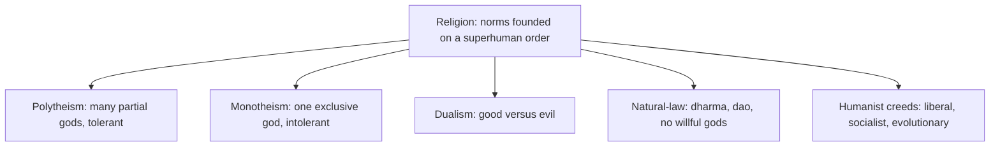

> *Source: Sapiens: A Brief History of Humankind by Yuval Noah Harari (HarperCollins, 2015), Chapter 12 "The Law of Religion", PDF pp. 216–243 (printed pp. unknown)*

# 12: กฎของศาสนา

## แก่นความคิด

หูคนสมัยใหม่ได้ยินคำว่า "ศาสนา" แล้วนึกถึงความแตกแยก สงครามระหว่างนิกาย การกดขี่ข่มเหงผู้เชื่อต่าง และความเกลียดชังในนามของสิ่งศักดิ์สิทธิ์ แฮรารีขอให้พลิกเครื่องหมาย ศาสนาเป็นตัวหลอมรวมมนุษย์ครั้งใหญ่ครั้งที่สาม ทำงานในระดับความเชื่อ เช่นเดียวกับที่เงินทำงานให้กับการแลกเปลี่ยน และจักรวรรดิทำงานให้กับการเมือง ทุกระเบียบสังคมและทุกลำดับชั้นคือ imagined order และโครงสร้างที่เกิดจาก imagined order นั้นเปราะบาง สังคมยิ่งใหญ่เท่าไรก็ยิ่งเปราะบางเท่านั้น บทบาทชี้ขาดของศาสนาในประวัติศาสตร์คือการยึดโครงสร้างเปราะบางเหล่านั้นไว้กับอำนาจเหนือมนุษย์ เพื่อให้กฎหมายพื้นฐานอย่างน้อยบางข้ออยู่นอกเหนือการท้าทาย

การเดินหมากที่กล้าหาญของบทนี้อยู่ที่นิยามของศาสนา ศาสนาคือระบบบรรทัดฐานและค่านิยมของมนุษย์ที่ตั้งอยู่บนความเชื่อในระเบียบเหนือมนุษย์ ผลตามมามีสองข้อ ข้อแรก พุทธศาสนาเป็นศาสนาแม้เทพเจ้าจะเป็นเพียงชายขอบ ข้อสอง คอมมิวนิสต์โซเวียตก็เป็นศาสนาไม่น้อยไปกว่าอิสลาม มองจากจุดนั้น สามศตวรรษที่ผ่านมาซึ่งได้ชื่อว่ายุคฆราวาสนิยมก็กลายเป็นยุคของความกระตือรือร้นทางศาสนาอย่างเข้มข้น และเป็นยุคของสงครามศาสนาที่นองเลือดที่สุดในประวัติศาสตร์

## โครงสร้างข้อโต้แย้ง

- **ศาสนาในฐานะสมอสากล** ทุก imagined order ต้องการอะไรสักอย่างที่ทำให้กฎของตนดูเป็นสิ่งที่เลี่ยงไม่ได้ ไม่ใช่เรื่องตามอำเภอใจ ศาสนาให้สมอนั้นโดยอ้างว่าบรรทัดฐานของตนมาจากระเบียบเหนือมนุษย์ ไม่ใช่ความพึงพอใจชั่ววูบของคน แต่เป็นความจริงระดับจักรวาล ข้ออ้างนี้ทำให้คนแปลกหน้าทำงานร่วมกันได้ข้ามดินแดนกว้างใหญ่ เพราะไม่ได้มีแค่กฎร่วมกัน แต่มีความเชื่อมั่นว่ากฎนั้นต่อรองไม่ได้ ศาสนาโบราณส่วนใหญ่เป็นลัทธิบูชาประจำถิ่น ศาสนาสากลที่เผยแผ่เพิ่งปรากฏในสหัสวรรษแรกก่อนคริสตกาล ทั้งพุทธศาสนา คริสต์ศาสนา และอิสลาม ซึ่งเป็นการปฏิวัติเทียบได้กับจักรวรรดิสากลและเงินสากลในการหลอมรวมมนุษยชาติ

- **ความอดกลั้นของพหุเทวนิยมและความไม่ยอมรับของเอกเทวนิยม** ตรรกะภายในของพหุเทวนิยมคือ เทพเจ้าหลายองค์อยู่ใต้พลังสูงสุดหนึ่งเดียว (โชคชะตา โอโลดุมาเร อาตมัน) ซึ่งไม่สนใจสิ่งใดเลย ส่วนเทพเจ้าบางส่วนที่มีผลประโยชน์และอคติยังต่อรองได้ เพราะเทพเจ้าของคนอื่นเห็นชัดว่าทำงานให้พวกเขาได้ดี พหุเทวนิยมจึงเพาะความอดกลั้น ไม่มีจักรวรรดิที่บังคับให้เปลี่ยนศาสนา ไม่มีการล่าแม่มดนอกรีต นี่คือฝั่งตรงข้ามเชิงโครงสร้างของเอกเทวนิยม เอกเทวนิยมถือกำเนิดเมื่อผู้นับถือยกเทพเจ้าองค์อุปถัมภ์ขึ้นเป็นพลังสูงสุดเพียงหนึ่งเดียว แต่ยังปฏิบัติต่อท่านเหมือนเทพที่มีอคติและต่อรองได้ ความไม่ยอมรับของเอกเทวนิยมเป็นเรื่องเชิงโครงสร้าง ความเชื่ออื่นใดล้วนแปลว่าความจริงของคุณเป็นเพียงบางส่วน ถึงอย่างนั้นนักบุญก็แอบพาเทพเจ้ากลับเข้ามา เทพีบริจิดเข้ารับพิธีล้างบาปแล้วกลายเป็นนักบุญบริจิต

- **ทวินิยมและศาสนาแบบกฎธรรมชาติ** ทวินิยมวางพลังสองอย่างที่เป็นอิสระจากกัน คือความดีกับความชั่ว ทวินิยมแก้ Problem of Evil (ปัญหาแห่งความชั่ว) ได้สะอาด เพราะมีพลังชั่วอาละวาดอยู่ในโลก แต่สะดุดที่ Problem of Order (ปัญหาแห่งระเบียบ) ที่ว่าใครเป็นผู้ออกกฎของการทำสงครามระดับจักรวาล ลัทธิโซโรอัสเตอร์ ลัทธิกนอสติก และลัทธิมานิเคียนเป็นศาสนาทวินิยมหลัก และเอกเทวนิยมก็รับปีศาจ การแยกกายกับวิญญาณ และสวรรค์กับนรกของลัทธิเหล่านี้เข้ามา ศาสนาแบบกฎธรรมชาติวางระเบียบเหนือมนุษย์ไว้ในกฎของธรรมชาติ ไม่ใช่ในความประสงค์ของเทพเจ้า ได้แก่ ลัทธิเชน พุทธศาสนา ลัทธิเต๋า ลัทธิขงจื๊อ และลัทธิสโตอิก เหลือเทพเจ้าไว้ ถ้ามี ก็เป็นเทพที่ธรรมชาติผูกมัดเหมือนสิ่งอื่นทุกอย่าง ธรรมของพุทธศาสนาคือความทุกข์เกิดขึ้นจากตัณหา การหลุดพ้นจากตัณหาทำให้ความทุกข์สิ้นสุด ถือกันว่าเป็นความจริงสากลเทียบได้กับ E = mc²

- **มนุษยนิยมกับสามนิกาย** มนุษยนิยมคือการบูชาธรรมชาติอันศักดิ์สิทธิ์และไม่เหมือนใครของ Homo sapiens มนุษยนิยมเสรีนิยมทำให้เสียงภายในของแต่ละปัจเจกศักดิ์สิทธิ์ (สิทธิมนุษยชนกลายเป็นบทบัญญัติ สร้างบนวิญญาณแบบคริสต์) มนุษยนิยมสังคมนิยมทำให้เผ่าพันธุ์ศักดิ์สิทธิ์โดยรวม (ความเท่าเทียมเป็นบทบัญญัติสูงสุด) มนุษยนิยมวิวัฒนาการซึ่งก็คือนาซี มองมนุษย์เป็นสิ่งที่เปลี่ยนแปลงได้ และชี้นำวิวัฒนาการไปสู่ซูเปอร์แมน ในสามสายนี้มีสายเดียวที่หลุดจากเอกเทวนิยม

## แนวคิดหลัก

### ศาสนาและศาสนาสากลที่เผยแผ่

ระบบบรรทัดฐานและค่านิยมของมนุษย์ที่ตั้งอยู่บนความเชื่อในระเบียบเหนือมนุษย์ มีเกณฑ์สองข้อ ข้อแรก ระเบียบนั้นไม่ใช่ผลผลิตจากความพึงพอใจของมนุษย์ (ฟุตบอลตกเกณฑ์) ข้อสอง ระเบียบนั้นรองรับบรรทัดฐานที่ผูกมัด (ความเชื่อเรื่องผีตกเกณฑ์) คำว่าเหนือมนุษย์ไม่ใช่คำเดียวกับเหนือธรรมชาติ กฎธรรมชาติของพุทธศาสนากับกฎประวัติศาสตร์ของมาร์กซิสต์เป็นเรื่องเหนือมนุษย์แต่ไม่มีพระเจ้า และนั่นคือคานงัดที่ทำให้พุทธศาสนากับคอมมิวนิสต์เป็นศาสนา

### ความอดกลั้นของพหุเทวนิยมกับความไม่ยอมรับของเอกเทวนิยม

ตรรกะภายในของพหุเทวนิยมคือ เทพเจ้าหลายองค์อยู่ใต้พลังสูงสุดหนึ่งเดียวซึ่งไม่สนใจสิ่งใดเลย ส่วนเทพเจ้าบางส่วนที่มีผลประโยชน์และอคติยังต่อรองได้ การแบ่งอำนาจทั้งหมดออกเป็นส่วน ๆ ย่อมได้เทพเจ้าหลายองค์ เพราะเทพเจ้าของคนอื่นเห็นชัดว่าทำงานให้พวกเขาได้ดี พหุเทวนิยมจึงเพาะความอดกลั้น เป็นฝั่งตรงข้ามเชิงโครงสร้างของเอกเทวนิยม ส่วนความไม่ยอมรับของเอกเทวนิยมเป็นเรื่องเชิงโครงสร้าง ความเชื่ออื่นใดล้วนแปลว่าความจริงของคุณเป็นเพียงบางส่วน

### มนุษยนิยมกับสามนิกาย

มนุษยนิยมคือการบูชาธรรมชาติอันศักดิ์สิทธิ์และไม่เหมือนใครของ Homo sapiens ส่วนมนุษยนิยมเสรีนิยมยกเสียงภายในของแต่ละปัจเจกขึ้นเป็นสิ่งศักดิ์สิทธิ์ (สิทธิมนุษยชนกลายเป็นบทบัญญัติ) มนุษยนิยมสังคมนิยมยกเผ่าพันธุ์ทั้งมวลขึ้นเป็นสิ่งศักดิ์สิทธิ์ (ความเท่าเทียมเป็นบทบัญญัติสูงสุด) ส่วนมนุษยนิยมวิวัฒนาการซึ่งก็คือนาซี มองมนุษย์เป็นสิ่งที่ดัดแปลงได้ และชี้นำวิวัฒนาการไปสู่ซูเปอร์แมน ในสามสายนี้มีสายเดียวที่หลุดจากเอกเทวนิยม

## ถ้อยคำน่าจดจำ

> "Today religion is often considered a source of discrimination, disagreement and disunion. Yet, in fact, religion has been the third great unifier of humankind, alongside money and empires." (PDF p. 217)
>
> แปลว่า ทุกวันนี้คนมักมองศาสนาเป็นแหล่งของความเลือกปฏิบัติ ความเห็นต่าง และความแตกแยก ทว่าในความเป็นจริง ศาสนาเป็นตัวหลอมรวมมนุษยชาติครั้งใหญ่ครั้งที่สาม ควบคู่กับเงินและจักรวรรดิ

> "Syncretism might, in fact, be the single great world religion." (PDF p. 230)
>
> แปลว่า อันที่จริง การหลอมรวมความเชื่ออาจเป็นศาสนาโลกที่ยิ่งใหญ่เพียงหนึ่งเดียว

## ความเชื่อมโยง

- [[Book/Sapiens_TH/09_The_Arrow_of_History|09 ลูกศรของประวัติศาสตร์]] ศาสนาเติมชุดสามของพลังสากลให้ครบ ทั้งเงิน จักรวรรดิ และศาสนา ซึ่งดันประวัติศาสตร์ไปสู่ความเป็นหนึ่งเดียว
- [[Book/Sapiens_TH/10_The_Scent_of_Money|10 กลิ่นของเงิน]] เงินเป็น imagined order สากลตัวแรก ศาสนาทำให้กลไกเดียวกันเป็นสากลและเพิ่มอำนาจเหนือมนุษย์เข้าไป
- [[Book/Sapiens_TH/11_Imperial_Visions|11 ภาพฝันของจักรวรรดิ]] ศาสนาให้ความชอบธรรมเหนือมนุษย์แก่จักรวรรดิ และจักรวรรดิที่นับถือพหุเทวนิยมอย่างอดกลั้นก็ต่างจากจักรวรรดิเอกเทวนิยมที่บังคับให้เปลี่ยนศาสนา
- [[Book/Sapiens_TH/16_The_Capitalist_Creed|16 ลัทธิทุนนิยม]] บทนี้เอ่ยถึงทุนนิยมว่าเป็นศาสนาสมัยใหม่ที่ประสบความสำเร็จที่สุด และยกไปกล่าวถึงในบทของตัวเอง
- [[Book/Sapiens_TH/20_The_End_of_Homo_Sapiens|20 จุดจบของ Homo Sapiens]] การปะทะครั้งสุดท้ายระหว่างตัวตนศักดิ์สิทธิ์แบบมนุษยนิยมกับชีววิทยา บวกกับความทะเยอทะยานเหนือมนุษย์ที่ฟื้นคืน ส่งต่อไปยังฉากจบของหนังสือ
- [[Book/Sapiens_TH/Sapiens - Overview|ภาพรวม Sapiens]] เส้นทางอ่าน แผนที่บท และทางเดินต่าง ๆ

## ข้อคิดที่ได้

ศาสนาไม่ใช่ฝั่งตรงข้ามของระเบียบสังคม แต่เป็นกาวเหนือมนุษย์ที่ยึด imagined order ต่าง ๆ เข้าไว้ด้วยกัน และลัทธิความเชื่อที่เราเรียกว่าฆราวาสก็ไม่เคยเลิกใช้กลไกนั้นเลย
