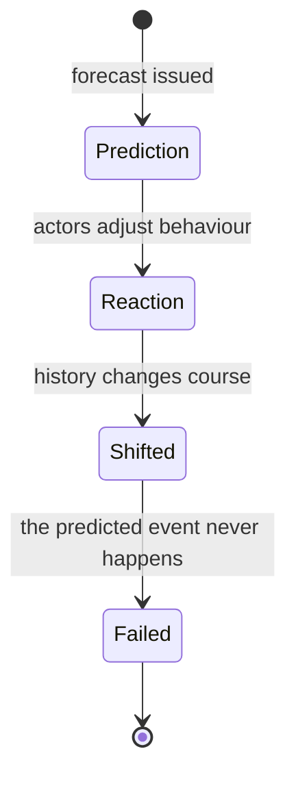

> *Source: Sapiens: A Brief History of Humankind by Yuval Noah Harari (HarperCollins, 2015), Chapter 13 "The Secret of Success", PDF pp. 244–251 (printed pp. unknown)*

# 13: ความลับของความสำเร็จ

## แก่นความคิด

บทก่อน ๆ สืบรอยว่าการค้า จักรวรรดิ และศาสนาสากลดึงประชากรมนุษย์ทุกกลุ่มเข้ามาในใยเดียวกันได้อย่างไร เป็นเรื่องง่ายที่จะเผลอคิดว่าการหลอมรวมนี้เป็นเรื่องเลี่ยงไม่ได้ บทที่ 13 หยุดเรื่องเล่าไว้ตรงนั้นเพื่อโจมตีความสบายใจนั้น เรื่องของบทนี้ไม่ใช่เหตุการณ์ใดเหตุการณ์หนึ่งในประวัติศาสตร์ แต่คือธรรมชาติของประวัติศาสตร์เอง ว่าสิ่งที่เกิดขึ้นเป็นสิ่งที่เลี่ยงไม่ได้หรือไม่ และ "ความสำเร็จ" ในประวัติศาสตร์หมายถึงอะไรกันแน่

คำตอบของแฮรารีมีสองส่วน ส่วนแรกคือ **hindsight fallacy** เพราะทุกขณะเป็นทางแยก ผลลัพธ์ที่ดูเลี่ยงไม่ได้เมื่อมองย้อนหลังกลับไม่แน่นอนเลยตอนที่ยังเป็นอนาคต ส่วนที่สองคือ **"Blind Clio"** ทางเลือกของประวัติศาสตร์ไม่ได้เกิดขึ้นเพื่อประโยชน์ของมนุษย์ ความสำเร็จหมายถึงความสำเร็จในการทำสำเนาตัวเองออกไป ไม่ว่าสำเนาเหล่านั้นจะทำอะไรกับพาหะของมัน บทนี้จึงเปลี่ยนเรื่องเล่าว่าเรามาถึงตรงนี้ได้อย่างไรให้เป็นคำเตือนไม่ให้อ่านเรื่องนั้นย้อนกลับ

## โครงสร้างข้อโต้แย้ง

- **การหลอมรวมอาจเลี่ยงไม่ได้ แต่โลกใบนี้ไม่ใช่** การเลื่อนจากวัฒนธรรมเล็ก ๆ จำนวนมากไปสู่สังคมโลกเดียวอาจเป็นเรื่องเลี่ยงไม่ได้ การค้า จักรวรรดิ และศาสนาสากลพา Sapiens แทบทุกคนเข้ามาอยู่ในโลกวันนี้จนได้ โลกที่เป็นหนึ่งเดียวอาจเป็นผลที่น่าจะเกิดขึ้น แต่ **โลกใบนี้** ไม่ใช่ ทำไมภาษาอังกฤษจึงแพร่หลายและไม่ใช่ภาษาเดนมาร์ก ทำไมจึงมีคริสต์ศาสนิกชนราว 2,000 ล้านคนและมุสลิม 1,250 ล้านคน แต่มีผู้นับถือลัทธิโซโรอัสเตอร์เพียง 150,000 คน ถ้าย้อนกลับไปหมื่นปีก่อนแล้วปล่อยให้กระบวนการเดิมเกิดขึ้นอีกครั้ง เอกเทวนิยมจะผงาดขึ้นเสมอและทวินิยมจะเสื่อมลงเสมอหรือเปล่า

- **hindsight fallacy กับการทดสอบของคอนสแตนติน** จากอดีตมาถึงปัจจุบันมีถนนที่เดินผ่านมาแล้วเพียงสายเดียว แต่มีทางแยกนับไม่ถ้วนที่แตกออกไปในอนาคต ต้นศตวรรษที่ 4 จักรวรรดิโรมันเผชิญขอบฟ้าของความเป็นไปได้ทางศาสนากว้างไกล คอนสแตนตินจะคงพหุเทวนิยมไว้ก็ได้ แต่เขาอยากได้ศาสนาเดียวมาหลอมรวมอาณาจักรของตน เมนูของเขากว้างขวาง ทั้งลัทธิมานิเคียน ลัทธิมิทรา (Mithraism) ลัทธิบูชาไอซิสหรือไซบีลี ลัทธิโซโรอัสเตอร์ ยูดาย ไปจนถึงพุทธศาสนา ทำไมต้องเป็นพระเยซู นักประวัติศาสตร์บรรยายได้ว่า **อย่างไร** คริสต์ศาสนากลายเป็นผู้ชนะ แต่พวกเขาอธิบายไม่ได้ว่า **ทำไม** ความเป็นไปได้ข้อนั้นจึงกลายเป็นจริง นั่นคือเส้นแบ่งของศาสตร์นี้ นักวิชาการบางคนเสนอคำอธิบายแบบกำหนดตายตัว ลดทอนคริสต์ศาสนาให้เหลือพลังทางชีววิทยาหรือเศรษฐกิจ นักประวัติศาสตร์ส่วนใหญ่สงสัยในคำอธิบายทำนองนั้น และแฮรารีขยับข้อสงสัยให้คมขึ้นว่า ยิ่งรู้จักยุคสมัยหนึ่งดีเท่าไร ก็ยิ่งอธิบายยากเท่านั้นว่าทำไมสิ่งต่าง ๆ จึงเกิดในแบบหนึ่งและไม่ใช่อีกแบบหนึ่ง

- **ความอลวนระดับสอง และเหตุใดเราจึงศึกษาประวัติศาสตร์** ประวัติศาสตร์อธิบายแบบกำหนดตายตัวไม่ได้และทำนายไม่ได้ เพราะเป็นระบบอลวน พลังจำนวนมากปฏิสัมพันธ์กันจนการเปลี่ยนแปลงเพียงเล็กน้อยก่อผลต่างมหาศาล ยิ่งกว่านั้น ประวัติศาสตร์ยังเป็นระบบอลวน "ระดับสอง" ความอลวนระดับหนึ่ง (อย่างอากาศ) ไม่ตอบสนองต่อคำทำนายเกี่ยวกับตัวเอง ส่วนความอลวนระดับสองตอบสนองต่อคำทำนาย คำทำนายที่แม่นยำจึงเป็นไปไม่ได้ ตลาดคือตัวอย่างมาตรฐาน โปรแกรมที่ทำนายได้อย่างไม่มีผิดพลาดว่าน้ำมันจะแตะ 100 ดอลลาร์พรุ่งนี้ จะทำให้นักค้าทั้งตลาดรีบซื้อวันนี้ แล้วดันราคาขึ้นไปถึง 100 ดอลลาร์ตั้งแต่วันนี้แทน การเมืองก็อลวนแบบระดับสองเช่นกัน นักวิจารณ์ที่ตำหนินักโซเวียตวิทยาว่าพลาดเหตุการณ์ปี 1989 หรือตำหนิผู้เชี่ยวชาญตะวันออกกลางว่าพลาด Arab Spring กำลังตัดสินอย่างไม่เป็นธรรม เพราะการปฏิวัติโดยนิยามคือสิ่งที่ทำนายไม่ได้ การปฏิวัติที่ทำนายได้ย่อมไม่เคยปะทุขึ้น แล้วทำไมต้องศึกษาประวัติศาสตร์ ไม่ใช่เพื่อทำนายอนาคต จุดประสงค์คือเปิดขอบฟ้าของเราให้กว้างขึ้น ทำให้เรารู้ว่าสถานการณ์ปัจจุบันของเราไม่ได้เป็นสิ่งที่ธรรมชาติกำหนดไว้ และทำให้เห็นว่ามีความเป็นไปได้มากกว่าที่เราจินตนาการวางอยู่ตรงหน้า

- **Blind Clio และวัฒนธรรมในฐานะปรสิต** เราอธิบายทางเลือกของประวัติศาสตร์ไม่ได้ แต่เราบอกอะไรที่สำคัญได้ ทางเลือกเหล่านั้นไม่ได้เกิดขึ้นเพื่อประโยชน์ของมนุษย์ ไม่มีข้อพิสูจน์ว่าความอยู่ดีของมนุษย์ดีขึ้นเมื่อประวัติศาสตร์ดำเนินไป ไม่มีข้อพิสูจน์ว่าคริสต์ศาสนาดีกว่าลัทธิมานิเคียน หรือว่าจักรวรรดิอาหรับดูแลผู้คนได้ดีกว่าราชวงศ์ซัสซานิด เพราะไม่มีมาตรวัดความเป็นประโยชน์ที่เป็นกลาง วัฒนธรรมต่าง ๆ นิยามความดีต่างกัน และเราไม่มีไม้บรรทัดสำหรับตัดสินระหว่างกัน นักวิชาการจำนวนมากขึ้นเรื่อย ๆ มองวัฒนธรรมเป็นโรคติดต่อทางจิตหรือปรสิต โดยมีมนุษย์เป็นพาหะที่รู้เท่าไม่ถึงการณ์ เหมือนไวรัส ความคิดอาศัยอยู่ในใจ เพิ่มจำนวน และแพร่จากพาหะหนึ่งไปยังอีกพาหะหนึ่ง ดูดกินเจ้าบ้าน ทำให้เจ้าบ้านอ่อนแอลง และบางครั้งก็ฆ่าเจ้าบ้าน ตราบใดที่เจ้าบ้านยังมีชีวิตอยู่นานพอจะส่งปรสิตต่อไปได้ ปรสิตก็ไม่สนใจว่าสภาพของเจ้าบ้านจะเป็นอย่างไร

- **ทางเลือกที่สำคัญที่สุด** ประวัติศาสตร์เดินจากทางแยกหนึ่งไปยังทางแยกถัดไป เลือกด้วยเหตุผลลึกลับบางอย่าง ครั้งนี้ทางนี้ ครั้งหน้าทางนั้น ราวปี ค.ศ. 1500 ประวัติศาสตร์เลือกสิ่งที่สำคัญที่สุด นั่นคือ Scientific Revolution การปฏิวัตินี้เริ่มในยุโรปตะวันตก ซึ่งเป็นคาบสมุทรขนาดใหญ่ที่ปลายด้านตะวันตกของแอฟริกา-เอเชีย และจนถึงตอนนั้นไม่เคยมีบทบาทสำคัญใด ๆ ทำไมที่นั่นและไม่ใช่จีนหรืออินเดีย ทำไมตอนนั้นและไม่ใช่สองศตวรรษก่อนหรือสามศตวรรษหลัง เราไม่รู้ มีคนเสนอทฤษฎีไว้หลายสิบข้อ ไม่มีข้อใดน่าเชื่อเป็นพิเศษ ขอบฟ้าของความเป็นไปได้กว้างมาก และส่วนใหญ่ไม่เคยกลายเป็นจริง ประวัติศาสตร์อาจดำเนินไปโดยไม่มีคริสต์ศาสนา ไม่มีจักรวรรดิโรมัน ไม่มีเหรียญทอง และไม่มี Scientific Revolution ก็ได้

## แนวคิดหลัก

### ภาพลวงของการมองย้อนหลัง (hindsight fallacy)

การมองย้อนหลังอ่านถนนสายเดียวที่เดินผ่านมาว่าเป็นถนนสายเดียวที่มีอยู่ ความรู้ตื้น ๆ ทำให้เห็นเพียงผลลัพธ์ที่เกิดขึ้นจริง แล้วผลลัพธ์นั้นก็ดูเลี่ยงไม่ได้ ความรู้ลึกเผยอนาคตจำนวนมากที่คนร่วมสมัยเผชิญอยู่จริง ผลในทางวิธีวิทยาคือ นักประวัติศาสตร์สร้างภาพขึ้นใหม่ได้ว่า **อย่างไร** คริสต์ศาสนายึดโรมได้ แต่อธิบายไม่ได้ว่า **ทำไม** ทางเลือกนั้นจึงชนะลัทธิมานิเคียน

### ความอลวนระดับสอง (level-two chaos)

ระบบอลวนที่ตอบสนองต่อคำทำนายเกี่ยวกับตัวเอง ทั้งตลาด การเมือง และการปฏิวัติ เราทำนายไม่ได้อย่างแม่นยำเลย เพราะคำทำนายที่น่าเชื่อถือจะเปลี่ยนพฤติกรรมที่คำทำนายนั้นชี้ถึง แนวคิดนี้ให้นิยามใหม่ว่าประวัติศาสตร์มีไว้ทำอะไร ในเมื่อประวัติศาสตร์เป็นวิทยาศาสตร์เชิงทำนายไม่ได้ เราจึงศึกษาประวัติศาสตร์เพื่อเปิดขอบฟ้าของเรา และเพื่อถอนความเคยชินที่คิดว่าปัจจุบันเป็นสิ่งที่เลี่ยงไม่ได้

### memes กับมุมมองวัฒนธรรมแบบปรสิต

ถ้าวิวัฒนาการทางชีววิทยาเดินด้วยการจำลองตัวเองของยีน วิวัฒนาการทางวัฒนธรรมก็เดินด้วยการจำลองตัวเองของ memes ซึ่งเป็นหน่วยของข้อมูลทางวัฒนธรรมที่วัดความสำเร็จจากจำนวนการแพร่กระจายของตัวเองล้วน ๆ ไม่ใช่จากผลที่ความคิดนั้นมีต่อเจ้าบ้าน อุปมาของปรสิตทำให้ความสำเร็จในประวัติศาสตร์กลายเป็นคุณสมบัติของความคิด ไม่ใช่คุณสมบัติของผู้คน

### Blind Clio (ไคลโอตาบอด)

ไคลโอ มิวส์แห่งประวัติศาสตร์ ปรากฏตัวในบทนี้อย่างตาบอด ทางเลือกของประวัติศาสตร์เกิดขึ้นโดยไม่คำนึงถึงความอยู่ดีของมนุษย์ เพราะวัฒนธรรมต่าง ๆ นิยามความดีต่างกัน จึงไม่มีไม้บรรทัดที่เป็นกลางสำหรับจัดอันดับผลลัพธ์ การแพร่กระจายของเงิน จักรวรรดิ และศาสนาเป็นพยานถึงความเหมาะสมในการสืบพันธุ์ของ memes ไม่ใช่ถึงความรุ่งเรืองของมนุษย์

## ถ้อยคำน่าจดจำ

> "It is an iron rule of history that what looks inevitable in hindsight was far from obvious at the time." (PDF p. 246)
>
> แปลว่า กฎเหล็กข้อหนึ่งของประวัติศาสตร์คือ สิ่งที่ดูเลี่ยงไม่ได้เมื่อมองย้อนหลังนั้นห่างไกลจากความชัดเจนเลยในเวลานั้น

> "We study history not to know the future but to widen our horizons, to understand that our present situation is neither natural nor inevitable." (PDF p. 248)
>
> แปลว่า เราศึกษาประวัติศาสตร์ไม่ใช่เพื่อรู้อนาคต แต่เพื่อเปิดขอบฟ้าของเราให้กว้างขึ้น เพื่อเข้าใจว่าสถานการณ์ปัจจุบันของเราไม่ใช่เรื่องธรรมชาติและไม่ใช่เรื่องเลี่ยงไม่ได้

## ความเชื่อมโยง

- [[Book/Sapiens_TH/09_The_Arrow_of_History|09 ลูกศรของประวัติศาสตร์]] บทนี้เปิดด้วยการหลอมรวมที่บทที่ 9 อธิบายว่าเป็นลูกศรของประวัติศาสตร์ แล้วถามว่ารูปทรงเฉพาะของการหลอมรวมนั้นเคยเป็นสิ่งที่เลี่ยงไม่ได้จริงหรือ
- [[Book/Sapiens_TH/12_The_Law_of_Religion|12 กฎของศาสนา]] การเดิมพันของคอนสแตนตินเล่นซ้ำเอกเทวนิยมแบบจักรวรรดิของบทที่ 12 ในฐานะทางเลือกหนึ่งท่ามกลางลัทธิต่าง ๆ มากมาย
- [[Book/Sapiens_TH/08_There_Is_No_Justice_in_History|08 ไม่มีความยุติธรรมในประวัติศาสตร์]] Blind Clio ขยาย imagined order ของบทที่ 8 ออกไป ลำดับชั้นทางสังคมเป็นอุบัติเหตุของอำนาจ ไม่มีธรรมชาติหรือความยุติธรรมรองรับ
- [[Book/Sapiens_TH/14_The_Discovery_of_Ignorance|14 การค้นพบความไม่รู้]] บทนี้จบลงที่ Scientific Revolution ด้วยคำถามว่าทำไมยุโรปและทำไมตอนนั้น ซึ่งบทที่ 14 รับช่วงต่อ
- [[Book/Sapiens_TH/19_And_They_Lived_Happily_Ever_After|19 แล้วพวกเขาก็อยู่ด้วยกันอย่างมีความสุขตลอดไป]] ข้ออ้างที่ว่าประวัติศาสตร์ไม่สนใจความสุขของปัจเจกคือสิ่งที่บทที่ 19 นำมาทดสอบ
- [[Book/Sapiens_TH/Sapiens - Overview|ภาพรวม Sapiens]] เส้นทางอ่าน แผนที่บท และทางเดินต่าง ๆ

## ข้อคิดที่ได้

ผู้ชนะของประวัติศาสตร์ชนะการแข่งขันเรื่องการแพร่กระจายตัวเอง ไม่ใช่การแข่งขันเรื่องความดี และทุกความแน่นอนที่ "เลี่ยงไม่ได้" ซึ่งเรายึดเป็นหลักในการใช้ชีวิตเคยเป็นเพียงทางแยกทางหนึ่งท่ามกลางทางแยกมากมาย ทางเลือกนั้นมีเหตุผลที่ไม่มีใครเอ่ยชื่อได้กำกับอยู่
