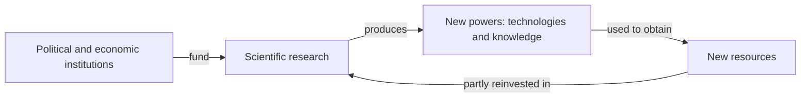

> *Source: Sapiens: A Brief History of Humankind by Yuval Noah Harari (HarperCollins, 2015), Chapter 14 "The Discovery of Ignorance", PDF pp. 253–280 (printed pp. unknown)*

# 14: การค้นพบความไม่รู้

## แก่นความคิด

บทนี้เปิดด้วยนักเดินทางข้ามเวลาสองคนที่จับคู่กันอย่างประหลาด ชาวนายุคกลางที่หลับไปในปี ค.ศ. 1000 แล้วตื่นขึ้นในปี 1500 จะพบว่าโลกคุ้นเคยเหมือนเดิมทุกอย่าง แต่ลูกเรือคนหนึ่งของโคลัมบัสที่ตื่นขึ้นมาเจอ iPhone ในศตวรรษที่ 21 คงสงสัยว่าตัวเองไปลงเอยที่สวรรค์หรือนรกกันแน่ แฮรารีเทตัวเลขออกมาทั้งชุด ประชากรเพิ่มขึ้น 14 เท่าตั้งแต่ปี 1500 การผลิตเพิ่มขึ้น 240 เท่า การใช้พลังงานต่อวันเพิ่มขึ้น 115 เท่า ทว่าสิ่งที่บทนี้พูดถึงจริง ๆ ไม่ใช่การเติบโต หากแต่เป็นความคิดที่ทำให้การเติบโตนั้นเกิดขึ้นได้

ทุกประเพณีความคิดก่อนหน้านี้ถือว่ารู้คำตอบสำคัญครบแล้ว วิทยาศาสตร์สมัยใหม่เป็นพวกแรกที่ยอมรับความไม่รู้อย่างเปิดเผย ทฤษฎีที่ดีที่สุดของเราก็อาจผิดได้ Scientific Revolution จึงไม่ใช่การปฏิวัติของความรู้ หากแต่เป็นการปฏิวัติของความไม่รู้ เริ่มจากการค้นพบว่ามนุษย์ยังไม่รู้คำตอบของคำถามสำคัญที่สุดของตัวเอง บทนี้ให้นิยามวิทยาศาสตร์สมัยใหม่ (ยอมรับความไม่รู้ สังเกตและวัด คว้าอำนาจใหม่มาไว้ในมือ) แล้วไล่ดูว่าวิทยาศาสตร์ผูกตัวเองเข้ากับการเมืองและเศรษฐกิจเป็นวงจรที่ยิ่งหมุนยิ่งแรงได้อย่างไร และตามรอยลัทธิที่เกิดจากความคิดชุดนี้ คือความเชื่อในความก้าวหน้า ซึ่งไปจบที่การรณรงค์อย่างเปิดเผยเพื่อเอาชนะความตาย

## โครงสร้างข้อโต้แย้ง

- **ห้าศตวรรษของการเติบโตแบบทบต้น** การพุ่งขึ้นของอำนาจเห็นได้ในทุกตัวชี้วัด มนุษย์ 500 ล้านคนในปี 1500 กลายเป็น 7 พันล้านคน การผลิตต่อปีโตจาก 250 พันล้านดอลลาร์เป็นราว 60 ล้านล้านดอลลาร์ ในเดือนกรกฎาคม 1969 สิ่งมีชีวิตตัวหนึ่งทิ้งรอยเท้าไว้บนดวงจันทร์ เวลา 05:29:45 ของวันที่ 16 กรกฎาคม 1945 ระเบิดปรมาณูลูกแรกก็ระเบิดขึ้น มนุษย์ได้ความสามารถที่ไม่เพียงเปลี่ยนประวัติศาสตร์ได้เท่านั้น แต่ยังยุติประวัติศาสตร์ได้ด้วย ก่อนราวปี 1500 ไม่มีใครคาดหวังว่าการค้นคว้าจะให้ผลตอบแทน ผู้ปกครองสมัยใหม่เชื่อตรงกันข้าม ลงทุนในการค้นคว้าแล้วจะได้อำนาจใหม่ และความเชื่อนั้นก็พิสูจน์ตัวเองซ้ำแล้วซ้ำอีก

- **การค้นพบความไม่รู้** วิทยาศาสตร์สมัยใหม่ต่างจากทุกประเพณีก่อนหน้าในสามข้อ ยอมรับความไม่รู้ พึ่งการสังเกตกับคณิตศาสตร์ และไล่ล่าอำนาจใหม่ ประเพณีก่อนสมัยใหม่ถือว่าทุกเรื่องสำคัญรู้กันหมดแล้ว ยอมรับเพียงความไม่รู้ของปัจเจก และความไม่รู้ในเรื่องที่ไม่สำคัญ วิทยาศาสตร์จึงแตกแบบแผนด้วยการยอมรับความไม่รู้ร่วมกันในคำถามที่สำคัญที่สุด ดาร์วินไม่เคยอ้างว่าตัวเองเป็นคำตอบสุดท้ายเรื่องชีวิต นักชีววิทยายังสารภาพว่าอธิบายจิตสำนึกไม่ได้ และนักฟิสิกส์ยอมรับว่าไม่รู้ว่าอะไรทำให้เกิด Big Bang ความกล้าพูดตรงนี้ทำให้วิทยาศาสตร์ไม่หยุดนิ่ง แต่ก็สร้างปัญหาสังคมขึ้นมา ถ้าตำนานร่วมที่ยึดคนนับล้านไว้เปิดให้สงสัยได้ สังคมจะเกาะกันอยู่ได้อย่างไร ระเบียบสมัยใหม่ตอบด้วยสองวิธีที่ไม่ใช่วิทยาศาสตร์ แช่แข็งวิทยาศาสตร์บางส่วนให้กลายเป็นความจริงสัมบูรณ์ (วิธีของนาซีกับคอมมิวนิสต์) หรือไม่ก็วางรากระเบียบไว้บนสิ่งสัมบูรณ์ที่ไม่ใช่วิทยาศาสตร์ (humanism แบบเสรีนิยม)

- **การสังเกต คณิตศาสตร์ และความรู้ในฐานะอำนาจ** ปี 1687 นิวตันตีพิมพ์ *The Mathematical Principles of Natural Philosophy* แสดงให้เห็นว่ากฎง่าย ๆ สามข้อทำนายการเคลื่อนที่ของทุกสิ่งได้ ตั้งแต่แอปเปิลที่ร่วงลงมาจนถึงดาวเคราะห์ แต่ชีววิทยา เศรษฐศาสตร์ และจิตวิทยาดื้อต่อสมการที่เรียบร้อย วิทยาศาสตร์จึงสร้างคณิตศาสตร์ชุดใหม่สำหรับความซับซ้อนขึ้นมา คือสถิติ กรณีศึกษาคือสกอตแลนด์ปี 1744 นักบวชเพรสไบทีเรียนสองคนอยากตั้งกองทุนบำนาญให้แม่ม่ายของนักบวช แทนที่จะสวดภาวนา พวกเขาจ้างนักคณิตศาสตร์มาขุดบันทึกการตาย กฎจำนวนมาก (Law of Large Numbers) ของแบร์นูลีบอกว่าการตายของคนคนเดียวทำนายไม่ได้ แต่ค่าเฉลี่ยทำนายได้ คำทำนายของพวกเขาว่ากองทุนจะมี £58,348 ภายในปี 1765 พลาดไปหนึ่งปอนด์พอดี ปี 1620 ฟรานซิส เบคอนตีพิมพ์แถลงการณ์ *The New Instrument* เสนอว่าความรู้คืออำนาจ ("knowledge is power") เนื่องจากไม่มีทฤษฎีใดแน่นอนเต็มร้อย เอาความจริงมาตรวจสอบความรู้จึงเป็นวิธีที่แย่ การทดสอบจริงคือประโยชน์ใช้สอย หมากที่ลึกกว่าของเบคอนคือจับวิทยาศาสตร์แต่งงานกับเทคโนโลยี สองดินแดนที่แยกจากกันสนิทก่อนปี 1500 และผูกติดกันแน่นเฉพาะในศตวรรษที่ 19

- **ความก้าวหน้า, Gilgamesh Project และผู้เลี้ยงดูของวิทยาศาสตร์** คำสารภาพเรื่องความไม่รู้เปลี่ยนการคำนวณ ถ้าปัญหาที่เลวร้ายที่สุดของเราเป็นแค่ผลของความไม่รู้ ความรู้ใหม่ก็ละลายทิ้งได้เลย ความยากจนตามมาถัดไป พระเยซูบอกสาวกว่าคนจนจะอยู่กับพวกเขาเสมอ แต่คนสมัยใหม่มองความขัดสนเป็นปัญหาทางเทคนิค ปัญหาที่ยากที่สุดคือความตายเอง ศรัทธาก่อนสมัยใหม่ทำให้ความตายเป็นแหล่งความหมาย และให้สัญญาเรื่องชีวิตหลังความตายแทนที่จะพยายามหนี นักวิทยาศาสตร์ปฏิเสธภูมิปัญญานั้น ความตายไม่ใช่พระบัญชา แต่เป็นชุดของความล้มเหลวทางเทคนิคต่อเนื่องกัน และปัญหาทางเทคนิคทุกข้อมีทางแก้ทางเทคนิค หลักฐานสนับสนุนความกล้านี้: อายุขัยเฉลี่ยไต่จากราว 25–40 ปีขึ้นไปเป็น 67 ปีทั่วโลก วิทยาศาสตร์กินเงินมาก สิ่งมหัศจรรย์ที่ได้มาจึงมีรัฐบาล ธุรกิจ และผู้บริจาคเป็นคนจ่าย งานวิจัยส่วนใหญ่ได้ทุนเพราะมีใครสักคนเชื่อว่างานนั้นรับใช้เป้าหมายทางการเมือง เศรษฐกิจ หรือศาสนา ผู้เลี้ยงดูวิทยาศาสตร์จึงเป็นอุดมการณ์หรือผลประโยชน์เสมอ ซึ่งเป็นเหตุผลที่สองบทถัดไปหันไปหาจักรวรรดิกับทุนนิยม

## แนวคิดหลัก

### Ignoramus คำสารภาพตั้งต้น

วิทยาศาสตร์สมัยใหม่ตั้งอยู่บนคำกำชับภาษาละติน *ignoramus* แปลว่าเราไม่รู้ ไม่ได้ถือเพียงว่าความรู้ยังไม่ครบ แต่ถือว่าทุกสิ่งที่เราเชื่ออาจพิสูจน์ได้ว่าผิด ไม่มีแนวคิด ความคิด หรือทฤษฎีใดศักดิ์สิทธิ์ ของใหม่คือการประกาศให้ความไม่รู้ร่วมกันในคำถามสำคัญที่สุดเป็นเรื่องชอบธรรม

### วงจรป้อนกลับของ Scientific Revolution

คำบรรยายภาพของแฮรารีให้เครื่องยนต์ของบทนี้ไว้ วิทยาศาสตร์ การเมือง และเศรษฐกิจ เสริมกำลังกันและกัน สถาบันการเมืองและเศรษฐกิจป้อนทรัพยากร งานวิจัยตอบแทนด้วยอำนาจใหม่ อำนาจนั้นได้ทรัพยากรใหม่มา และบางส่วนก็ไหลกลับไปลงทุนในงานวิจัยอีก วงจรนี้อธิบายว่าทำไมผู้ปกครองก่อนสมัยใหม่จึงได้แต่ความชะงักงัน ส่วนผู้ปกครองสมัยใหม่ได้การเติบโตแบบทบต้น

### ความรู้คืออำนาจ ความจริงที่วัดด้วยประโยชน์

สโลแกนของเบคอนบีบ epistemology สมัยใหม่ไว้ทั้งก้อน เพราะไม่มีทฤษฎีใดถูกต้องเต็มร้อย เอาความจริงมาตรวจสอบความรู้จึงเป็นวิธีที่แย่ การทดสอบจริงคือทฤษฎีนั้นให้อำนาจเราทำสิ่งใหม่ได้หรือไม่ นี่อธิบายการสมรสที่มาช้าและเปลี่ยนโชคชะตาระหว่างวิทยาศาสตร์กับเทคโนโลยี สองดินแดนที่แยกกันก่อนปี 1500 และเพิ่งผูกสมรสกันแน่นในศตวรรษที่ 19

### อุดมคติแห่งความก้าวหน้ากับ Gilgamesh Project

ความเชื่อที่ว่าพรุ่งนี้ดีกว่าวันนี้ได้ ด้วยความรู้และการประดิษฐ์คิดค้น ไม่ใช่ด้วยการแทรกแซงของเทพเจ้า เป็นสิ่งประดิษฐ์สมัยใหม่ทั้งดุ้น Gilgamesh Project ตั้งชื่อตามตำนานที่เก่าแก่ที่สุดของมนุษยชาติ คือการตามหาความเป็นอมตะ กิลกาเมชโบราณล้มเหลว และกลับมาพร้อมปัญญาที่ว่าความตายคือโชคชะตา วิทยาศาสตร์สมัยใหม่ตอบกลับว่าความตายคือชุดของความล้มเหลวทางเทคนิคที่รอทางแก้ทางเทคนิคอยู่

## ถ้อยคำน่าจดจำ

> "The Scientific Revolution has not been a revolution of knowledge. It has been above all a revolution of ignorance." (PDF p. 257)
>
> แปลว่า Scientific Revolution ไม่ใช่การปฏิวัติของความรู้ หากแต่เป็นการปฏิวัติของความไม่รู้เหนือสิ่งอื่นใด

> "The leading project of the Scientific Revolution is to give humankind eternal life." (PDF p. 273)
>
> แปลว่า โครงการหลักของ Scientific Revolution คือการมอบชีวิตอมตะให้มนุษยชาติ

## ความเชื่อมโยง

- [[Book/Sapiens_TH/01_An_Animal_of_No_Significance|01 สัตว์ที่ไร้ความสำคัญ]] กรอบของหนังสือกลับมา การปฏิวัติครั้งใหญ่ครั้งที่สามมอบอำนาจให้สปีชีส์ที่อยู่ยอดสุดยุติประวัติศาสตร์ได้
- [[Book/Sapiens_TH/02_The_Tree_of_Knowledge|02 ต้นไม้แห่งความรู้]] วิทยาศาสตร์สืบทอดแรงขับเรื่องความรู้ที่แฮรารีสาวไปถึง Cognitive Revolution
- [[Book/Sapiens_TH/15_The_Marriage_of_Science_and_Empire|15 การสมรสระหว่างวิทยาศาสตร์กับจักรวรรดิ]] ประกาศไว้ที่นี่ พลังแรกที่ออกทุนและบังคับทิศทางวิทยาศาสตร์
- [[Book/Sapiens_TH/16_The_Capitalist_Creed|16 ลัทธิทุนนิยม]] ประกาศไว้ที่นี่ พลังที่สองซึ่งหลอมวิทยาศาสตร์ อุตสาหกรรม และสงครามเข้าด้วยกัน
- [[Book/Sapiens_TH/20_The_End_of_Homo_Sapiens|20 จุดจบของ Homo Sapiens]] ความทะเยอทะยานเรื่องความเป็นอมตะของ Gilgamesh Project ชี้ไปสู่อนาคตที่มนุษย์ออกแบบเอง
- [[Book/Sapiens_TH/Sapiens - Overview|ภาพรวม Sapiens]] เส้นทางอ่าน แผนที่บท และทางเดินต่าง ๆ

## ข้อคิดที่ได้

โลกสมัยใหม่สร้างขึ้นบนคำสารภาพข้อหนึ่ง ยอมรับว่าไม่รู้ ลงทุนเพื่อหาคำตอบ และอย่าลืมว่าคนที่ออกเงินงานวิจัยเป็นคนกำหนดว่าความรู้จะไปทางไหน
