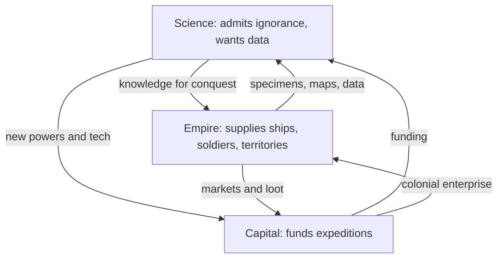

> *Source: Sapiens: A Brief History of Humankind by Yuval Noah Harari (HarperCollins, 2015), Chapter 15 "The Marriage of Science and Empire", PDF pp. 281–310 (printed pp. unknown)*

# 15: การสมรสระหว่างวิทยาศาสตร์กับจักรวรรดิ

## แก่นความคิด

บทที่ 14 ทิ้งเราไว้กับอารยธรรมที่เริ่มต้นด้วยการยอมรับว่าตัวเองไม่รู้อะไร บทนี้แสดงให้เห็นว่าคำสารภาพนั้นกลายเป็นพลังพิชิตโลกได้ก็ต่อเมื่อสมรสกับจักรวรรดิ Scientific Revolution กับการขยายจักรวรรดิสมัยใหม่แยกจากกันไม่ได้ เป็นกิจการเดียวที่มองจากสองปลายของเรือลำเดียวกัน นักวิทยาศาสตร์ต้องการเงินกับข้อมูล ส่วนจักรวรรดิต้องการความรู้กับความชอบธรรม

สัญลักษณ์ของเรื่องคือการเดินทางไปตาฮีตีของคุกในปี 1768 วิทยาศาสตร์บริสุทธิ์ล้วน ๆ การจับเวลาการโคจรผ่านหน้าดวงอาทิตย์ของดาวศุกร์ มีนายทหารเรือเป็นผู้สั่งการและถือโอกาสประกาศยึดออสเตรเลียระหว่างทาง การหลอมรวมนั้นตอบปริศนาของบทว่าทำไมดินแดนหลังเขาอันหนาวเหน็บแห่งหนึ่งของยูเรเซียจึงพิชิตโลกได้ และทำให้เรื่องราวมืดลง พันธมิตรเดียวกันผลิตการล้างเผ่าพันธุ์ชาวแทสเมเนีย racism ที่อ้างวิทยาศาสตร์ และโลกที่เรายังอยู่ในทุกวันนี้ จักรวรรดิตายไปแล้ว แต่ capital กับวิทยาศาสตร์ซึ่งเป็นลูกหลานของการสมรสนั้นยังไม่ตาย

## โครงสร้างข้อโต้แย้ง

- **ทำไมต้องยุโรป และทำไมถึงเกิดช้านัก** ปริศนาคือราวปี 1500 ยุโรปตะวันตกเป็นเพียงดินแดนชายขอบเมื่อเทียบกับจีน อินเดีย หรือโลกอิสลาม แต่ภายในสามศตวรรษชาวยุโรปกลับครองโลก คำตอบไม่ใช่เทคโนโลยี ชาวยุโรปไม่ได้เปรียบอะไรเหนือออตโตมันหรือจีนในเรื่องอาวุธ เรือ หรือการเดินเรือ ความต่างอยู่ที่กรอบคิด คือความเต็มใจยอมรับความไม่รู้ และความทะเยอทะยานจะพิชิตสิ่งที่ไม่รู้จัก จักรวรรดิก่อนสมัยใหม่ (โรมัน อาหรับ มองโกล แอซเทก) ออกไปพิชิตเพื่อแผ่วัฒนธรรมของตนหรือปล้นความมั่งคั่ง ส่วนจักรวรรดิยุโรปออกไปพิชิตเพื่อค้นพบ ตรงนี้ทำให้ชาวยุโรปเป็นนักเรียนรู้ที่โลภที่สุด และเป็นผู้ทำลายที่รุนแรงที่สุดไปพร้อมกัน

- **แผนที่ว่างเปล่ากับ parochialism penalty** แผนที่โลกก่อนสมัยใหม่ไม่มีช่องว่าง ภูมิภาคที่ยังไม่รู้จักเต็มไปด้วยสัตว์ประหลาดหรือไม่ก็หายไปจากแผนที่ ทั้งหมดอ้างว่ารู้ครบถ้วน แผนที่ยุโรปที่เต็มไปด้วยช่องว่างคือการยอมรับความไม่รู้ต่อสาธารณะ และเปลี่ยนวิชาแผนที่ให้กลายเป็นโครงการวิจัย โคลัมบัสยอมรับไม่ได้ว่าคัมภีร์ไบเบิลมองข้ามโลกไปครึ่งใบ เวสปุชชีบอกว่าเราไม่รู้ แล้วก็ได้ทวีปหนึ่งตั้งชื่อตามเขา parochialism penalty คือราคาของการคิดเอาเองว่ารู้จักโลกแล้ว ชาวแอซเทกไม่รู้เรื่องการฆ่าล้างเผ่าพันธุ์ในแคริบเบียนที่อยู่หน้าประตูบ้าน ชาวอินคาไม่รู้ชะตากรรมของเม็กซิโก จักรวรรดิในเอเชียได้ยินเรื่องอเมริกาแล้วก็ไม่ทำอะไร ชาวยุโรปผู้เชี่ยวชาญการบุกดินแดนที่ไม่รู้จักกลับเก็บความรู้ไปเรื่อย ๆ จนการพิชิตแต่ละครั้งมีต้นทุนต่ำลงทุกที

- **วิทยาศาสตร์ในมือจักรวรรดิกับมรดกของ racism** การเก็บความรู้อย่างเป็นระบบในฐานะเครื่องมือปกครองและเครื่องมือให้เหตุผลแก่ตัวเอง การสำรวจใหญ่ของอินเดีย การขุดค้นโมเฮนโจดาโร การถอดอักษรคูนิฟอร์ม ภาษาศาสตร์เปรียบเทียบ ความรู้ชุดนี้ปกครอง (ชาวอังกฤษไม่กี่พันคนปกครองชาวอินเดีย 300 ล้านคนได้ ส่วนหนึ่งเพราะรู้จักพวกเขาดีกว่าพวกเขารู้จักตัวเอง) ให้ความชอบธรรม (ความรู้ใหม่ตีตราว่าจักรวรรดิคือความก้าวหน้า) และทำให้ขนหัวลุกได้ (ศพชาวแทสเมเนียในพิพิธภัณฑ์ ทฤษฎีเชื้อสายอารยัน) ส่วน racism ที่อ้างวิทยาศาสตร์คือความเชื่อว่าความต่างทางชีววิทยาให้สิทธิในการครอบงำ เป็นผลผลิตของวิทยาศาสตร์ในมือจักรวรรดิ เมื่อชีววิทยาหักล้างแนวคิดเรื่อง race จักรวรรดิก็ปรับตัว culturism คือคำที่แฮรารีบัญญัติขึ้นสำหรับทายาทที่ดูดีของ racism แบบจักรวรรดิ ความต่างระหว่างผู้คนตอนนี้อธิบายด้วยวัฒนธรรมและประวัติศาสตร์แทนชีววิทยา ซึ่งหักล้างยากกว่า racism เพราะนักชีววิทยาแสดงได้ว่าความต่างทางชีววิทยาเป็นเรื่องจิ๊บจ๊อย แต่นักวิชาการวัฒนธรรมจะบอกว่าความต่างทางวัฒนธรรมเป็นเรื่องจิ๊บจ๊อยไม่ได้ ถ้าไม่รื้อสาขาวิชาของตัวเองทิ้ง ตรงนี้เองที่ทำให้ culturism ยังมีชีวิตอยู่ในเวทีการเมืองที่ดูดี

## แนวคิดหลัก

### การสมรสระหว่างวิทยาศาสตร์กับจักรวรรดิ

ชื่อที่แฮรารีใช้เรียก symbiosis ที่ทำให้ทั้งสองฝ่ายพิชิตโลกได้: วิทยาศาสตร์กับจักรวรรดิเติบโตมาพร้อมกัน จับมือกันมา ต่างฝ่ายป้อนสิ่งที่อีกฝ่ายขาด คำถามเรื่องเรือของคุกถามว่านี่คือการสำรวจทางวิทยาศาสตร์ที่มีกำลังทหารคุ้มครอง หรือการสำรวจทางทหารที่มีนักวิทยาศาสตร์ติดตามไปด้วย ไม่มีคำตอบ เพราะคนที่เกี่ยวข้องแยกความต่างนั้นไม่ออก การปฏิวัติทุกครั้งหลังจากนั้นสืบทอดสถาบันที่หลอมรวมแล้วนี้ไว้

### แผนที่ว่างเปล่ากับบทลงโทษของความคับแคบ (parochialism penalty)

แผนที่โลกก่อนสมัยใหม่ไม่มีช่องว่าง ภูมิภาคที่ยังไม่รู้จักมีสัตว์ประหลาดอยู่เต็มหรือไม่ก็เว้นว่างไว้ ทั้งหมดอ้างว่ารู้หมดแล้ว แผนที่ยุโรปที่เต็มไปด้วยช่องว่างคือการยอมรับความไม่รู้ต่อสาธารณะ และเปลี่ยนวิชาแผนที่ให้กลายเป็นโครงการวิจัย parochialism penalty คือราคาของการคิดเอาเองว่ารู้จักโลกแล้ว ชาวแอซเทกไม่รู้เรื่องการฆ่าล้างเผ่าพันธุ์ในแคริบเบียนที่อยู่หน้าประตูบ้าน ชาวอินคาไม่รู้ชะตากรรมของเม็กซิโก ฝ่ายชาวยุโรปผู้เชี่ยวชาญการบุกดินแดนที่ตัวเองไม่รู้จักก็เก็บความรู้ไปเรื่อย ๆ จนการพิชิตแต่ละครั้งมีต้นทุนต่ำลงทุกที

### วิทยาศาสตร์ในมือจักรวรรดิ จาก racism สู่ culturism

การเก็บความรู้อย่างเป็นระบบในฐานะเครื่องมือปกครองและเครื่องมือให้เหตุผลแก่ตัวเอง การสำรวจใหญ่ของอินเดีย การขุดค้นโมเฮนโจดาโร การถอดอักษรคูนิฟอร์ม ภาษาศาสตร์เปรียบเทียบ ความรู้ชุดนี้ปกครอง ให้ความชอบธรรม และทำให้ขนหัวลุกได้ ส่วน culturism คือคำที่แฮรารีบัญญัติขึ้นสำหรับทายาทที่ดูดีของ racism แบบจักรวรรดิ ความต่างระหว่างผู้คนตอนนี้อธิบายด้วยวัฒนธรรมและประวัติศาสตร์แทนชีววิทยา หักล้างยากกว่า racism เพราะนักชีววิทยาแสดงได้ว่าความต่างทางชีววิทยาเป็นเรื่องจิ๊บจ๊อย แต่นักวิชาการวัฒนธรรมจะบอกว่าความต่างทางวัฒนธรรมเป็นเรื่องจิ๊บจ๊อยไม่ได้ ถ้าไม่รื้อสาขาวิชาของตัวเองทิ้ง

## ถ้อยคำน่าจดจำ

> "Was Cook's ship a scientific expedition protected by a military force or a military expedition with a few scientists tagging along? That's like asking whether your petrol tank is half empty or half full. It was both." (PDF p. 284)
>
> แปลว่า เรือของคุกเป็นคณะสำรวจทางวิทยาศาสตร์ที่มีกำลังทหารคุ้มครอง หรือเป็นคณะสำรวจทางทหารที่มีนักวิทยาศาสตร์ไม่กี่คนติดตามไปด้วย คำถามนี้เหมือนถามว่าถังน้ำมันของคุณเหลืออยู่ครึ่งถังหรือหายไปครึ่งถัง คำตอบคือทั้งสองอย่าง

> "Columbus' fleet of 1492 – which consisted of three small ships manned by 120 sailors – was like a trio of mosquitoes compared to Zheng He's drove of dragons." (PDF p. 296)
>
> แปลว่า กองเรือของโคลัมบัสในปี 1492 ซึ่งประกอบด้วยเรือเล็กสามลำที่มีลูกเรือ 120 คน เทียบกับฝูงมังกรของเจิ้งเหอแล้วเหมือนยุงสามตัว

## ความเชื่อมโยง

- [[Book/Sapiens_TH/14_The_Discovery_of_Ignorance|14 การค้นพบความไม่รู้]] การยอมรับความไม่รู้คือสินสอดที่วิทยาศาสตร์นำมาเข้าพิธีสมรสนี้ นักพฤกษศาสตร์กับนายทหารเรือต่างสารภาพว่าไม่รู้ว่าข้างนอกนั้นมีอะไร
- [[Book/Sapiens_TH/16_The_Capitalist_Creed|16 ลัทธิทุนนิยม]] บทนี้ระบุชื่อทุนนิยมเป็นครึ่งหลังของศักยภาพอันเป็นเอกลักษณ์ของยุโรป ถ้าไม่มีนักธุรกิจ โคลัมบัส คุก และอาร์มสตรองก็แล่นเรือไปไหนไม่ได้
- [[Book/Sapiens_TH/11_Imperial_Visions|11 ภาพฝันของจักรวรรดิ]] แฮรารีนิยามจักรวรรดิยุโรปโดยเทียบกับจักรวรรดิทั้งหมดก่อนหน้า ทั้งโรมัน อาหรับ มองโกล และแอซเทก ต่างออกไปพิชิตเพื่อแผ่วัฒนธรรมหรือปล้น ไม่เคยเพื่อค้นพบ
- [[Book/Sapiens_TH/01_An_Animal_of_No_Significance|01 สัตว์ที่ไร้ความสำคัญ]] กรอบของบทที่ 1 ตีตรา Scientific Revolution ว่าเป็นบานพับใหม่ล่าสุดของประวัติศาสตร์ บทนี้แสดงว่าบานพับนั้นหมุนอยู่บนจักรวรรดิ
- [[Book/Sapiens_TH/Sapiens - Overview|ภาพรวม Sapiens]] เส้นทางอ่าน แผนที่บท และทางเดินต่าง ๆ

## ข้อคิดที่ได้

ยุโรปพิชิตโลกได้ไม่ใช่ด้วยเครื่องจักรที่ดีกว่า แต่ด้วยการสมรสของกรอบคิด ยอมรับความไม่รู้ ออกไปสำรวจช่องว่างที่มีทุนนิยมค้ำประกัน เรายังอยู่ในโลกของการสมรสนั้น
