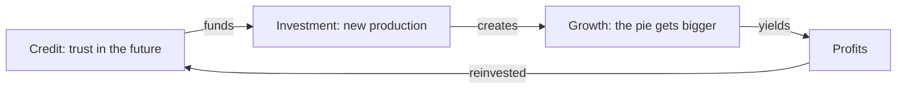

> *Source: Sapiens: A Brief History of Humankind by Yuval Noah Harari (HarperCollins, 2015), Chapter 16 "The Capitalist Creed", PDF pp. 311–338 (printed pp. unknown)*

# 16: ลัทธิทุนนิยม

## แก่นความคิด

สองบทที่แล้วแนะนำเครื่องยนต์สองตัวของยุคสมัยใหม่ วิทยาศาสตร์ที่เรียนรู้ที่จะยอมรับความไม่รู้ของตัวเอง กับจักรวรรดิที่พาอำนาจยุโรปไปทั่วโลก บทนี้ติดตั้งตัวที่สาม การยั่วยุครั้งแรกของแฮรารีคือเรื่องนี้ไม่เกี่ยวกับเงินเลย เงินมีมานานแล้ว สิ่งที่ทันสมัยคือความเชื่อเรื่องเวลา ความเชื่อว่าอนาคตจะร่ำรวยกว่าปัจจุบัน และเราสร้างวันนี้บนรายได้ที่ยังไม่ได้หามา ความเชื่อนั้น เมื่อกลายเป็นสถาบันในนาม **credit** ก็เปลี่ยนเศรษฐกิจที่นิ่งสนิทให้กลายเป็นเศรษฐกิจที่กำลังโต เหมือนวัยรุ่นที่ชุ่มฮอร์โมนทั้งตัว ("like a hormone-soused teenager")

การยั่วยุครั้งที่สองคือชื่อเรื่อง ทุนนิยมเป็น**ลัทธิ** ไม่ใช่แค่ระบบเศรษฐกิจ เริ่มจากทฤษฎีว่าด้วยการทำงานของเงิน แล้วกลายเป็นจริยศาสตร์ที่บอกคนว่าควรประพฤติตัวอย่างไร เลี้ยงลูกอย่างไร ไปจนถึงคิดอย่างไร การเติบโตทางเศรษฐกิจคือสุดยอดสิ่งดี คำกล่าวอ้างสุดอื้อฉาวของแอดัม สมิธที่ว่าความโลภเป็นเรื่องดี ความเห็นแก่ตัวคือความเอื้อเฟื้อ ได้ต่อสายศีลธรรมตะวันตกใหม่ ส่วน credit วิทยาศาสตร์ และจักรวรรดิ ต่างหมุน "วงเวทมนตร์" ("magic circles") ของกันและกันจนหลอมโลกนี้ขึ้นใหม่

ทำไมเรื่องนี้สำคัญ วิทยาศาสตร์กับจักรวรรดิของบทที่ 15 ทำงานด้วย capital ถ้าไม่มีสิ่งนี้ก็อ่านไม่รู้เรื่อง แต่ความไว้วางใจชุดเดียวกับที่ออกทุนห้องแล็บและกองเรือก็ไปออกทุนค้าทาส สงครามฝิ่น และความสยองของคองโก ฆ่าคน "ด้วยความเฉยเมยเย็นชา" ("out of cold indifference") ไม่ใช่ด้วยความเกลียด บทปิดท้ายด้วยคำถามว่าพายจะโตได้ตลอดไปหรือไม่ และโตให้ใคร เชิญชวนให้เรามองทุนนิยมเป็นศรัทธาที่เราเลือกเอง ไม่ใช่กฎธรรมชาติ

## แนวคิดหลัก

### credit กับความเชื่อในอนาคต

credit คือเงินชนิดพิเศษของยุคสมัยใหม่ เงินธรรมดาเป็นตัวแทนของสิ่งที่มีอยู่จริง credit เป็นตัวแทนของสินค้าในจินตนาการ สิ่งที่ยังไม่มีอยู่ โดยสมมติว่าทรัพยากรในอนาคตจะอุดมสมบูรณ์กว่าปัจจุบันมาก คำของแฮรารี: credit ทำให้เรา "สร้างปัจจุบันด้วยราคาของอนาคต" ("to build the present at the expense of the future") หลักค้ำประกันเดียวของ credit คือความไว้วางใจ ซึ่งเป็นเหตุผลที่ธนาคารให้กู้สิบดอลลาร์ต่อเงินหนึ่งดอลลาร์ที่ถืออยู่ได้ credit สำคัญเพราะเป็นกลไกที่ทำให้ศรัทธากลายเป็นโรงงาน และเป็นเหตุผลว่าทำไมประวัติศาสตร์เศรษฐกิจแท้จริงแล้วคือประวัติศาสตร์ของความเชื่อ

### creed ของทุนนิยม

ภาพที่ทุนนิยมกลายเป็นเมื่อโตเกินขอบเขตของเศรษฐศาสตร์ เริ่มจากทฤษฎีที่ทั้งบรรยายและสั่งการ แล้วค่อย ๆ กลายเป็นจริยศาสตร์ คำสอนว่าคนควรประพฤติอย่างไร ให้การศึกษาลูกอย่างไร และคิดอย่างไร หลักข้อสำคัญของลัทธิบอกว่าการเติบโตทางเศรษฐกิจคือสุดยอดสิ่งดี หรืออย่างน้อยเป็นตัวแทนของสิ่งนั้น เพราะความยุติธรรม เสรีภาพ และแม้แต่ความสุขล้วนขึ้นกับการเติบโต ความแตกต่างที่ก่อร่างระบบนี้ขึ้นมาและตั้งชื่อให้คือ **capital** เงินกับสินค้าที่ลงทุนในการผลิต ส่วนความมั่งคั่งเฉย ๆ ก็แค่ฝังดินหรือใช้ทิ้งไป ผู้ประกอบการที่นำกำไรกลับไปลงทุนจึงเป็นนักบุญของระบบ ส่วนฟาโรห์ที่สร้างปิรามิดหรือโจรสลัดที่ฝังเหรียญไม่ใช่ แนวคิดนี้สำคัญเพราะจัดวางทุนนิยมใหม่ให้เป็นศรัทธา สิ่งที่ต้องตรวจสอบและสงสัยเหมือนลัทธิอื่น ๆ ไม่ใช่กฎธรรมชาติที่อยู่เบื้องหลังทุกอย่าง

### ตำนานตลาดเสรีกับนรกของทุนนิยม

หลักคำสอนตลาดเสรีที่ว่าเก็บการเมืองออกไป ลดภาษีและกฎระเบียบ ปล่อยให้ตลาดเดินเอง เป็นรูปแบบที่พบมากที่สุดของลัทธินี้ในทุกวันนี้ ในรูปสุดโต่ง แฮรารีโต้แย้งว่าแนวคิดนี้ไร้เดียงสาเท่ากับความเชื่อเรื่องซานตาคลอส ไม่มีตลาดใดปลอดจากอคติทางการเมือง และความเชื่อในอนาคตต้องมีตำรวจ ศาล และคุกที่รัฐหนุนหลังคอยคุ้มครอง นรกคือตอนที่การผูกขาดและการสมคบกันเอาชนะการแข่งขัน และความโลภก็บูดเป็นทาส แนวคิดนี้พาคำตัดสินทางศีลธรรมของบทมาด้วย การเติบโตที่ไม่มีข้อพิจารณาทางจริยธรรมอื่นมาควบคุมนำไปสู่หายนะ และบาปอันเป็นเอกลักษณ์ของทุนนิยมคือความเฉยเมยเย็นชา ไม่ใช่ความเกลียด

## ถ้อยคำน่าจดจำ

> "It sounds like a giant Ponzi scheme, doesn't it? But if it's a fraud, then the entire modern economy is a fraud." (PDF p. 313)
>
> แปลว่า ฟังดูเหมือนแชร์ลูกโซ่ยักษ์ใช่ไหม แต่ถ้าเป็นการฉ้อโกง เศรษฐกิจสมัยใหม่ทั้งระบบก็คือการฉ้อโกง

> "The profits of production must be reinvested in increasing production." (PDF p. 318)
>
> แปลว่า กำไรจากการผลิตต้องนำกลับไปลงทุนเพื่อเพิ่มการผลิต

> "Capitalism has killed millions out of cold indifference coupled with greed." (PDF p. 336)
>
> แปลว่า ทุนนิยมฆ่าคนนับล้านด้วยความเฉยเมยเย็นชาประกอบกับความโลภ

## ความเชื่อมโยง

- [[Book/Sapiens_TH/05_Historys_Biggest_Fraud|05 การฉ้อโกงครั้งใหญ่ที่สุดในประวัติศาสตร์]] บทนี้ปิดท้ายด้วยความสงสัยว่าการเติบโตสมัยใหม่อาจกลายเป็น "การฉ้อโกงครั้งใหญ่" ("a colossal fraud") ในที่สุด เช่นเดียวกับเกษตรกรรม
- [[Book/Sapiens_TH/10_The_Scent_of_Money|10 กลิ่นของเงิน]] credit ขยาย imagined order ของเงินจากสิ่งในปัจจุบันไปสู่สิ่งในอนาคต ทั้งสองอย่างตั้งอยู่บนความไว้วางใจร่วมกันเท่านั้น
- [[Book/Sapiens_TH/14_The_Discovery_of_Ignorance|14 การค้นพบความไม่รู้]] ความคิดเรื่องความก้าวหน้าที่ขับเคลื่อนลัทธินี้ คือการแปลความเชื่อเรื่องการยอมรับความไม่รู้และการลงทุนในงานวิจัยออกมาเป็นเศรษฐกิจ
- [[Book/Sapiens_TH/15_The_Marriage_of_Science_and_Empire|15 การสมรสระหว่างวิทยาศาสตร์กับจักรวรรดิ]] capital ออกทุนให้เครื่องจักรวิทยาศาสตร์กับจักรวรรดิ และนักวิทยาศาสตร์เป็นคนจ่ายบิล ความอดอยากในแคว้นเบงกอลที่พูดถึงที่นั่นกลับมาในฐานะอาชญากรรมของทุนนิยม
- [[Book/Sapiens_TH/Sapiens - Overview|ภาพรวม Sapiens]] เส้นทางอ่าน แผนที่บท และทางเดินต่าง ๆ

## ข้อคิดที่ได้

โลกสมัยใหม่เดินด้วยศรัทธาครั้งใหญ่เพียงครั้งเดียว คือพรุ่งนี้พายจะใหญ่กว่าวันนี้ ส่วนศรัทธานั้นจะสร้างสวรรค์หรือพิสูจน์ตัวเองว่าเป็นการฉ้อโกงครั้งมหึมา ยังเป็นคำถามที่เปิดอยู่
