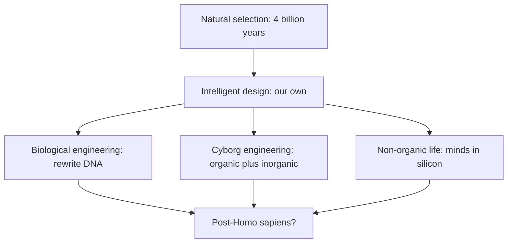

> *Source: Sapiens: A Brief History of Humankind by Yuval Noah Harari (HarperCollins, 2015), Chapter 20 "The End of Homo Sapiens", PDF pp. 402–422 (printed pp. unknown)*

# 20: จุดจบของ Homo Sapiens

## แก่นความคิด

นี่คือจุดที่แฮรารียกข้อกล่าวอ้างที่เร้าใจที่สุดของเขาขึ้นมา: Homo sapiens อย่างที่เรารู้จักอาจกำลังถึงจุดจบ ไม่ใช่เพราะหายนะหรือระบบนิเวศล่มสลาย แต่เพราะความสำเร็จทางเทคโนโลยีของเราเอง หลังจากวิวัฒนาการด้วย natural selection มา 4 พันล้านปี เรากำลังจะแทนที่วิวัฒนาการนั้นด้วย intelligent design ที่เราออกแบบเอง ในไม่ช้า พันธุวิศวกรรม เทคโนโลยี cyborg และ artificial intelligence อาจสร้างสิ่งมีชีวิตที่ต่างจากเรามากจนการเรียกสิ่งเหล่านั้นว่า "human" ก็ไม่ต่างจากการเรียกเรากับ Neanderthal ว่าเป็นสปีชีส์เดียวกัน

บทนี้ไล่เรียงเส้นทางที่เป็นไปได้สามเส้น ทางแรก biological engineering (เขียน DNA ของเราใหม่) ทางที่สอง cyborg engineering (หลอมรวมส่วน organic เข้ากับส่วน inorganic) ทางที่สาม non-organic life (สร้างจิตใจขึ้นในซิลิคอน) แต่ละเส้นทางอาจให้กำเนิดสิ่งมีชีวิตที่ร่างกายต่างกัน จิตใจต่างกัน และประสบการณ์แห่งสำนึกต่างกัน นัยที่ตามมาชวนตะลึง ถ้าเราออกแบบร่างกายและจิตใจของตัวเองได้ สิทธิมนุษยชน ประชาธิปไตย หรือความหมายของชีวิตจะเหลืออะไร liberal humanism ที่เป็นกระแสหลักของโลกสมัยใหม่ตั้งอยู่บนสมมติฐานว่ามนุษย์ทุกคนมีธรรมชาติอย่างเดียวกัน แต่ถ้าเราออกแบบธรรมชาตินั้นใหม่ได้ล่ะ

แฮรารีเลี่ยงการทำนายว่าเส้นทางไหนจะชนะหรือจะเกิดขึ้นเมื่อไหร่ ประเด็นของเขาง่ายกว่านั้น ม่านกำลังปิดลงบนยุคของ Homo sapiens และอะไรก็ตามที่ตามมาจะต้องเผชิญคำถามที่ตอนนี้เรายังนึกภาพไม่ออก สิ่งเดียวที่แน่นอนคืออนาคตไม่ได้เป็นของนักการเมืองหรือนักเศรษฐศาสตร์ แต่เป็นของวิศวกรในห้องทดลอง

## แนวคิดหลัก

### สามเส้นทางสู่ post-humanity

Biological engineering เขียน DNA ของเราใหม่เพื่อเพิ่มสติปัญญา กำจัดโรค หรือยืดอายุขัย จนเกิดการเปลี่ยนแปลงครั้งใหญ่ในไม่กี่ทศวรรษแทนที่จะใช้เวลาหลายพันปี ส่วน cyborg engineering หลอมรวมร่างกาย organic เข้ากับชิ้นส่วน inorganic ทั้งส่วนต่อประสานระหว่างสมองกับคอมพิวเตอร์ อวัยวะเทียมที่สั่งงานด้วยความคิด และเซนเซอร์ที่ขยายประสาทสัมผัสเกินขีดจำกัดทางชีววิทยา ส่วน non-organic life สร้างสิ่งมีชีวิตอัจฉริยะที่ไม่มีร่างกายชีวภาพ ถ้าสำนึกเป็นเพียงรูปแบบหนึ่งของการประมวลผลข้อมูล จิตใจก็ทำงานบนซิลิคอนได้ เส้นทางเหล่านี้อาจสร้างสิ่งมีชีวิตที่ต่างจากเรามากจนการเรียกสิ่งเหล่านั้นว่า "human" ไม่ต่างจากการเรียกเรากับ Neanderthal ว่าเป็นสปีชีส์เดียวกัน

### intelligent design กลับมา

ตลอด 4 พันล้านปี natural selection หล่อหลอมชีวิตทั้งหมดผ่านการกลายพันธุ์แบบสุ่มที่แรงกดดันจากสิ่งแวดล้อมคอยกรอง ตอนนี้เรากำลังกลายเป็นผู้ออกแบบอัจฉริยะเสียเอง พันธุวิศวกรรมคือ intelligent design ที่ทรงพลังกว่ามาก เปลี่ยนแปลงได้ตรงจุดที่ต้องการภายในไม่กี่ปีแทนที่จะใช้เวลาหลายพันปี ต่างจาก intelligent design ในศาสนา ตรงที่ไม่มีผู้สร้างเหนือธรรมชาติ มีเพียงมนุษย์กับ CRISPR และคอมพิวเตอร์ ไม่ว่าจะเรียกเป็น "intelligent design" หรือ "genetic engineering" ผลก็เหมือนกัน ชีวิตที่เกิดจากการเลือกอย่างมีสำนึก ไม่ใช่ความบังเอิญ

### โครงการ Gilgamesh

ตั้งชื่อตามกษัตริย์โบราณผู้แสวงหาความเป็นอมตะ โครงการนี้คือการค้นหาทางวิทยาศาสตร์เพื่อเอาชนะความตายด้วยการยืดอายุขัยอย่างสุดขั้ว ความตายกลายเป็นปัญหาทางเทคนิค (เซลล์เสื่อม อวัยวะล้มเหลว DNA สะสมข้อผิดพลาด) ที่มีวิธีแก้ทางเทคนิค นักวิจัยบางคนทำนายว่าภายในศตวรรษเดียวผู้คนจะมีอายุขัย 500 หรือ 1000 ปี แต่ถ้าคนมีชีวิตอยู่หลายศตวรรษ สังคมจะกลายเป็นสังคมอนุรักษ์นิยมสุดขั้วที่ปกครองโดยผู้อาวุโสอมตะหรือเปล่า โครงการนี้ท้าทายโครงสร้างทางสังคมทุกแบบที่สร้างขึ้นบนสมมติฐานว่ามนุษย์ต้องตาย

### เราอยากอยากได้อะไร

ถ้าออกแบบจิตใจได้พอ ๆ กับร่างกาย แล้วเราควรออกแบบอะไร คำถามที่ว่า "เราอยากได้อะไร" กลายเป็น "เราอยากอยากได้อะไร" และไม่มีคำตอบที่เป็นภววิสัย liberal humanism บอกให้ "ทำตามหัวใจ" แต่ถ้าเราออกแบบหัวใจใหม่ได้ เราจะทำตามอะไร การตัดสินใจที่เราทำในไม่กี่ทศวรรษข้างหน้า ว่าจะเสริมอะไร จะรักษาอะไรไว้ จะทิ้งอะไร จะกำหนดไม่เพียงอนาคตของเรา แต่อนาคตของสำนึกด้วย และเรากำลังตัดสินใจเรื่องเหล่านี้โดยไม่มีกรอบจริยธรรมที่ชัดเจน แรงตลาดกับโมเมนตัมทางเทคโนโลยีคือสิ่งที่ขับเคลื่อน มากกว่าจะเป็นการเลือกอย่างตั้งใจ

## ถ้อยคำน่าจดจำ

> "Homo sapiens is transcending those limits. It is now beginning to break the laws of natural selection, replacing them with the laws of intelligent design." (PDF p. 402)
>
> แปลว่า Homo sapiens กำลังก้าวข้ามขีดจำกัดเหล่านั้น ตอนนี้เริ่มทำลายกฎของ natural selection และแทนที่ด้วยกฎของ intelligent design

> "At present, we are still uncertain how all this will end. But it is clear that the curtain is falling on the sapiens era." (PDF p. 422)
>
> แปลว่า ตอนนี้เรายังไม่แน่ใจว่าเรื่องทั้งหมดนี้จะจบลงอย่างไร แต่ชัดเจนว่าม่านกำลังปิดลงบนยุคของ sapiens

## ความเชื่อมโยง

- [[Book/Sapiens_TH/14_The_Discovery_of_Ignorance|14 การค้นพบความไม่รู้]] Scientific Revolution ยอมรับความไม่รู้ของตัวเอง แล้วความรู้นั้นก็ทำให้เรากลายเป็นเทพ การปฏิวัติครั้งเดียวกันที่ให้ยาปฏิชีวนะและไฟฟ้าแก่เรา กำลังมอบอำนาจให้เราออกแบบตัวเองใหม่
- [[Book/Sapiens_TH/19_And_They_Lived_Happily_Ever_After|19 แล้วพวกเขาก็อยู่ด้วยกันอย่างมีความสุขตลอดไป]] ถ้าออกแบบชีวเคมีและจิตใจของตัวเองได้ คำถามเรื่องความสุขก็เปลี่ยนไปโดยสิ้นเชิง ความสุขที่ออกแบบมาจะเป็นความสุข "จริง" หรือเปล่า และเรื่องนั้นสำคัญไหม
- [[Book/Sapiens_TH/01_An_Animal_of_No_Significance|01 สัตว์ที่ไร้ความสำคัญ]] บทเปิดของหนังสือเน้นความต่อเนื่องทางชีววิทยาระหว่างเรากับสัตว์อื่น บทปิดกลับทำให้ความต่อเนื่องนั้นแตกสลาย เราอาจกลายเป็นสิ่งอื่นไปเลย ตัดห่วงโซ่ที่ย้อนกลับไปถึงเซลล์แรก
- [[Book/Sapiens_TH/Sapiens - Overview|ภาพรวม Sapiens]] หนังสือทั้งเล่มปูมาถึงจุดนี้ จากลิงไร้ความสำคัญสู่เจ้าแห่งดาวเคราะห์ สู่ผู้ที่อาจออกแบบการแทนที่ตัวเอง เรื่องเล่ากลับมาบรรจบวง แต่วงนั้นแตกไปแล้ว

## ข้อคิดที่ได้

Homo sapiens อาจไม่ได้จบลงด้วยเสียงระเบิด แต่ด้วยการเปลี่ยนแปลงเงียบ ๆ ในห้องทดลองทั่วโลก คำถามไม่ใช่ว่าจะเกิดขึ้นหรือไม่ แต่คือเราจะเลือกเป็นอะไร และเราจะเลือกอย่างรู้ตัวหรือเดินละเมอเข้าไปในอนาคตที่ตัวเองควบคุมไม่ได้
