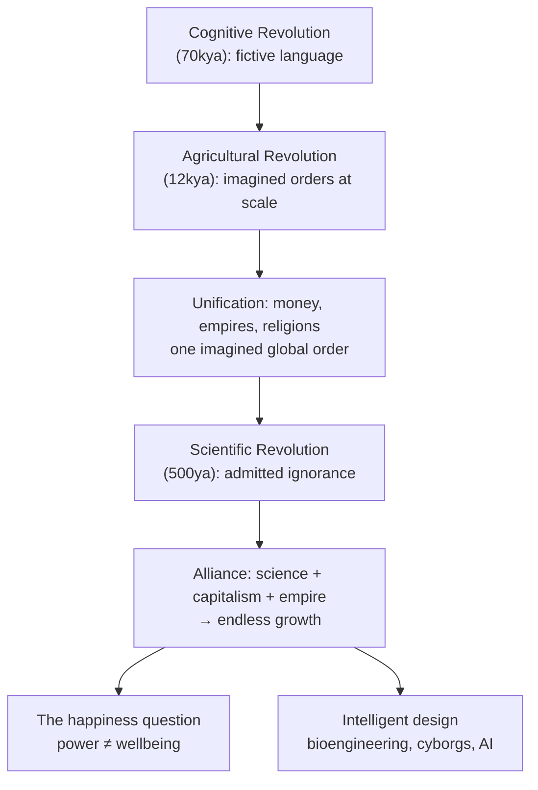

# ภาพรวม Sapiens

> **Source:** *Sapiens: A Brief History of Humankind* by Yuval Noah Harari (HarperCollins, 2015; PDFDrive/calibre e-book conversion, 439 PDF pages)

## นี่คืออะไร

คลังโน้ตนี้สรุป **Sapiens: A Brief History of Humankind** งานประวัติศาสตร์แนว big history ของยูวัล โนอาห์ แฮรารี ว่าลิงแอฟริกันที่ไร้ความสำคัญตัวหนึ่งกลายเป็นพลังครอบงำดาวเคราะห์ได้อย่างไร และเรื่องนั้นบอกอะไรเกี่ยวกับทิศทางที่เรากำลังไป

หนังสือเล่มนี้ไม่ใช่ตำราประวัติศาสตร์แบบเดิม แต่เป็นสายของข้อโต้แย้งที่เร้าใจ บทละข้อ มัดไว้ด้วยแกนเดียว **ประวัติศาสตร์ขับเคลื่อนด้วยความสามารถอันเป็นเอกลักษณ์ของเราในการสร้างและเชื่อเรื่องแต่งที่ใช้ร่วมกัน** นั่นคือ imagined order อย่างเทพเจ้า ชาติ เงิน บริษัท และสิทธิมนุษยชน การปฏิวัติสามครั้งเป็นเครื่องยนต์ของโครงเรื่อง: **Cognitive Revolution** (ราว 70,000 ปีก่อน) ให้ภาษาสำหรับเรื่องแต่งแก่เรา **Agricultural Revolution** (ราว 12,000 ปีก่อน) ทำให้เราทวีจำนวนโดยมีทุกข์ของปัจเจกเป็นราคา **Scientific Revolution** (ราว 500 ปีก่อน) ยอมรับความไม่รู้ พอจับมือกับทุนนิยมและจักรวรรดิ ก็ปล่อยการเติบโตไม่สิ้นสุดออกมา คำตัดสินของแฮรารีระหว่างทางคือ อำนาจส่วนรวมกับความสุขของปัจเจกมักวิ่งสวนทางกัน สปีชีส์ที่กลายเป็น "เทพ" ก็ยังไม่รู้ว่าตัวเองอยากได้อะไร

โน้ตบททั้ง 20 ข้างล่างจับแก่นความคิด โครงสร้างข้อโต้แย้ง แนวคิด และถ้อยคำน่าจดจำของแต่ละบท แหล่งอ้างอิงใช้ **เลขหน้า PDF** (ไฟล์แปลงนี้ไม่มีเลขหน้าพิมพ์ เลขหน้าพิมพ์จึงไม่ทราบ)

## แผนที่บท

### ภาคที่หนึ่ง Cognitive Revolution (PDF pp. 10–82)

| โน้ต | ข้อโต้แย้งในหนึ่งบรรทัด | แหล่งอ้างอิง |
|---|---|---|
| [[Book/Sapiens_TH/01_An_Animal_of_No_Significance\|01 สัตว์ที่ไร้ความสำคัญ]] | เมื่อราว 70,000 ปีก่อน มนุษย์ยังเป็นสัตว์ชายขอบ สกุล *Homo* เคยมีสปีชีส์พี่น้องมากมาย | บทที่ 1, PDF pp. 11–26 |
| [[Book/Sapiens_TH/02_The_Tree_of_Knowledge\|02 ต้นไม้แห่งความรู้]] | Cognitive Revolution: fictive language ทำให้ Sapiens ร่วมมือกันเป็นกลุ่มใหญ่ที่ยืดหยุ่นได้ | บทที่ 2, PDF pp. 27–47 |
| [[Book/Sapiens_TH/03_A_Day_in_the_Life_of_Adam_and_Eve\|03 หนึ่งวันในชีวิตของอาดัมกับอีฟ]] | ชีวิตนักล่าเก็บของในฐานะ "original affluent society" และต้นตอของความไม่เข้ากันในร่างกายเรา | บทที่ 3, PDF pp. 48–70 |
| [[Book/Sapiens_TH/04_The_Flood\|04 น้ำท่วม]] | ชัยชนะครั้งแรกของ Sapiens: การสูญพันธุ์ของสัตว์ใหญ่ที่มาพร้อมการแผ่ขยายไปทั่วโลก | บทที่ 4, PDF pp. 71–82 |

### ภาคที่สอง Agricultural Revolution (PDF pp. 83–167)

| โน้ต | ข้อโต้แย้งในหนึ่งบรรทัด | แหล่งอ้างอิง |
|---|---|---|
| [[Book/Sapiens_TH/05_Historys_Biggest_Fraud\|05 การฉ้อโกงครั้งใหญ่ที่สุดในประวัติศาสตร์]] | เกษตรกรรมคือ luxury trap ที่ทำให้เราเชื่องลง เป็นการฉ้อโกงครั้งใหญ่ที่สุดในประวัติศาสตร์ | บทที่ 5, PDF pp. 84–104 |
| [[Book/Sapiens_TH/06_Building_Pyramids\|06 สร้างปิรามิด]] | สังคมขนาดใหญ่ทำงานบน imagined order ส่วนชนชั้นสูงก็อยู่ในเรื่องแต่งชุดเดียวกับชาวนา | บทที่ 6, PDF pp. 105–126 |
| [[Book/Sapiens_TH/07_Memory_Overload\|07 ความจำล้นเกิน]] | มนุษย์คิดค้นการเขียนและคณิตศาสตร์เพื่อเก็บสิ่งที่สมองเก็บไม่ได้ นั่นคือฐานข้อมูลชุดแรก | บทที่ 7, PDF pp. 127–140 |
| [[Book/Sapiens_TH/08_There_Is_No_Justice_in_History\|08 ไม่มีความยุติธรรมในประวัติศาสตร์]] | imagined order ไม่ได้เป็นกลาง แต่เข้ารหัสลำดับชั้น (เพศ เชื้อชาติ ชนชั้น) ว่าเป็นเรื่อง "ธรรมชาติ" | บทที่ 8, PDF pp. 141–167 |

### ภาคที่สาม The Unification of Humankind (PDF pp. 168–251)

| โน้ต | ข้อโต้แย้งในหนึ่งบรรทัด | แหล่งอ้างอิง |
|---|---|---|
| [[Book/Sapiens_TH/09_The_Arrow_of_History\|09 ลูกศรของประวัติศาสตร์]] | ประวัติศาสตร์เคลื่อนไปสู่ความเป็นหนึ่ง วัฒนธรรมเปลี่ยนผ่านความขัดแย้งภายใน | บทที่ 9, PDF pp. 169–178 |
| [[Book/Sapiens_TH/10_The_Scent_of_Money\|10 กลิ่นของเงิน]] | เงินคือเรื่องเล่าที่ประสบความสำเร็จที่สุดเท่าที่เคยมี ใครก็แลกเปลี่ยนได้เพราะต่างไว้ใจกัน | บทที่ 10, PDF pp. 179–194 |
| [[Book/Sapiens_TH/11_Imperial_Visions\|11 ภาพฝันของจักรวรรดิ]] | จักรวรรดิแพร่กระจายทั้งระเบียบการเมืองและวัฒนธรรมไปพร้อมกัน ทั้งด้านดีและด้านร้าย | บทที่ 11, PDF pp. 195–215 |
| [[Book/Sapiens_TH/12_The_Law_of_Religion\|12 กฎของศาสนา]] | ศาสนาให้กฎสากลและระเบียบเหนือมนุษย์ ตั้งแต่ animism ไปจนถึง monotheism | บทที่ 12, PDF pp. 216–243 |
| [[Book/Sapiens_TH/13_The_Secret_of_Success\|13 ความลับของความสำเร็จ]] | ประวัติศาสตร์วุ่นวายและไม่มีกำหนดตายตัว อย่าสับสนการมองย้อนหลังกับความหลีกเลี่ยงไม่ได้ | บทที่ 13, PDF pp. 244–251 |

### ภาคที่สี่ Scientific Revolution (PDF pp. 252–419)

| โน้ต | ข้อโต้แย้งในหนึ่งบรรทัด | แหล่งอ้างอิง |
|---|---|---|
| [[Book/Sapiens_TH/14_The_Discovery_of_Ignorance\|14 การค้นพบความไม่รู้]] | ความก้าวหน้าครั้งใหญ่ของวิทยาศาสตร์: การยอมรับความไม่รู้และสร้างต่อจาก "ฉันไม่รู้" | บทที่ 14, PDF pp. 253–280 |
| [[Book/Sapiens_TH/15_The_Marriage_of_Science_and_Empire\|15 การสมรสระหว่างวิทยาศาสตร์กับจักรวรรดิ]] | จักรวรรดิยุโรปออกเงินสนับสนุนการค้นพบ แล้ววิทยาศาสตร์ก็ตอบแทนด้วยการยึดครอง | บทที่ 15, PDF pp. 281–310 |
| [[Book/Sapiens_TH/16_The_Capitalist_Creed\|16 ลัทธิทุนนิยม]] | ทุนนิยมคือลัทธิแห่งการเติบโตในอนาคต เครดิตคือศรัทธาในวันพรุ่งนี้ | บทที่ 16, PDF pp. 311–338 |
| [[Book/Sapiens_TH/17_The_Wheels_of_Industry\|17 ล้อแห่งอุตสาหกรรม]] | Industrial Revolution บวกพลังงาน บวกทุนนิยม ก่อให้เกิดการเติบโตไม่สิ้นสุด พร้อมเหยื่อที่ตามมา | บทที่ 17, PDF pp. 339–354 |
| [[Book/Sapiens_TH/18_A_Permanent_Revolution\|18 การปฏิวัติที่ไม่หยุดนิ่ง]] | ข้อตกลงของ modernity: ยอมสละความหมายเพื่อแลกกับอำนาจ และการถอนมนตร์ที่ตามมา | บทที่ 18, PDF pp. 355–380 |
| [[Book/Sapiens_TH/19_And_They_Lived_Happily_Ever_After\|19 แล้วพวกเขาก็อยู่ด้วยกันอย่างมีความสุขตลอดไป]] | คำถามเรื่องความสุข: จริง ๆ แล้วเราอยู่ดีกว่าบรรพบุรุษหรือเปล่า | บทที่ 19, PDF pp. 381–401 |
| [[Book/Sapiens_TH/20_The_End_of_Homo_Sapiens\|20 จุดจบของ Homo Sapiens]] | พรมแดนถัดไป: intelligent design, bioengineering, cyborgs และ non-organic life | บทที่ 20, PDF pp. 402–419 |

**Afterword** สั้น ๆ (PDF pp. 420–421) ย้อนสรุปข้อโต้แย้งทั้งเล่ม มนุษย์กลายเป็นเทพ แต่เป็นเทพที่ไร้ความรับผิดชอบ ไม่พอใจ และไม่รู้ว่าตัวเองอยากได้อะไร เนื้อหาส่วนนี้รวมอยู่ในแนวคิดหลักของภาพรวมนี้

## ข้อโต้แย้งทั้งเล่มประกอบกันอย่างไร

## เส้นทางอ่าน

| เป้าหมาย | เริ่มตรงนี้ |
|---|---|
| **เรื่องทั้งหมด (ตามลำดับหนังสือ)** | [[Book/Sapiens_TH/01_An_Animal_of_No_Significance\|01 สัตว์ที่ไร้ความสำคัญ]] → … → [[Book/Sapiens_TH/20_The_End_of_Homo_Sapiens\|20 จุดจบของ Homo Sapiens]] |
| **ทัวร์เร็ว ๆ ของข้อโต้แย้งหลัก (5 โน้ต)** | [[Book/Sapiens_TH/02_The_Tree_of_Knowledge\|02 ต้นไม้แห่งความรู้]] → [[Book/Sapiens_TH/05_Historys_Biggest_Fraud\|05 การฉ้อโกงครั้งใหญ่ที่สุดในประวัติศาสตร์]] → [[Book/Sapiens_TH/10_The_Scent_of_Money\|10 กลิ่นของเงิน]] → [[Book/Sapiens_TH/16_The_Capitalist_Creed\|16 ลัทธิทุนนิยม]] → [[Book/Sapiens_TH/20_The_End_of_Homo_Sapiens\|20 จุดจบของ Homo Sapiens]] |
| **ทำไมเราเชื่ออย่างที่เชื่อ** | [[Book/Sapiens_TH/02_The_Tree_of_Knowledge\|02 ต้นไม้แห่งความรู้]] → [[Book/Sapiens_TH/06_Building_Pyramids\|06 สร้างปิรามิด]] → [[Book/Sapiens_TH/09_The_Arrow_of_History\|09 ลูกศรของประวัติศาสตร์]] → [[Book/Sapiens_TH/12_The_Law_of_Religion\|12 กฎของศาสนา]] |
| **มุมเศรษฐกิจและการเติบโต** | [[Book/Sapiens_TH/10_The_Scent_of_Money\|10 กลิ่นของเงิน]] → [[Book/Sapiens_TH/16_The_Capitalist_Creed\|16 ลัทธิทุนนิยม]] → [[Book/Sapiens_TH/17_The_Wheels_of_Industry\|17 ล้อแห่งอุตสาหกรรม]] |
| **มุมอำนาจ จักรวรรดิ และการเมือง** | [[Book/Sapiens_TH/11_Imperial_Visions\|11 ภาพฝันของจักรวรรดิ]] → [[Book/Sapiens_TH/13_The_Secret_of_Success\|13 ความลับของความสำเร็จ]] → [[Book/Sapiens_TH/15_The_Marriage_of_Science_and_Empire\|15 การสมรสระหว่างวิทยาศาสตร์กับจักรวรรดิ]] → [[Book/Sapiens_TH/18_A_Permanent_Revolution\|18 การปฏิวัติที่ไม่หยุดนิ่ง]] |
| **มุมความสุขและความหมาย** | [[Book/Sapiens_TH/03_A_Day_in_the_Life_of_Adam_and_Eve\|03 หนึ่งวันในชีวิตของอาดัมกับอีฟ]] → [[Book/Sapiens_TH/08_There_Is_No_Justice_in_History\|08 ไม่มีความยุติธรรมในประวัติศาสตร์]] → [[Book/Sapiens_TH/19_And_They_Lived_Happily_Ever_After\|19 แล้วพวกเขาก็อยู่ด้วยกันอย่างมีความสุขตลอดไป]] |
| **ธรรมชาติมนุษย์และชีววิทยา** | [[Book/Sapiens_TH/01_An_Animal_of_No_Significance\|01 สัตว์ที่ไร้ความสำคัญ]] → [[Book/Sapiens_TH/03_A_Day_in_the_Life_of_Adam_and_Eve\|03 หนึ่งวันในชีวิตของอาดัมกับอีฟ]] → [[Book/Sapiens_TH/04_The_Flood\|04 น้ำท่วม]] |
| **อนาคต AI และ biotech** | [[Book/Sapiens_TH/20_The_End_of_Homo_Sapiens\|20 จุดจบของ Homo Sapiens]] + [[Book/Sapiens_TH/14_The_Discovery_of_Ignorance\|14 การค้นพบความไม่รู้]] |

## แนวคิดหลัก

1. **ประวัติศาสตร์เริ่มต้นด้วยเรื่องแต่ง** ราว 70,000 ปีก่อน Sapiens ได้ภาษาที่พูดถึงสิ่งที่ไม่มีอยู่จริง ทำให้เกิดความร่วมมือที่ยืดหยุ่นและกว้างขวางในหมู่คนแปลกหน้า ([[Book/Sapiens_TH/02_The_Tree_of_Knowledge|02 ต้นไม้แห่งความรู้]])
2. **imagined order ขับเคลื่อนทุกสังคมขนาดใหญ่** กฎหมาย ชาติ เงิน บริษัท และสิทธิมนุษยชนมีอยู่เพียงในจินตนาการร่วมของเรา แต่ก็กำหนดรูปร่างความเป็นจริง ([[Book/Sapiens_TH/06_Building_Pyramids|06 สร้างปิรามิด]])
3. **Agricultural Revolution คือกับดัก** ทวีอำนาจส่วนรวมแต่มักทำให้ชีวิตของปัจเจกแย่ลง นั่นคือ luxury trap ที่ล็อกเราไว้กับเกษตรกรรม ([[Book/Sapiens_TH/05_Historys_Biggest_Fraud|05 การฉ้อโกงครั้งใหญ่ที่สุดในประวัติศาสตร์]])
4. **ประวัติศาสตร์รวมโลกเป็นหนึ่งผ่านสามพาหนะ: เงิน จักรวรรดิ และศาสนา** แต่ละอย่างเป็น imagined order ที่คนแปลกหน้าแบ่งกันได้ ([[Book/Sapiens_TH/10_The_Scent_of_Money|10 กลิ่นของเงิน]], [[Book/Sapiens_TH/11_Imperial_Visions|11 ภาพฝันของจักรวรรดิ]], [[Book/Sapiens_TH/12_The_Law_of_Religion|12 กฎของศาสนา]])
5. **ประวัติศาสตร์ไม่มีทิศทางและไม่มีการรับประกัน** ความวุ่นวายและเหตุบังเอิญครองเวที คำอธิบาย "ความสำเร็จ" ที่สร้างย้อนหลังล้วนเป็น myth ([[Book/Sapiens_TH/13_The_Secret_of_Success|13 ความลับของความสำเร็จ]])
6. **Scientific Revolution ตั้งอยู่บนความไม่รู้ที่ยอมรับ** วิทยาศาสตร์สมัยใหม่ต่างจากทุกประเพณีก่อนหน้า ตรงที่ให้ค่ากับ "ฉันไม่รู้" และเปลี่ยนคำนั้นให้เป็นโครงการวิจัย ([[Book/Sapiens_TH/14_The_Discovery_of_Ignorance|14 การค้นพบความไม่รู้]])
7. **วิทยาศาสตร์สมรสกับจักรวรรดิและทุนนิยม** แต่ละฝ่ายออกเงินให้กันและกัน ผลลัพธ์คือการยึดครองโลกของยุโรปและเศรษฐกิจเติบโตแบบสมัยใหม่ ([[Book/Sapiens_TH/15_The_Marriage_of_Science_and_Empire|15 การสมรสระหว่างวิทยาศาสตร์กับจักรวรรดิ]], [[Book/Sapiens_TH/16_The_Capitalist_Creed|16 ลัทธิทุนนิยม]])
8. **อำนาจที่มากขึ้นไม่ได้แปลว่าความสุขมากขึ้น** ความสามารถส่วนรวมกับความเป็นอยู่ของปัจเจกวิ่งสวนทางกันซ้ำแล้วซ้ำอีก ([[Book/Sapiens_TH/19_And_They_Lived_Happily_Ever_After|19 แล้วพวกเขาก็อยู่ด้วยกันอย่างมีความสุขตลอดไป]])
9. **ตอนนี้เราเป็นเทพ และไม่รู้ว่าตัวเองอยากได้อะไร** ประวัติศาสตร์บทต่อไปอาจเป็น intelligent design: ชีวิตที่ผ่าน bioengineering, cyborg หรือ non-organic life ([[Book/Sapiens_TH/20_The_End_of_Homo_Sapiens|20 จุดจบของ Homo Sapiens]])

## ที่เกี่ยวข้อง

- *Homo Deus* (ภาคต่อของแฮรารี) วาระของศตวรรษที่ 21 เรื่องความเป็นอมตะ ความสุขสุดขีด และความเป็นเทพ ยังไม่มีในคลังโน้ตนี้
- โน้ตกลุ่มวิทยาศาสตร์และ big-history ในคลังโน้ตที่กว้างกว่า กรอบจักรวาลแบบเป็นชั้น (ฟิสิกส์ → เคมี → ชีววิทยา → ประวัติศาสตร์)
- คลังโน้ตเศรษฐกิจและการเงิน สำหรับเสียงสะท้อนสมัยใหม่ของบทว่าด้วยทุนนิยม

---

*คลังโน้ตนี้สร้างจาก Sapiens: A Brief History of Humankind (HarperCollins, 2015) มีโน้ตบท 20 บทบวกภาพรวมนี้ อ้างอิงเลขหน้า PDF เลขหน้าพิมพ์ไม่มีในไฟล์แปลงต้นทาง (ไม่ทราบ)*
