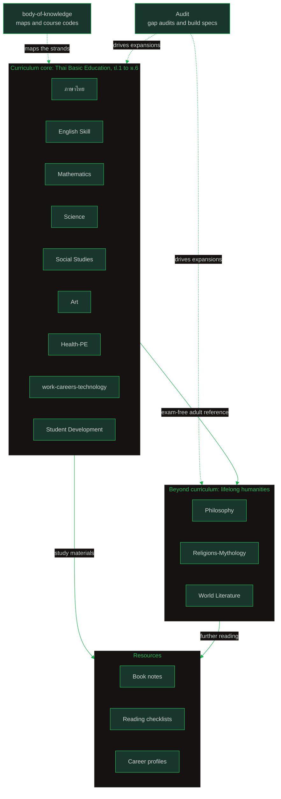

# Oralita General Knowledge

My second brain for everything outside software engineering, kept public and synced between my laptop and tablet.

The core is the **Thai Basic Education Curriculum, ป.1 through ม.6**: 8 learning areas plus Learner Development Activities, following the Basic Education Core Curriculum B.E. 2551 (2008), revised 2560 (2017). Around that core sit a beyond-curriculum humanities layer (philosophy, world religions, world literature), book notes, career profiles, and reading checklists.

**~750 notes across 17 folders.** Curriculum tracks follow the official strands (สาระการเรียนรู้); standalone tracks each start at a `00_overview`.

---

## Vault Map

### Curriculum core (ป.1–ม.6)

| Folder | What lives there | Notes |
|---|---|---:|
| [ภาษาไทย/](https://github.com/oat431/general-knowledge/tree/main/%E0%B8%A0%E0%B8%B2%E0%B8%A9%E0%B8%B2%E0%B9%84%E0%B8%97%E0%B8%A2) | Thai Language: 5 learning strands, reading to literature | 99 |
| [English Skill/](https://github.com/oat431/general-knowledge/tree/main/English%20Skill) | English: 4 strands + a teaching-ordered grammar/skills guide (01 to 19) | 90 |
| [Science/](https://github.com/oat431/general-knowledge/tree/main/Science) | Fundamental + Physics, Chemistry, Biology, Earth Science, Computer Science, with cheat sheets | 114 |
| [Mathematics/](https://github.com/oat431/general-knowledge/tree/main/Mathematics) | Fundamental (ป.1–ม.3) + Advanced Sci-Math (ม.4–ม.6), with cheat sheets | 51 |
| [Social Studies/](https://github.com/oat431/general-knowledge/tree/main/Social%20Studies) | 5 strands: Religion, Civics, Economics, History, Geography | 68 |
| [work-careers-technology/](https://github.com/oat431/general-knowledge/tree/main/work-careers-technology) | 5 strands: Home Economics, Agriculture, Crafts & Industry, Career Education, Technology | 27 |
| [Art/](https://github.com/oat431/general-knowledge/tree/main/Art) | 3 domains: Visual Arts, Music, Performing Arts | 22 |
| [Health-PE/](https://github.com/oat431/general-knowledge/tree/main/Health-PE) | 2 strands: Health Education, Physical Education | 16 |
| [Student Development/](https://github.com/oat431/general-knowledge/tree/main/Student%20Development) | Learner Development Activities: Guidance, Student Activities, Social & Public Benefit | 15 |

### Beyond curriculum, books, careers

| Folder | What lives there | Notes |
|---|---|---:|
| [Philosophy/](https://github.com/oat431/general-knowledge/tree/main/Philosophy) | 22-topic track, Pre-Socratics to modern | 23 |
| [Religions-Mythology/](https://github.com/oat431/general-knowledge/tree/main/Religions-Mythology) | World religions and mythology track | 21 |
| [World Literature/](https://github.com/oat431/general-knowledge/tree/main/World%20Literature) | 22-topic track, ancient epics to the modern novel | 23 |
| [Book/](https://github.com/oat431/general-knowledge/tree/main/Book) | Book notes: *Sapiens* in English and Thai | 42 |
| [checklist/](https://github.com/oat431/general-knowledge/tree/main/checklist) | Book checklists per subject with priority tiers | 10 |
| [career/](https://github.com/oat431/general-knowledge/tree/main/career) | 8 career profiles: engineer, teacher, nurse, lawyer, accountant, psychologist, agriculture, 3D animator | 68 |

### Meta

| Folder | What lives there | Notes |
|---|---|---:|
| [body-of-knowledge/](https://github.com/oat431/general-knowledge/tree/main/body-of-knowledge) | Curriculum BOK maps: per-area overviews with strands and course codes | 60 |
| [Audit/](https://github.com/oat431/general-knowledge/tree/main/Audit) | Gap audits and build specs that drive expansions | 5 |

## How the Layers Relate

- **Curriculum core** follows the national Basic Education Core Curriculum: 8 learning areas plus Learner Development Activities.
- **Beyond curriculum** is the exam-free adult layer, roughly 62 topics across philosophy, world literature, and world religions.
- **Resources** turn knowledge into reading plans and career decisions.
- **body-of-knowledge** maps the curriculum (strands, course codes); **Audit** records what is missing and what gets built next.

---

## The Sub-vaults in Detail

### Curriculum core

Entry map: [Body of Knowledge: Overview](https://github.com/oat431/general-knowledge/blob/main/body-of-knowledge/Body%20of%20Knowledge%20-%20Overview.md) (strands, concept-area counts, and course codes ค111–ค303, ว111–ว341).

- **[ภาษาไทย/](https://github.com/oat431/general-knowledge/tree/main/%E0%B8%A0%E0%B8%B2%E0%B8%A9%E0%B8%B2%E0%B9%84%E0%B8%97%E0%B8%A2)** ([ภาพรวม](https://github.com/oat431/general-knowledge/blob/main/%E0%B8%A0%E0%B8%B2%E0%B8%A9%E0%B8%B2%E0%B9%84%E0%B8%97%E0%B8%A2/00_%E0%B8%A0%E0%B8%B2%E0%B8%9E%E0%B8%A3%E0%B8%A7%E0%B8%A1.md)): 5 strands, การอ่าน, การเขียน, การฟัง การดู และการพูด, หลักการใช้ภาษาไทย, วรรณคดีและวรรณกรรม, about 75 concept areas.
- **[English Skill/](https://github.com/oat431/general-knowledge/tree/main/English%20Skill)** ([English Skill Content](https://github.com/oat431/general-knowledge/blob/main/English%20Skill/English%20Skill%20Content.md)): a practical guide for teaching English to Thai adults who rarely speak it. Numbered in teaching order: 01–08 grammar foundation, 09–14 TOEFL/IELTS prep, 15 TOEIC, 16–19 the national 4-strand curriculum (OBEC standards).
- **[Science/](https://github.com/oat431/general-knowledge/tree/main/Science)** ([Cheat Sheet Index](https://github.com/oat431/general-knowledge/blob/main/Science/Cheat_Sheet/00_Index.md)): fundamental science (ป.1–ม.3) then the 5 specialized tracks of ม.4–ม.6: Physics, Chemistry, Biology, Earth Science, Computer Science.
- **[Mathematics/](https://github.com/oat431/general-knowledge/tree/main/Mathematics)** ([Cheat Sheet Index](https://github.com/oat431/general-knowledge/blob/main/Mathematics/Cheat_Sheet/00_Index.md)): fundamental mathematics (ป.1–ม.3) then advanced Sci-Math (ม.4–ม.6).
- **[Social Studies/](https://github.com/oat431/general-knowledge/tree/main/Social%20Studies)**: Religion/Morality/Ethics, Civics, Economics (including sufficiency economy), History, Geography: about 94 concept areas.
- **[work-careers-technology/](https://github.com/oat431/general-knowledge/tree/main/work-careers-technology)**, **[Art/](https://github.com/oat431/general-knowledge/tree/main/Art)**, **[Health-PE/](https://github.com/oat431/general-knowledge/tree/main/Health-PE)**: one `00_overview` per strand, ป.1 through ม.6.
- **[Student Development/](https://github.com/oat431/general-knowledge/tree/main/Student%20Development)**: the required non-academic component: Guidance and Counseling, Student Activities (Scouts/Girl Guides), Social and Public Benefit.

### Beyond-curriculum general knowledge

Entry notes: [Philosophy](https://github.com/oat431/general-knowledge/blob/main/Philosophy/00_overview.md) · [Religions-Mythology](https://github.com/oat431/general-knowledge/blob/main/Religions-Mythology/00_overview.md) · [World Literature](https://github.com/oat431/general-knowledge/blob/main/World%20Literature/00_overview.md)

Roughly 62 topics for adult, exam-free lifelong reference (per the 2026-09-05 build spec): philosophy from the Pre-Socratics onward, world religions and mythology, and world literature from ancient epics to the modern novel. Each track is numbered `01_` upward and starts at its `00_overview`.

### Book notes and checklists

- **[Book/](https://github.com/oat431/general-knowledge/tree/main/Book)**: chapter-level notes on *Sapiens* by Yuval Noah Harari, in [English](https://github.com/oat431/general-knowledge/blob/main/Book/Sapiens/Sapiens%20-%20Overview.md) and [Thai](https://github.com/oat431/general-knowledge/blob/main/Book/Sapiens_TH/Sapiens%20-%20Overview.md).
- **[checklist/](https://github.com/oat431/general-knowledge/tree/main/checklist)** ([Book Checklist: Overview](https://github.com/oat431/general-knowledge/blob/main/checklist/Book%20Checklist%20-%20Overview.md)): curated textbook and study-guide lists per subject, with priority tiers: 🔴 Essential, 🟡 Recommended, 🟢 Optional. Start at 🔴, summarize into vault notes as you go.

### career

Eight career profiles, each with its own Overview note (for example [Engineer](https://github.com/oat431/general-knowledge/tree/main/career)): 3D animator, accountant, agriculture, engineer, lawyer, nurse, psychologist, teacher.

### Meta: body-of-knowledge and Audit

- **[body-of-knowledge/](https://github.com/oat431/general-knowledge/tree/main/body-of-knowledge)**: one Overview per learning area plus the umbrella [Body of Knowledge: Overview](https://github.com/oat431/general-knowledge/blob/main/body-of-knowledge/Body%20of%20Knowledge%20-%20Overview.md). These map the curriculum at a glance: strands, concept counts, course codes, and which vault folder holds the notes.
- **[Audit/](https://github.com/oat431/general-knowledge/tree/main/Audit)**: gap audits and build specs (for example the 2026-09-05 more-topic proposal that produced the philosophy and literature tracks). This folder is the vault's changelog of intent.

---

## How to Use This Vault

- **Following the curriculum:** start at [Body of Knowledge: Overview](https://github.com/oat431/general-knowledge/blob/main/body-of-knowledge/Body%20of%20Knowledge%20-%20Overview.md), pick a learning area, read its Overview, then the strand notes.
- **Teaching English to Thai adults:** open [English Skill Content](https://github.com/oat431/general-knowledge/blob/main/English%20Skill/English%20Skill%20Content.md) at 01 and work forward in order.
- **Self-study math or science:** the [Math](https://github.com/oat431/general-knowledge/blob/main/Mathematics/Cheat_Sheet/00_Index.md) and [Science](https://github.com/oat431/general-knowledge/blob/main/Science/Cheat_Sheet/00_Index.md) cheat-sheet indexes point to the fastest path through each topic.
- **Reading *Sapiens*:** chapter notes in [English](https://github.com/oat431/general-knowledge/blob/main/Book/Sapiens/Sapiens%20-%20Overview.md) or [Thai](https://github.com/oat431/general-knowledge/blob/main/Book/Sapiens_TH/Sapiens%20-%20Overview.md).
- **Choosing textbooks:** [Book Checklist: Overview](https://github.com/oat431/general-knowledge/blob/main/checklist/Book%20Checklist%20-%20Overview.md), essential tier first.
- **Exploring a career:** the matching folder under [career/](https://github.com/oat431/general-knowledge/tree/main/career), starting at its Overview.
- **Lifelong humanities reading:** [Philosophy](https://github.com/oat431/general-knowledge/blob/main/Philosophy/00_overview.md), [Religions-Mythology](https://github.com/oat431/general-knowledge/blob/main/Religions-Mythology/00_overview.md), [World Literature](https://github.com/oat431/general-knowledge/blob/main/World%20Literature/00_overview.md), in any order.

## Conventions

- Curriculum folders follow the official learning strands (สาระการเรียนรู้); standalone tracks are numbered topic notes starting at `00_overview`.
- Notes carry YAML frontmatter (tags, source, created, status) and wikilinks for cross-references.
- Thai and English mix by subject: curriculum notes keep Thai terms (สาระ, ป.1–ม.6) with English explanations; the Thai-language tracks are written in Thai.
- En-dashes mark ranges (ป.1–ม.6, Ch 12–13); em-dashes are not used in prose.

## Sources

Basic Education Core Curriculum B.E. 2551 (2008), revised 2560 (2017), OBEC/IPST · IPST textbooks ([ipst.ac.th](https://www.ipst.ac.th)) · *Sapiens* by Yuval Noah Harari · Build specs and audits in [Audit/](https://github.com/oat431/general-knowledge/tree/main/Audit).

## License

Released into the public domain under [The Unlicense](https://github.com/oat431/general-knowledge/blob/main/LICENSE).

---

nice to mee ya 🖖
