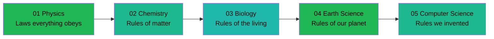

---
tags:
  - science
  - cheatsheet
  - index
level: "Rules of the World"
sources: ["[[../Advance/Physics/01_Measurement_and_Scientific_Method|Advance notes]]", "[[../Advance/Biology/08_Evolution|Biology notes]]", "[[../Advance/Chemistry/01_Atomic_Structure|Chemistry notes]]"]
created: 2026-10-07
---

# Science Cheat Sheet — Index: Rules of the World

> *"The universe doesn't negotiate. These are the rules it runs on — and the ones we invented to run alongside it."*

This folder distills the full Science note collection (`Fundamental/` + `Advance/`) into **5 rulebooks**, one per layer of reality. Unlike a formula list, each rule comes with its **WHY**: not just *what* the world does, but why it *must* do it that way.

Read them in chain order: each rulebook links to the previous and next one.

---

## The Chain: Layers of the World

| # | Rulebook | The Layer | Covers |
|---|---|---|---|
| 01 | [[01_Physics_Motion_and_Energy]] | **Layer 1: the laws everything must obey** | Motion, forces, energy & momentum, rotation & fluids, heat & thermodynamics, waves & light, electricity & magnetism, modern physics |
| 02 | [[02_Chemistry_Matter_and_Reactions]] | **Layer 2: the rules of matter's behavior** | Atoms, bonding, the mole & reactions, energy & speed, equilibrium, electrochemistry, organic, nuclear |
| 03 | [[03_Biology_Life_and_Evolution]] | **Layer 3: the rules of the living** | Cells, energy of life, DNA & information, genetics, evolution, body systems, ecology |
| 04 | [[04_Earth_Science_Systems_and_Cycles]] | **Layer 4: the rules of our planet** | Rock cycle, plate tectonics, surface processes, deep time, atmosphere, hydrosphere, space, climate |
| 05 | [[05_Computer_Science_Logic_and_Information]] | **Layer 5: the rules we invented** | Computational thinking, information, logic, programming, algorithms, data structures, networks, databases, AI, security |
| 06 | [[06_Roadmap]] | **Meta: the map of all layers** | How the five layers unlock each other, from quarks to computation |

---

## How the Layers Stack

Each layer is built ON the one below it:

- **Chemistry** is physics applied to atoms: electromagnetic force + quantum rules decide how elements bond.
- **Biology** is chemistry that learned to copy itself: molecular reactions organized into self-replicating cells.
- **Earth Science** is physics, chemistry, and biology running on one planet for 4.6 billion years.
- **Computer Science** is the layer humans built out of logic and electrons: the first layer that *we* authored.

> 💡 **Deeper why:** This stack is real, not just pedagogical. Every biological process is a chemical process; every chemical process is an electromagnetic interaction between electrons; every one of those obeys quantum mechanics. The "rules of the world" are one rulebook, written at five resolutions.

---

## How to Use These Cheat Sheets

1. **Start at 01** to read reality from the bottom up; jump anywhere if you need one rule.
2. Each rule has 4 parts: **The Rule** (formula/principle with Thai term), **WHY** (why the world must work this way), **Example** (one short worked case), ***When to use*** (exam hint).
3. Look for `> 💡 Deeper why:` callouts — first-principles asides beyond the ม.4–ม.6 curriculum. Skippable, but they're where the real understanding lives.
4. Full explanations, grade-band breakdowns, and practice live in the source notes under `Fundamental/` and `Advance/`: each rulebook links back via its `sources` frontmatter.
5. Thai rule names appear in parentheses so you can cross-reference with IPST (สสวท.) textbooks.

---

## Chain Navigation

⬅ *(start)* · ➡ [[01_Physics_Motion_and_Energy]] · 🗺 [[06_Roadmap]]
