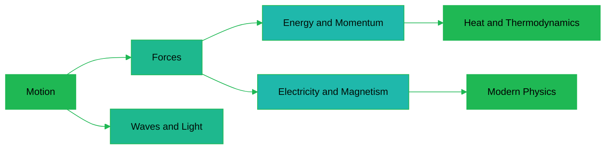

---
tags:
  - science
  - cheatsheet
  - physics
level: "Layer 1: the laws everything obeys"
sources:
  - "[[../Advance/Physics/02_Kinematics]]"
  - "[[../Advance/Physics/03_Dynamics]]"
  - "[[../Advance/Physics/04_Work_Energy_and_Power]]"
  - "[[../Advance/Physics/05_Momentum]]"
  - "[[../Advance/Physics/10_Heat_and_Thermodynamics]]"
  - "[[../Advance/Physics/11_Electrostatics]]"
  - "[[../Advance/Physics/19_Quantum_Physics]]"
created: 2026-10-07
---

# Physics: Rules of Motion and Energy

*Layer 1: the laws everything obeys. Not a formula list: the operating manual of reality.*

> *"God does not play dice with the universe."* (Albert Einstein)

Every object, from a falling mango to a collapsing star, obeys the same small set of laws. They are not suggestions or conventions: they are the rules the world was built with, and nothing can violate them and remain part of this universe. Each rule below carries the reason reality **must** work that way.

---

## 1 | Motion: การเคลื่อนที่

Kinematics (จลนศาสตร์) describes *how* things move before we ask *why*: position, velocity (ความเร็ว), acceleration (ความเร่ง).

### 1.1 The Four Kinematic Equations: สมการการเคลื่อนที่

**The Rule.** For constant acceleration (ความเร่งคงที่), initial velocity $u$, final $v$, acceleration $a$, time $t$, displacement $s$:

$$v = u + at \qquad s = ut + \tfrac{1}{2}at^2 \qquad v^2 = u^2 + 2as \qquad s = \tfrac{(u+v)}{2}t$$

**WHY.** Velocity is the rate of change of position; acceleration, the rate of change of velocity. Fix the rate and these relations follow by geometry: the $v$-$t$ graph is a straight line and displacement is the area under it. Constant change *is* these equations.

**Example.** A car accelerates from rest at $2\ \text{m/s}^2$ for $5$ s: $v = 10\ \text{m/s}$, $s = \frac{1}{2}(2)(25) = 25$ m.

*When to use: any problem saying "constant/uniform acceleration", including free fall.*

### 1.2 Free Fall: การตกอิสระ

**The Rule.** Near Earth's surface every object falls with the same acceleration regardless of mass: $a = g \approx 9.8\ \text{m/s}^2$.

**WHY.** Gravity pulls with force proportional to mass ($F = mg$) and inertia resists in proportion to the same mass ($F = ma$), so the mass cancels exactly. That cancellation is the seed of general relativity.

> 💡 **Deeper why:** Einstein read it as evidence that gravity is not a force at all: free fall is motion along a straight line (geodesic) in curved spacetime. Astronauts in orbit are not beyond gravity (still ~90% as strong up there); they are weightless because they are falling, exactly like the mango.

**Example.** A stone dropped from 20 m: $t = \sqrt{2s/g} \approx 2.02$ s, landing at $v \approx 19.8\ \text{m/s}$.

*When to use: anything dropped or thrown vertically, and the vertical half of every projectile.*

### 1.3 Projectile Motion: การเคลื่อนที่แบบโพรเจกไทล์

**The Rule.** Horizontal and vertical motions are independent. Launch speed $u$, angle $\theta$, no air resistance:

$$v_x = u\cos\theta\ (\text{constant}), \quad v_y = u\sin\theta - gt, \quad R = \frac{u^2\sin 2\theta}{g}, \quad H = \frac{u^2\sin^2\theta}{2g}$$

**WHY.** Gravity acts only downward, and perpendicular vector components cannot affect each other: the horizontal motion never knows the vertical exists. This independence follows from space itself being a vector space.

**Example.** A ball kicked at $20\ \text{m/s}$, $30°$: range $R = \frac{400\sin 60°}{9.8} \approx 35.3$ m, flight time $t = \frac{2u\sin\theta}{g} \approx 2.04$ s.

*When to use: anything launched into the air. Split into x and y, solve separately, rejoin via time $t$.*

### 1.4 Uniform Circular Motion: การเคลื่อนที่แบบวงกลม

**The Rule.** Speed $v$ on a circle of radius $r$ requires a center-pointing acceleration:

$$a_c = \frac{v^2}{r}, \qquad F_c = \frac{mv^2}{r} = m\omega^2 r, \qquad v = \omega r = \frac{2\pi r}{T}$$

**WHY.** Velocity is a vector, so changing *direction* at constant speed is still acceleration, and the velocity vector rotates inward continuously. Without a centripetal force (แรงสู่ศูนย์กลาง) the object flies off tangentially: inertia insists on straight lines.

**Example.** A 0.5 kg ball on a 1 m string at 4 m/s: tension $= \frac{mv^2}{r} = 8$ N.

*When to use: planets, banked curves, vertical loops. Always ask which real force plays the role of $F_c$.*

---

## 2 | Forces: แรง

Dynamics (พลศาสตร์) studies the cause of motion: force (แรง). Newton's three laws govern every push and pull in the classical world.

### 2.1 Newton's First Law: Inertia: กฎข้อที่หนึ่งของนิวตัน

**The Rule.** An object keeps its state of rest or constant-velocity motion unless a net external force (แรงลัพธ์) acts on it.

**WHY.** Straight-line constant motion is the *default state* of the universe. Force is not needed to keep things moving, only to *change* motion. Friction hides this truth on Earth, which is why it took millennia to see.

**Example.** A braking bus throws passengers forward: their bodies were moving and continue until the seatbelt supplies the force.

*When to use: concept questions about "no net force", floating in space, seatbelts, tablecloth tricks.*

### 2.2 Newton's Second Law: กฎข้อที่สองของนิวตัน

**The Rule.** $\vec{F}_{net} = m\vec{a} = \frac{d\vec{p}}{dt}$

**WHY.** This defines what force *does*: mass measures resistance to change, acceleration measures the change. Every other mechanics equation in this rulebook is derived from it.

**Example.** A 2 kg block pushed with 10 N against 4 N of friction: $a = \frac{6}{2} = 3\ \text{m/s}^2$.

*When to use: forces and acceleration together. Draw a free-body diagram (แผนภาพวัตถุอิสระ) first, always.*

### 2.3 Newton's Third Law: กฎข้อที่สามของนิวตัน

**The Rule.** Action and reaction are equal and opposite (แรงกิริยาและแรงปฏิกิริยา): $\vec{F}_{A \to B} = -\vec{F}_{B \to A}$.

**WHY.** Momentum cannot appear from nowhere. If A pushed B without B pushing back, the pair's total momentum would change with no external cause. The third law is momentum conservation wearing a disguise.

**Example.** A rocket expels gas downward; the gas pushes the rocket up with exactly the same force. No air to push against is needed, which is why rockets work best in vacuum.

*When to use: recoil, propulsion, walking. Trap: action-reaction never cancel because they act on different bodies.*

### 2.4 Friction: แรงเสียดทาน

**The Rule.** $f_s \leq \mu_s N$ (static), $f_k = \mu_k N$ (kinetic), with $\mu_s > \mu_k$. Here $N$ is the normal force (แรงตั้งฉาก) and $\mu$ the coefficient of friction (สัมประสิทธิ์ความเสียดทาน).

**WHY.** Surfaces are mountain ranges at the atomic scale: real contact occurs only at tiny peaks that weld together, and sliding must break these welds. Welded area scales with how hard surfaces are pressed together, so friction scales with $N$, not with apparent contact area.

**Example.** A 10 kg crate with $\mu_k = 0.3$: $f_k = 0.3 \times 98 = 29.4$ N. Starting it takes more than $\mu_s N$; keeping it moving takes less.

*When to use: blocks, braking. On an incline $N = mg\cos\theta$, not $mg$.*

### 2.5 Universal Gravitation: กฎความโน้มถ่วงสากล

**The Rule.**

$$F = G\frac{m_1 m_2}{r^2}, \qquad G = 6.67 \times 10^{-11}\ \text{N·m}^2/\text{kg}^2, \qquad g = \frac{GM}{R^2}\ \text{near a surface}$$

**WHY.** Gravity's influence spreads over spheres of area $4\pi r^2$, so its strength must fall as $1/r^2$: any force mediated through three-dimensional space looks like this. The weakest of forces still runs the cosmos because it only attracts, never cancels, and accumulates over astronomical masses.

> 💡 **Deeper why:** In general relativity there is no gravitational force. Planets orbit because they follow the straightest possible paths through spacetime curved by the Sun. Newton's law is the low-speed, weak-gravity limit of that deeper theory.

**Example.** For a satellite, gravity supplies $F_c$: $\frac{GMm}{r^2} = \frac{mv^2}{r}$, so $v = \sqrt{GM/r}$, independent of the satellite's mass.

*When to use: orbits, weight on other planets, escape velocity $v_e = \sqrt{2GM/R}$.*

---

## 3 | Energy and Momentum: พลังงานและโมเมนตัม

Two quantities are absolutely conserved: energy (พลังงาน) and momentum (โมเมนตัม). They are the accounting system of reality, and the books have never failed to balance.

### 3.1 Work and the Work-Energy Theorem: งานและทฤษฎีบทงาน-พลังงาน

**The Rule.** $W = Fs\cos\theta$, and net work equals the change in kinetic energy (พลังงานจลน์):

$$W_{net} = \Delta E_k = \tfrac{1}{2}mv^2 - \tfrac{1}{2}mu^2$$

**WHY.** This is Newton's second law integrated over *distance*: force acting through space accumulates into kinetic energy. Not an extra law, the second law seen from the perspective of place instead of time.

**Example.** A 1000 kg car brakes from 20 m/s: $W_{net} = -\frac{1}{2}(1000)(400) = -200$ kJ removed by friction.

*When to use: forces over distances, braking, springs, "how fast at the bottom of the ramp?"*

### 3.2 Conservation of Mechanical Energy: กฎการอนุรักษ์พลังงานกล

**The Rule.** With only conservative forces (แรงอนุรักษ์: gravity, springs):

$$\tfrac{1}{2}mv^2 + mgh + \tfrac{1}{2}kx^2 = \text{constant}$$

**WHY.** Energy cannot be created or destroyed, only converted. Without friction, potential energy (พลังงานศักย์) and kinetic energy trade like money between two accounts with a fixed total.

> 💡 **Deeper why:** By Noether's theorem every symmetry of the laws produces a conserved quantity. The laws of physics are the same today as tomorrow (time-translation symmetry), and that symmetry *mathematically forces* a conserved quantity to exist. We call it energy. If energy were not conserved, the laws of physics would be changing with time.

**Example.** A pendulum released from height $h$ reaches the bottom at $v = \sqrt{2gh}$: independent of mass and string length.

*When to use: ramps, pendulums, springs, loops. Faster than Newton's laws whenever the path shape does not matter.*

### 3.3 Power: กำลัง

**The Rule.** $P = \frac{W}{t} = Fv$ (constant force and velocity).

**WHY.** Energy conservation says nothing about the *rate* of transfer. Two engines can do the same job with the same energy; power measures which finishes sooner.

**Example.** A 60 kg student climbs 3 m in 2 s: $P = \frac{mgh}{t} = \frac{60 \times 9.8 \times 3}{2} = 882$ W.

*When to use: engines, motors. A kWh is energy; a kW is power.*

### 3.4 Momentum and Impulse: โมเมนตัมและการดล

**The Rule.** Momentum (โมเมนตัม) is $\vec{p} = m\vec{v}$; impulse (การดล) is force acting through time: $\vec{J} = \vec{F}\Delta t = \Delta\vec{p}$.

**WHY.** Newton's second law integrated over *time* (compare 3.1, over distance). Momentum is the currency of collisions because the third law guarantees whatever one body loses, the other gains exactly.

**Example.** A 0.15 kg ball hits a wall at 20 m/s and rebounds at 15 m/s: $\Delta p = 0.15(-15-20) = -5.25\ \text{kg·m/s}$ of impulse from the wall.

*When to use: collisions, airbags, crumple zones, longer $\Delta t$ means smaller $F$ for the same $\Delta p$.*

### 3.5 Conservation of Momentum: กฎการอนุรักษ์โมเมนตัม

**The Rule.** With no net external force: $m_1\vec{u}_1 + m_2\vec{u}_2 = m_1\vec{v}_1 + m_2\vec{v}_2$.

**WHY.** Internal forces come in third-law pairs and cancel in the total, so only external forces can change a system's momentum. Isolated system: no external forces, frozen total.

> 💡 **Deeper why:** Noether again: momentum conservation follows from *space*-translation symmetry, physics here is the same as physics one meter to the left. Energy is the shadow of time symmetry; momentum, of space symmetry.

**Example.** A 2 kg cart at 3 m/s sticks to a resting 1 kg cart (perfectly inelastic, การชนแบบไม่ยืดหยุ่น): $v = \frac{6}{3} = 2\ \text{m/s}$. $E_k$ drops 9 J → 6 J: momentum always survives a collision; kinetic energy changes form.

*When to use: every collision and explosion. Momentum is conserved in ALL collisions; kinetic energy only in elastic ones (การชนแบบยืดหยุ่น).*

---

## 4 | Rotation and Fluids: การหมุนและของไหล

The same laws reapplied to spinning bodies and flowing matter.

### 4.1 Torque and Rotational Equilibrium: ทอร์กและสมดุลการหมุน

**The Rule.** Torque (ทอร์ก) is the rotational effect of a force: $\tau = Fr\sin\theta$. Equilibrium requires $\sum \vec{F} = 0$ **and** $\sum \tau = 0$.

**WHY.** A force far from the pivot sweeps a longer arc, so rotation cares about force × distance, not force alone. This is why levers (คาน) let a small force lift a large weight: torque balance, not force balance, decides.

**Example.** Seesaw: a 30 kg child at 2 m balances a 20 kg child at $r = \frac{30 \times 2}{20} = 3$ m, since $m_1 g r_1 = m_2 g r_2$.

*When to use: seesaws, beams, wrenches, tipping. Choose the pivot at an unknown force to erase it from the torque equation.*

### 4.2 Bernoulli's Principle: หลักของแบร์นูลลี

**The Rule.** For steady flow of an incompressible, non-viscous fluid (ของไหลอุดมคติ):

$$P + \tfrac{1}{2}\rho v^2 + \rho gh = \text{constant}$$

Fast flow means low pressure.

**WHY.** Energy conservation for fluids: pressure, $\frac{1}{2}\rho v^2$, and $\rho gh$ are stored, kinetic, and potential energy *per volume*. If a fluid speeds up, its pressure energy must fall. The books still balance.

**Example.** A pipe narrows from $4\ \text{cm}^2$ to $1\ \text{cm}^2$ with $v_1 = 1\ \text{m/s}$: continuity ($A_1v_1 = A_2v_2$) gives $v_2 = 4\ \text{m/s}$ and pressure drops by $\frac{1}{2}\rho(16-1) \approx 7500$ Pa.

*When to use: airplane wings, venturi tubes, perfume sprayers, the shower curtain pulled inward.*

### 4.3 Buoyancy: Archimedes' Principle: แรงลอยตัว

**The Rule.** Buoyant force (แรงลอยตัว) equals the weight of displaced fluid: $F_b = \rho_{fluid} V_{displaced}\, g$.

**WHY.** Pressure grows with depth, so the bottom of a submerged object is pushed up harder than its top is pushed down. The net lift equals exactly the weight of the fluid that would otherwise fill that space: nature prices the seat by its volume.

**Example.** A block of density $500\ \text{kg/m}^3$ floats displacing its own weight, so half its volume is submerged ($\rho_{obj}/\rho_{water} = 0.5$).

*When to use: floating, sinking, hydrometers, balloons. Float condition: $\rho_{obj} < \rho_{fluid}$.*

---

## 5 | Heat and Thermodynamics: ความร้อนและอุณหพลศาสตร์

Heat (ความร้อน) is energy in transit due to a temperature difference. The second law is the only law of physics that knows which direction time points.

### 5.1 Heat Transfer and Specific Heat: การถ่ายโอนความร้อน

**The Rule.** $Q = mc\Delta T$ (warming), $Q = mL$ (phase change at constant $T$).

**WHY.** Temperature is average molecular kinetic energy, so added heat usually speeds molecules up. During a phase change (การเปลี่ยนสถานะ) the energy instead breaks intermolecular bonds, so temperature stalls while ice melts: latent heat (ความร้อนแฝง) is the price of reorganizing matter.

**Example.** Heat 200 g of water 25°C → 100°C: $Q = 0.2 \times 4186 \times 75 \approx 62.8$ kJ. Water's huge $c$ is why coastal climates are mild.

*When to use: calorimetry and mixing problems: heat lost = heat gained.*

### 5.2 The Gas Laws: กฎของแก๊ส

**The Rule.** Ideal gas (แก๊สอุดมคติ):

$$PV = nRT, \qquad \frac{P_1V_1}{T_1} = \frac{P_2V_2}{T_2}$$

Boyle ($PV$ const), Charles ($V/T$ const), Gay-Lussac ($P/T$ const).

**WHY.** Gas pressure is billions of molecular collisions per second on the walls. Squeeze the volume and collisions grow more frequent (Boyle); heat the gas and molecules hit harder (Gay-Lussac). All the gas laws are one law seen from different angles: pressure is molecular bombardment.

**Example.** A 2 L balloon at 300 K heated to 330 K at constant pressure: $V_2 = 2 \times \frac{330}{300} = 2.2$ L. Use kelvin, always.

*When to use: any $P$-$V$-$T$ problem. STP: $1\ \text{atm} = 1.013\times10^5$ Pa, 273 K.*

### 5.3 The First Law of Thermodynamics: กฎข้อที่หนึ่งของอุณหพลศาสตร์

**The Rule.** $\Delta U = Q - W$: change in internal energy (พลังงานภายใน) = heat added − work done by the system.

**WHY.** Conservation of energy with one more bank account. Heat in, work out, and the difference must sit somewhere; it cannot vanish. This is why perpetual motion machines of the first kind are impossible.

**Example.** A gas absorbs 500 J and does 200 J of work expanding: $\Delta U = 300$ J, so its temperature rises.

*When to use: engines, compressors. Signs: $Q > 0$ heat IN, $W > 0$ work BY the gas.*

### 5.4 The Second Law and Entropy: กฎข้อที่สองและเอนโทรปี

**The Rule.** Heat flows spontaneously hot → cold, never the reverse. Entropy (เอนโทรปี) of an isolated system never decreases: $\Delta S_{universe} \geq 0$. Engine efficiency is capped at $\eta \leq 1 - \frac{T_c}{T_h}$ (Carnot, เครื่องยนต์คาร์โนต์).

**WHY.** Entropy counts microscopic arrangements matching a macrostate, and disordered ones outnumber ordered ones astronomically, so random molecular shuffling almost certainly lands on disorder. The second law is not a force; it is overwhelming probability, and the reason time has a direction.

> 💡 **Deeper why:** $S = k_B \ln W$ (Boltzmann). A broken egg has more microstates than an intact one by a factor like $10^{10^{23}}$, so the egg never unbreaks, not because a law forbids it, but because no amount of waiting comes close to enough.

**Example.** Carnot engine between 500 K and 300 K: $\eta_{max} = 1 - \frac{300}{500} = 40\%$. No engine between these temperatures can beat it, however clever.

*When to use: efficiency, refrigerators, "why can't all heat become work?", the arrow of time.*

---

## 6 | Waves and Light: คลื่นและแสง

Waves (คลื่น) carry energy without carrying matter. Light is a wave that turns out to also be a particle, and both facts are rules here.

### 6.1 The Wave Equation: สมการคลื่น

**The Rule.** For all waves: $v = f\lambda$. Speed in a medium is fixed by the medium; frequency $f$ (ความถี่) and wavelength $\lambda$ (ความยาวคลื่น) trade off inversely.

**WHY.** A wave is a repeating pattern in motion: repeats per second ($f$) × length of one repeat ($\lambda$) must equal pattern speed. Arithmetic made physical, true for water, sound, and light alike.

**Example.** 340 Hz sound in air ($v = 340\ \text{m/s}$): $\lambda = 1$ m. Entering water ($v = 1500\ \text{m/s}$), $f$ stays (the source sets it) so $\lambda$ stretches to 4.4 m.

*When to use: every wave problem. Trap: crossing into a new medium changes speed and wavelength, never frequency.*

### 6.2 Superposition and Interference: การซ้อนทับและการแทรกสอด

**The Rule.** Waves add: $y_{total} = y_1 + y_2$. Constructive (แทรกสอดแบบเสริม) at path difference $n\lambda$; destructive (แทรกสอดแบบหักล้าง) at $(n+\tfrac{1}{2})\lambda$.

**WHY.** The wave equation is linear: if two disturbances each satisfy it, their sum does too, so waves pass through each other unharmed. This linearity is why you can hear one voice in a noisy room.

**Example.** Two in-phase speakers; listener 3.0 m and 3.5 m away with $\lambda = 0.5$ m: path difference $= 1\lambda$, constructive, loud.

*When to use: double-slit (ช่องคู่) $d\sin\theta = n\lambda$; noise canceling; standing waves on strings $f_n = \frac{nv}{2L}$.*

### 6.3 The Doppler Effect: ปรากฏการณ์ดอปเพลอร์

**The Rule.** Relative motion shifts the observed frequency: $f' = f\,\frac{v \pm v_o}{v \mp v_s}$. Approaching: higher pitch. Receding: lower.

**WHY.** A moving source emits each crest from a new position, so crests bunch ahead and stretch behind. Wave speed is unchanged (the medium sets it); only spacing shifts. The universe uses this as a speedometer: redshifted galaxies told us the universe expands.

**Example.** Ambulance at 30 m/s, 700 Hz siren, $v_{sound} = 340$: approaching $f' \approx 768$ Hz, receding $\approx 643$ Hz. The pitch drop *is* Doppler.

*When to use: sirens, radar guns, redshift/blueshift, ultrasound flow meters.*

### 6.4 Reflection, Refraction, and Snell's Law: การสะท้อนและการหักเห

**The Rule.** Reflection (การสะท้อน): angle in = angle out. Refraction (การหักเห):

$$n_1\sin\theta_1 = n_2\sin\theta_2, \qquad n = \frac{c}{v}, \qquad \sin\theta_c = \frac{n_2}{n_1}\ (\text{critical angle})$$

Light bends toward the normal entering a denser medium; beyond $\theta_c$ it totally internally reflects (การสะท้อนกลับหมด).

**WHY.** Light takes the path of least time (Fermat's principle). In a slow medium it minimizes total travel time by shortening the slow segment, which means bending. Refraction is the geometry of fastest-time paths, not a decision.

**Example.** Light enters glass ($n = 1.5$) at $30°$: $\sin\theta_2 = \frac{0.5}{1.5}$, so $\theta_2 \approx 19.5°$. Glass→air critical angle $\approx 41.8°$, the principle of optical fibers (ใยแก้วนำแสง).

*When to use: mirrors, lenses, prisms, apparent depth $d' = d/n$, mirages, fiber optics.*

---

## 7 | Electricity and Magnetism: ไฟฟ้าและแม่เหล็ก

Electricity and magnetism are one phenomenon seen from two frames of reference. Their rules power the modern world.

### 7.1 Coulomb's Law: กฎของคูลอมบ์

**The Rule.** Like charges repel; unlike attract:

$$F = k\frac{q_1 q_2}{r^2}, \qquad k = 9 \times 10^9\ \text{N·m}^2/\text{C}^2, \qquad \vec{E} = \frac{\vec{F}}{q}$$

**WHY.** The $1/r^2$ form comes from the field spreading over spheres of area $4\pi r^2$: the same geometry as gravity (2.5). $k$ dwarfs $G$, so electricity is the strongest force you feel daily: friction, normal force, and chemical bonds are all electric. You never notice because matter is almost perfectly neutral.

**Example.** $+2\ \mu\text{C}$ and $-3\ \mu\text{C}$ at 0.3 m: $F = \frac{(9\times10^9)(2\times10^{-6})(3\times10^{-6})}{0.09} = 0.6$ N, attractive.

*When to use: point charges, electric fields (สนามไฟฟ้า). Multiple charges: add forces as vectors.*

### 7.2 Ohm's Law and Circuits: กฎของโอห์มและวงจรไฟฟ้า

**The Rule.** $V = IR$, $P = VI = I^2R = \frac{V^2}{R}$. Series (อนุกรม): $R_{eq} = \sum R_i$, same current. Parallel (ขนาน): $\frac{1}{R_{eq}} = \sum \frac{1}{R_i}$, same voltage.

**WHY.** Voltage is energy per charge, current is charge flow, resistance is how hard the atomic lattice scatters electrons; $V = IR$ is the steady state where the field's push balances scattering. The series/parallel rules are Kirchhoff's laws in disguise: conservation of charge (junctions) and of energy (loops).

**Example.** 12 V across $4\ \Omega$ and $2\ \Omega$ in series: $I = 2$ A; the $2\ \Omega$ resistor dissipates $P = I^2R = 8$ W.

*When to use: every circuit. Series resistors share current; parallel resistors share voltage.*

### 7.3 Magnetic Force on Moving Charges: แรงแม่เหล็ก

**The Rule.** Force perpendicular to both velocity and field: $\vec{F} = q\vec{v} \times \vec{B}$, i.e. $F = qvB\sin\theta$; on a wire, $F = BIL\sin\theta$.

**WHY.** The cross product makes the magnetic force always sideways to the motion, so it does zero work: a magnetic field can bend a charge's path but never speed it up. Hence circular orbits with $r = \frac{mv}{qB}$.

**Example.** An electron at $10^6\ \text{m/s}$ perpendicular to 0.5 T: $F = qvB = 8\times10^{-14}$ N, circling with $r \approx 1.1\times10^{-5}$ m.

*When to use: right-hand rule (กฎมือขวา) problems, motors, accelerators, auroras.*

### 7.4 Electromagnetic Induction: Faraday and Lenz: การเหนี่ยวนำแม่เหล็กไฟฟ้า

**The Rule.** Changing magnetic flux induces an emf:

$$\varepsilon = -N\frac{\Delta\Phi_B}{\Delta t}, \qquad \Phi_B = BA\cos\theta$$

The minus sign is Lenz's law (กฎของเลนซ์): induced current opposes the change that created it.

**WHY.** That minus sign is energy conservation. If the induced current *helped* the change, you would get a runaway self-amplifying current: free energy from nothing. Lenz's law is the universe refusing to hand out that loan.

**Example.** 100 turns, area $0.02\ \text{m}^2$, field drops 0.5 T → 0.1 T in 0.2 s: $\varepsilon = 100 \times \frac{0.4 \times 0.02}{0.2} = 2$ V.

*When to use: generators, transformers ($\frac{V_s}{V_p} = \frac{N_s}{N_p}$), induction cooktops, wireless charging.*

---

## 8 | Modern Physics: ฟิสิกส์สมัยใหม่

At the smallest scales and highest speeds the rules change character: energy comes in packets, particles are waves, and certainty has a hard limit.

### 8.1 The Photoelectric Effect: ปรากฏการณ์โฟโตอิเล็กทริก

**The Rule.** $E = hf$, $E_k^{max} = hf - W$, where $W$ is the work function (ฟังก์ชันงาน). Below the threshold frequency, *no* electrons emerge, however bright the light.

**WHY.** Light energy arrives in indivisible packets (quanta, ควอนตัม) and one electron absorbs one photon. If that packet is too small the electron stays put; a trillion more too-small packets change nothing. Brightness is photon *number*, not photon *energy*. Einstein won his Nobel for this, not relativity.

**Example.** $f = 1.0\times10^{15}$ Hz on $W = 3.0$ eV metal: $hf = 4.14$ eV, $E_k^{max} = 1.14$ eV. Bright red light ($hf = 1.66$ eV) ejects nothing.

*When to use: photon problems. Shortcut: $hc \approx 1240\ \text{eV·nm}$, so $E = \frac{1240}{\lambda\,(\text{nm})}$ eV.*

### 8.2 Wave-Particle Duality: de Broglie: ทวิภาวะคลื่น-อนุภาค

**The Rule.** Every particle has a wavelength: $\lambda = \frac{h}{p} = \frac{h}{mv}$.

**WHY.** If light (a wave) can act as particles, symmetry demands particles can act as waves. Atomic orbits only make sense this way: an allowed orbit fits a whole number of electron wavelengths around its circumference. Electron microscopes image with matter waves daily.

**Example.** An electron at $10^6\ \text{m/s}$: $\lambda \approx 7.3\times10^{-10}$ m, atom-sized, so electrons diffract through crystals. A 70 kg human at 1 m/s: $\lambda \sim 10^{-35}$ m, unobservable.

*When to use: electron diffraction, Bohr orbits ($2\pi r = n\lambda$), "why don't people diffract?"*

### 8.3 The Uncertainty Principle: หลักความไม่แน่นอน

**The Rule.** $\Delta x\, \Delta p \geq \frac{\hbar}{2}$ and $\Delta E\, \Delta t \geq \frac{\hbar}{2}$, with $\hbar = \frac{h}{2\pi}$.

**WHY.** Not an instrument limit: a particle *is* its wave packet, and a wave squeezed into a small region must be built from many wavelengths, i.e. many momenta, unavoidable, like a note too short to have a pitch. This fuzziness is what keeps atoms from collapsing.

**Example.** An electron confined to $\Delta x \approx 10^{-10}$ m has $\Delta p \geq 5\times10^{-25}\ \text{kg·m/s}$, implying kinetic energy of a few eV: the real energy scale of atomic electrons.

*When to use: measurement limits, why electrons don't spiral into the nucleus, tunneling (อุโมงค์ควอนตัม).*

### 8.4 Mass-Energy Equivalence: สมมูลมวล-พลังงาน

**The Rule.** $E = mc^2$: mass is condensed energy.

**WHY.** Special relativity merges energy and momentum into one four-dimensional quantity whose "rest" piece is $mc^2$. Mass is not a separate substance; it is energy sitting still. Because $c^2$ is enormous, tiny masses hide tremendous energy: the budget of stars and nuclear power.

**Example.** Fission of 1 kg of U-235 converts ~0.9 g of mass: $E = 0.0009 \times (3\times10^8)^2 \approx 8\times10^{13}$ J, thousands of tons of coal.

*When to use: nuclear reactions: mass defect $\Delta E = \Delta m\, c^2$, binding energy, the Sun's power.*

### 8.5 Special Relativity: Time and Length: สัมพัทธภาพพิเศษ

**The Rule.** The speed of light $c$ is the same for all observers, forcing time dilation (การยืดออกของเวลา) and length contraction (การหดของความยาว):

$$t' = \frac{t}{\sqrt{1 - v^2/c^2}}, \qquad L' = L\sqrt{1 - v^2/c^2}$$

**WHY.** If every observer measures the same $c = d/t$, then distance and time must adjust. Something has to give, and it is not light: it is simultaneity, length, and duration. Relativity is the universe protecting one constant at the expense of everything else.

**Example.** A muon (มิวออน) lives $2.2\ \mu$s at rest: ~660 m of travel; yet cosmic muons reach the ground from 10 km up. At $0.995c$, $\gamma \approx 10$: we see them live 10× longer; they see the atmosphere 10× thinner. Both are right.

*When to use: fast particles, GPS clock corrections, the twin paradox, "why nothing exceeds $c$".*

### 8.6 Nuclear Decay: การสลายตัวของนิวเคลียส

**The Rule.** Decay is random per nucleus but exact in bulk:

$$N = N_0 e^{-\lambda t}, \qquad T_{1/2} = \frac{\ln 2}{\lambda} \approx \frac{0.693}{\lambda}$$

Alpha (แอลฟา, $_2^4\text{He}$ nucleus), beta (บีตา, electron), gamma (แกมมา, photon).

**WHY.** Unstable nuclei seek the lowest-energy configuration via quantum tunneling and weak interactions. A single decay is fundamentally unpredictable, but with $10^{23}$ nuclei the statistics are exact. Randomness at the bottom, certainty at the top: this is why radiometric dating works.

**Example.** Carbon-14 ($T_{1/2} = 5730$ y): a fossil with 25% of its original $^{14}$C is two half-lives old, ≈ 11,460 years.

*When to use: half-life and dating problems, radiation shielding (alpha stopped by paper, gamma needs lead).*

---

## Chain Navigation

⬅ [[Science/Cheat_Sheet/00_Index|00_Index]] · ➡ [[02_Chemistry_Matter_and_Reactions]] · 🗺 [[06_Roadmap]]
