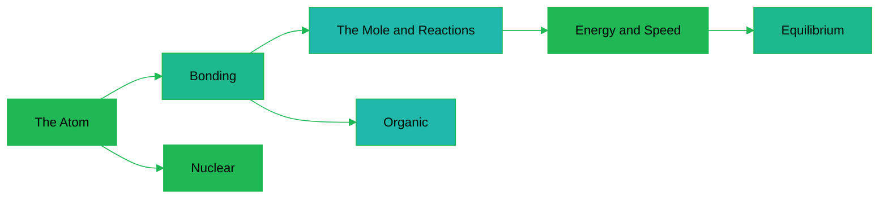

---
tags:
  - science
  - cheatsheet
  - chemistry
level: "Layer 2: the rules of matter's behavior"
sources:
  - "[[../Advance/Chemistry/01_Atomic_Structure]]"
  - "[[../Advance/Chemistry/03_Chemical_Bonding]]"
  - "[[../Advance/Chemistry/05_Stoichiometry]]"
  - "[[../Advance/Chemistry/09_Chemical_Equilibrium]]"
  - "[[../Advance/Chemistry/11_Thermochemistry]]"
  - "[[../Advance/Chemistry/13_Electrochemistry]]"
  - "[[../Advance/Chemistry/14_Organic_Fundamentals]]"
created: 2026-10-07
---

# Chemistry: Rules of Matter and Reactions

*Layer 1: the rules of matter's behavior. Not a list of reactions: the contract every atom signs at birth.*

> *"Nothing in life is to be feared, it is only to be understood."* (Marie Curie)

Physics says what energy and force must do. Chemistry says what *matter* must do with them. Atoms do not choose to bond, react, or decay: they are pushed by electric attraction and pulled toward lower energy, and every rule below is the visible trace of those two invisible hands. Read this as the operating manual of stuff.

---

## 1 | The Atom: อะตอม

Everything chemical is decided by electrons, and electrons are decided by the nucleus's pull. Know the atom's structure and the periodic table stops being a memorization task and becomes a consequence.

### 1.1 Atomic Structure: โครงสร้างอะตอม

**The Rule.** An atom (อะตอม) = protons (โปรตอน, $p^+$) + neutrons (นิวตรอน, $n^0$) in the nucleus, electrons (อิเล็กตรอน, $e^-$) around it. Atomic number (เลขอะตอม) $Z$ = number of protons; mass number (เลขมวล) $A = Z + N$. Isotopes (ไอโซโทป): same $Z$, different $N$.

**WHY.** The proton count *is* the element's identity: it sets the nuclear charge, which sets how hard electrons are held, which sets all chemistry. Neutrons add mass and nuclear glue without touching charge, so changing them changes stability but not chemistry.

**Example.** $^{14}_6\text{C}$: 6 protons, 8 neutrons, 6 electrons. It behaves chemically like $^{12}$C (same $Z$) but is radioactive (too many neutrons).

*When to use: isotope notation, ion charge (electrons ≠ protons), counting subatomic particles.*

### 1.2 Quantum Numbers and Electron Configuration: เลขควอนตัมและการจัดเรียงอิเล็กตรอน

**The Rule.** Each electron has four addresses: $n$ (shell, ระดับพลังงาน), $l$ (subshell s,p,d,f), $m_l$ (orbital), $m_s$ (spin). Fill by Aufbau (lowest energy first), Pauli (max 2 per orbital, opposite spins), Hund (singles first in equal orbitals):

$$1s^2\, 2s^2\, 2p^6\, 3s^2\, 3p^6\, 4s^2\, 3d^{10}\cdots$$

**WHY.** Electrons are waves, and only certain standing waves fit around the nucleus: the quantum numbers are just the allowed wave patterns. Pauli forbids two electrons sharing one state, which is the only reason matter has volume: without it, every electron would collapse into the lowest orbital and all atoms would be identical mush.

> 💡 **Deeper why:** The filling order (4s before 3d) is not a rule of thumb but orbital energy minimization: 4s penetrates closer to the nucleus and is lower in energy until 3d starts filling. Chemistry's whole structure rests on electrons settling into the cheapest available wave patterns.

**Example.** Fe ($Z = 26$): $[\text{Ar}]\,4s^2 3d^6$. Fe$^{2+}$ loses the 4s electrons first: $[\text{Ar}]\,3d^6$.

*When to use: writing configurations, counting unpaired electrons (magnetism), explaining transition-metal ion charges. Trap: remove 4s before 3d when ionizing.*

### 1.3 Periodic Trends: แนวโน้มตามตารางธาตุ

**The Rule.** Across a period (left→right): atomic radius (รัศมีอะตอม) ↓, ionization energy (IE, พลังงานไอออไนเซชัน) ↑, electronegativity (EN, อิเล็กโทรเนกาติวิตี) ↑. Down a group: radius ↑, IE ↓, EN ↓.

**WHY.** Across a period, protons are added while the shell stays the same, so effective nuclear charge (ประจุนิวเคลียร์สุทธิ) rises and pulls electrons tighter: everything else follows from that one squeeze. Down a group, new shells stack on and inner electrons shield the nucleus, so the outer electron is held more loosely.

**Example.** F is the most electronegative element (EN ≈ 4.0): small radius + strong nuclear pull = maximum grip on shared electrons. Cs is near the least: huge radius, heavily shielded.

*When to use: predicting bond type (ΔEN > 1.7 ionic, 0.4–1.7 polar covalent, < 0.4 nonpolar), comparing acidity, atomic size ranking.*

---

## 2 | Bonding: พันธะเคมี

Atoms bond for one reason only: the bonded arrangement has lower energy than the separated atoms. Every bond type is a different strategy for lowering that energy.

### 2.1 The Three Bond Types: พันธะไอออนิก โคเวเลนต์ โลหะ

**The Rule.** Ionic (พันธะไอออนิก): electron transfer, metal + nonmetal, ΔEN large. Covalent (พันธะโคเวเลนต์): electron sharing, nonmetal + nonmetal. Metallic (พันธะโลหะ): positive ions in a sea of delocalized electrons.

**WHY.** In all three cases the same thing happens: electrons end up closer to positive charge than they were alone. Ionic bonds pay off when transferring an electron lets it sit next to a strongly attracting nucleus; covalent bonds pay off when two nuclei can share the pull; metallic bonds pay off when metals, holding their electrons loosely, pool them. Bond type is not a choice of style; it is whichever energy-lowering strategy the electronegativities allow.

> 💡 **Deeper why:** The octet rule (กฎออกเตต) is not magic about the number 8. It is orbital energy minimization: filling the s and p subshells of a shell completes a large energy gap to the next shell, so 8 valence electrons is a local energy minimum. Atoms "want" 8 for the same reason a ball settles at the bottom of a bowl.

**Example.** NaCl: Na (EN 0.9) donates to Cl (EN 3.2), ionic. Cl$_2$: equal EN, pure sharing, nonpolar covalent. HCl: ΔEN 0.9, polar covalent (พันธะโคเวเลนต์มีขั้ว).

*When to use: classify a compound from positions in the periodic table; predict properties (ionic: hard, brittle, conducts when molten; metallic: malleable, conducts; covalent molecular: low melting points).*

### 2.2 VSEPR: Molecular Shapes: ทฤษฎี VSEPR และรูปร่างโมเลกุล

**The Rule.** Valence electron pairs repel and arrange as far apart as possible: 2 pairs linear (180°), 3 trigonal planar (120°), 4 tetrahedral (109.5°), 5 trigonal bipyramidal, 6 octahedral. Lone pairs (อิเล็กตรอนคู่โดดเดี่ยว) repel more strongly and shrink bond angles.

**WHY.** Electron pairs are negatively charged clouds; electrostatics forces them apart, and geometry is simply the arrangement that maximizes separation. Shape follows from repulsion the way seating follows from personal space.

**Example.** CH$_4$: 4 bonding pairs → tetrahedral, 109.5°. NH$_3$: 3 bonding + 1 lone pair → trigonal pyramidal, ~107° (lone pair squeezes). H$_2$O: 2 + 2 → bent, ~104.5°.

*When to use: predicting shape and polarity. Polar bonds + asymmetric shape = polar molecule (NH$_3$, H$_2$O); symmetric shapes cancel (CO$_2$, CH$_4$).*

### 2.3 Hybridization: ไฮบริไดเซชัน

**The Rule.** Atomic orbitals mix to match molecular geometry: 2 regions of electron density → $sp$ (linear), 3 → $sp^2$ (trigonal planar), 4 → $sp^3$ (tetrahedral). Single bond = σ (ซิกมา), double = 1σ + 1π (ไพ), triple = 1σ + 2π.

**WHY.** Bonds form where orbital overlap is greatest, so orbitals re-shape to point directly at partners. π bonds come from sideways overlap of leftover p-orbitals, which locks rotation; that is why double bonds create cis/trans isomers.

**Example.** Ethene C$_2$H$_4$: each carbon has 3 regions → $sp^2$, planar 120°, and the unhybridized p-orbitals form the C=C π bond.

*When to use: orbital questions, explaining rigidity of double bonds, counting σ and π bonds.*

### 2.4 Intermolecular Forces: แรงระหว่างโมเลกุล

**The Rule.** Weakest → strongest: London dispersion (แรงลอนดอน, all molecules, grows with size), dipole-dipole (แรงดึงดูดระหว่างขั้ว, polar molecules), hydrogen bonding (พันธะไฮโดรเจน, H bonded to N/O/F).

**WHY.** These are all residual electrostatics: the leftovers of bonding-level attraction. Electron clouds fluctuate, creating instant dipoles (London); permanent dipoles align (dipole-dipole); and H on N/O/F is left nearly a bare proton, so it grips lone pairs ferociously (hydrogen bond). Boiling points rank exactly by which force must be overcome.

**Example.** Boiling: CH$_4$ (−162°C, London only) < HCl (−85°C, +dipole) < H$_2$O (+100°C, +H-bonds). Water's absurdly high boiling point for its mass is hydrogen bonding, and the reason life exists in liquid water.

*When to use: comparing boiling/melting points, solubility ("like dissolves like", การละลาย), surface tension, DNA base pairing.*

---

## 3 | The Mole and Reactions: โมลและปฏิกิริยา

Chemistry counts atoms by weighing them. The mole is the bridge, and stoichiometry is the accounting.

### 3.1 The Mole: โมล

**The Rule.** One mole (โมล) = $6.02 \times 10^{23}$ particles (Avogadro's number, เลขอาโวกาโดร). Mass in grams of 1 mol = molar mass (มวลต่อโมล) in g/mol:

$$n = \frac{m}{M} = \frac{N}{N_A}$$

**WHY.** Atoms are too small to count and too numerous to weigh individually, so chemists needed a fixed-size bundle whose mass in grams numerically equals the atomic mass. The mole is that bundle: a counting unit disguised as a mass unit.

**Example.** 9 g of water: $n = \frac{9}{18} = 0.5$ mol $= 3.01 \times 10^{23}$ molecules.

*When to use: every quantitative problem starts by converting grams → moles.*

### 3.2 Stoichiometry and the Limiting Reagent: ปริมาณสัมพันธ์และสารกำหนดปริมาณ

**The Rule.** Balance the equation, convert to moles, use mole ratios. The limiting reagent (สารกำหนดปริมาณ) is the reactant that runs out first and caps the product; excess (สารเหลือ) is what is left over.

**WHY.** Atoms are neither created nor destroyed in a reaction; they only re-partner. The balanced equation is a conservation-of-atoms contract, and the mole ratio is its exchange rate. Whichever reactant offers the fewest "sets" of the recipe decides the yield.

**Example.** $\ce{N2 + 3H2 -> 2NH3}$: with 1 mol N$_2$ and 2 mol H$_2$, H$_2$ allows only $\frac{2}{3}$ mol N$_2$ to react, H$_2$ limits, giving $\frac{4}{3}$ mol NH$_3$, with $\frac{1}{3}$ mol N$_2$ left.

*When to use: any yield problem. Always divide moles by the coefficient to find the limiter.*

### 3.3 Solution Concentration: ความเข้มข้นของสารละลาย

**The Rule.** Molarity (โมลาริตี): $c = \frac{n}{V}$ (mol/L). Dilution (การเจือจาง): $c_1V_1 = c_2V_2$. Percent by mass, ppm for trace amounts.

**WHY.** Reactions happen particle-to-particle, so what matters is particles per volume, not grams of solution. Molarity measures exactly the thing that controls reaction rates and equilibria.

**Example.** Dilute 50 mL of 6 M HCl to 300 mL: $c_2 = \frac{6 \times 50}{300} = 1$ M.

*When to use: dilutions, titration volumes, converting between mass and volume of solutions.*

### 3.4 Gas Stoichiometry: ปริมาณสัมพันธ์ของแก๊ส

**The Rule.** Ideal gas law (กฎของแก๊สอุดมคติ): $PV = nRT$ with $R = 0.0821\ \text{L·atm/(mol·K)}$. At STP, 1 mol of any gas ≈ 22.4 L. Avogadro: equal volumes at equal $T, P$ hold equal moles.

**WHY.** Gas volume is almost entirely empty space between particles, so volume measures particle *count*, not particle identity: every gas obeys the same $PV=nRT$ because pressure is just molecular bombardment (see Physics 5.2).

**Example.** $\ce{2H2 + O2 -> 2H2O}$: 10 L of H$_2$ needs 5 L of O$_2$ and yields 10 L of steam (same $T, P$), volume ratios equal mole ratios.

*When to use: reactions involving gases; remember STP shortcut 22.4 L/mol, and $T$ in kelvin.*

---

## 4 | Energy and Speed: พลังงานและความเร็วของปฏิกิริยา

Two independent questions: *will* a reaction happen (thermochemistry, เคมีเชิงความร้อน), and *how fast* (kinetics, จลนพลศาสตร์). Nature answers them separately.

### 4.1 Enthalpy and Hess's Law: เอนทาลปีและกฎของเฮสส์

**The Rule.** Exothermic (คายความร้อน): $\Delta H < 0$. Endothermic (ดูดความร้อน): $\Delta H > 0$. Hess's law (กฎของเฮสส์): $\Delta H$ of a reaction equals the sum over any route:

$$\Delta H_{rxn} = \sum \Delta H_f(\text{products}) - \sum \Delta H_f(\text{reactants})$$

**WHY.** Enthalpy is a state function (ฟังก์ชันสภาวะ): it depends only on start and end, not the path, because energy is conserved. If two routes between the same states had different $\Delta H$, looping around would manufacture energy. Chemistry inherits this honesty from physics.

**Example.** $\Delta H_f$: CO$_2$ = −394, H$_2$O = −286, CH$_4$ = −75 kJ/mol. Combustion: $\Delta H = [(-394) + 2(-286)] - [(-75)] = -891$ kJ/mol. Exothermic: burning methane pays out energy.

*When to use: any heat-of-reaction problem; combine given equations by reversing (flip sign) and scaling (multiply).*

### 4.2 Entropy and Gibbs Free Energy: เอนโทรปีและพลังงานเสรีกิบส์

**The Rule.** A reaction is spontaneous (เกิดเองได้) when Gibbs free energy (พลังงานเสรีกิบส์) drops:

$$\Delta G = \Delta H - T\Delta S < 0$$

**WHY.** Two forces drive reactions: releasing heat ($\Delta H < 0$) and gaining disorder ($\Delta S > 0$), because the universe's total entropy must rise (physics 5.4). $\Delta G$ is the bookkeeping that combines both at temperature $T$: it is the total entropy change of the universe, priced in joules.

**Example.** Ice melting: $\Delta H > 0$ (absorbs heat) yet happens above 0°C because $\Delta S > 0$ wins once $T\Delta S > \Delta H$. The sign of $\Delta G$ flips exactly at the melting point.

*When to use: predicting spontaneity at a given temperature. $\Delta H<0,\Delta S>0$: always spontaneous; both unfavorable: never; mixed: temperature decides.*

### 4.3 Reaction Rate and the Arrhenius Equation: อัตราการเกิดปฏิกิริยาและสมการอาร์เรเนียส

**The Rule.** Rate (อัตราการเกิดปฏิกิริยา) = change in concentration per time. Rate law: $\text{rate} = k[A]^m[B]^n$ (orders from experiment, not from the equation). Temperature dependence:

$$k = A e^{-E_a/RT}$$

**WHY.** Molecules react only by colliding with enough energy to cross the activation energy (พลังงานกระตุ้น, $E_a$) barrier: bonds must stretch before they switch partners. The exponential in Arrhenius is the fraction of molecules with that energy (Boltzmann distribution): small $T$ changes shift that fraction dramatically, which is why reaction rates roughly double per 10°C.

**Example.** If $E_a = 50$ kJ/mol, heating 300 K → 310 K multiplies $k$ by $e^{\frac{50000}{8.314}(\frac{1}{300}-\frac{1}{310})} \approx 1.9$: nearly double, as the rule of thumb says.

*When to use: rate problems, explaining temperature and concentration effects, finding $E_a$ from two rate constants.*

### 4.4 Catalysts: ตัวเร่งปฏิกิริยา

**The Rule.** A catalyst (ตัวเร่งปฏิกิริยา) speeds a reaction by lowering $E_a$, is not consumed, and does **not** change $\Delta H$, $\Delta G$, or the equilibrium position: only how fast equilibrium is reached.

**WHY.** The catalyst offers a detour over a lower pass in the same mountain range: start and end states are untouched (so thermodynamics is unchanged), but the barrier between them shrinks, so more collisions qualify. A catalyst accelerates forward and backward equally; it cannot favor either side.

**Example.** Enzymes (เอนไซม์) in your body lower $E_a$ by factors of a million, letting reactions run at 37°C that would otherwise need boiling. Catalytic converters (เครื่องฟอกไอเสีย) do the same for exhaust gases.

*When to use: questions on what a catalyst does and does not change. Trap: it never shifts equilibrium yield.*

---

## 5 | Equilibrium: สมดุลเคมี

Reactions are reversible, and reversibility means negotiations. Equilibrium is not stillness: it is the truce where both sides fire at equal rates.

### 5.1 The Equilibrium Constant: ค่าคงที่สมดุล

**The Rule.** For $aA + bB \rightleftharpoons cC + dD$:

$$K_c = \frac{[C]^c[D]^d}{[A]^a[B]^b}$$

$K \gg 1$: products favored. $K \ll 1$: reactants favored. At equilibrium forward rate = reverse rate (อัตราการเกิดปฏิกิริยาไปข้างหน้า = ย้อนกลับ).

**WHY.** $K$ is fixed at a given temperature because it is a direct reading of $\Delta G°$ ($\Delta G° = -RT\ln K$): equilibrium sits exactly where the free-energy landscape is flat. Concentrations adjust until the two opposing drives balance, the chemistry version of a market clearing price.

**Example.** For $\ce{N2 + 3H2 <=> 2NH3}$ with $K_c = 0.5$ and at equilibrium $[\ce{N2}] = 1$ M, $[\ce{H2}] = 1$ M: $[\ce{NH3}] = \sqrt{0.5 \times 1 \times 1} \approx 0.71$ M.

*When to use: ICE tables (เริ่มต้น-เปลี่ยนแปลง-สมดุล), predicting reaction direction via $Q_c$ vs $K_c$ ($Q < K$: shifts forward).*

### 5.2 Le Chatelier's Principle: หลักของเลอชาเตอลิเย

**The Rule.** A system at equilibrium responds to a stress (adding/removing species, changing $P$, $V$, or $T$) by shifting to partially undo it (การรบกวนสมดุล).

**WHY.** The system has one goal: restore the condition $Q = K$. Add reactant and $Q$ drops below $K$, so the reaction runs forward until balance returns. Compress the volume and the side with fewer gas moles wins because it relieves pressure. Temperature is special: it changes $K$ itself, because $K$ was only ever fixed *at that temperature*.

**Example.** Haber process $\ce{N2 + 3H2 <=> 2NH3}$ (exothermic): high pressure favors NH$_3$ (4 mol gas → 2 mol), but high temperature favors the reverse (endothermic direction absorbs the added heat). Industry compromises at ~450°C, 200 atm.

*When to use: any "what happens if..." question. Only a catalyst leaves the position untouched; only temperature changes $K$.*

### 5.3 Acids, Bases, and Water: กริด เบส และน้ำ

**The Rule.** Arrhenius/Bronsted: acids (กรด) donate H$^+$, bases (เบส) accept it. Water self-ionizes:

$$K_w = [\ce{H3O+}][\ce{OH-}] = 1 \times 10^{-14}\ \text{at}\ 25°C, \qquad \text{pH} = -\log[\ce{H3O+}]$$

$$K_a K_b = K_w, \qquad \text{pH} + \text{pOH} = 14$$

Strong acids (แก่): HCl, HNO$_3$, H$_2$SO$_4$, HBr, HI, HClO$_4$, dissociate completely.

**WHY.** $K_w$ is an equilibrium constant like any other, so $[\ce{H3O+}]$ and $[\ce{OH-}]$ are locked in a seesaw: push one up and the other must fall, because their product is fixed by $\Delta G$ of water's self-ionization. Every acid-base fact is this seesaw plus who donates protons best.

**Example.** 0.01 M HCl: $[\ce{H3O+}] = 0.01$, pH = 2, so $[\ce{OH-}] = 10^{-12}$ M, pOH = 12.

*When to use: pH calculations, strong vs weak (weak acids: use $K_a$ with an ICE table, $[\ce{H3O+}] = \sqrt{K_a c}$ approximation).*

### 5.4 Buffers and Titration: สารละลายบัฟเฟอร์และไทเทรชัน

**The Rule.** A buffer (บัฟเฟอร์) = weak acid + its conjugate base (คู่กรด-เบส): resists pH change. For a buffer:

$$\text{pH} = \text{p}K_a + \log\frac{[\ce{A-}]}{[\ce{HA}]}$$

Titration (ไทเทรชัน) equivalence point (จุดสมมูล): $c_1V_1 = c_2V_2$ adjusted by mole ratio.

**WHY.** Added H$^+$ is absorbed by A$^-$ and added OH$^-$ by HA: the buffer keeps a standing army of both species to neutralize invaders, so only the *ratio* shifts slightly, and pH follows the ratio (Henderson-Hasselbalch). Blood runs at pH 7.4 ± 0.05 this way; outside that window, proteins unfold and life stops.

**Example.** Buffer with equal $[\ce{HA}] = [\ce{A-}]$: pH = p$K_a$ exactly. Add strong acid and the ratio tilts, moving pH only slightly.

*When to use: buffer pH, choosing a buffer (p$K_a$ within ±1 of target pH), titration curves (half-equivalence: pH = p$K_a$; equivalence of weak acid + strong base: pH > 7).*

### 5.5 Solubility Product: ผลคูณการละลาย

**The Rule.** For a sparingly soluble salt $\ce{A_xB_y}$: $K_{sp} = [A^{y+}]^x[B^{x-}]^y$ (ผลคูณการละลาย). Precipitation (การตกตะกอน) forms when the ion product $Q > K_{sp}$.

**WHY.** "Insoluble" salts are really in equilibrium: solid dissolving at the same rate as ions re-crystallizing. $K_{sp}$ is the ceiling concentration product that equilibrium allows; exceed it and the reverse reaction wins until balance is restored.

**Example.** AgCl, $K_{sp} = 1.8\times10^{-10}$: solubility $s = \sqrt{K_{sp}} \approx 1.3\times10^{-5}$ M. Mixing 0.01 M Ag$^+$ with 0.01 M Cl$^-$: $Q = 10^{-4} \gg K_{sp}$, so AgCl precipitates.

*When to use: predicting precipitates, comparing solubilities of same-formula salts, common-ion effect (adding a shared ion lowers solubility).*

---

## 6 | Electrochemistry: เคมีไฟฟ้า

Redox is electron bookkeeping, and electrochemistry is what happens when you force those electrons through a wire instead of letting them hop directly.

### 6.1 Oxidation, Reduction, and Galvanic Cells: ออกซิเดชัน รีดักชัน และเซลล์กัลวานิก

**The Rule.** Oxidation (ออกซิเดชัน) = loss of electrons; reduction (รีดักชัน) = gain ( mnemonic: OIL RIG). Galvanic cell (เซลล์กัลวานิก): spontaneous redox split across two half-cells; anode (แอโนด, oxidation, −) and cathode (แคโทด, reduction, +):

$$E°_{cell} = E°_{cathode} - E°_{anode} > 0$$

Electrons flow anode → cathode through the wire; the salt bridge (สะพานเกลือ) keeps charge neutral.

**WHY.** Electrons move spontaneously from where they are held loosely (low reduction potential) to where they are held tightly (high potential), like water downhill. Splitting the reaction across two beakers forces that downhill flow through your wire: the cell is a dam on the electron river.

**Example.** Zn/Cu cell (Daniell, เซลล์แดนเนียล): $E° = 0.34 - (-0.76) = 1.10$ V. Zn oxidizes (anode), Cu$^{2+}$ reduces (cathode).

*When to use: cell diagrams, predicting spontaneous redox from the $E°$ table (higher $E°$ species gets reduced).*

### 6.2 Electrolytic Cells: เซลล์อิเล็กโทรไลติก

**The Rule.** An electrolytic cell (เซลล์อิเล็กโทรไลติก) uses external voltage to force a non-spontaneous reaction ($E_{cell} < 0$). Anode is now +, cathode −, but anode = oxidation still holds. Faraday: mass deposited $\propto$ charge $Q = It$.

**WHY.** Electricity can push electrons uphill, reversing nature's preference: the same way a pump lifts water. This is the rule behind electroplating (การชุบโลหะ), aluminum refining, and recharging every battery you own: charging is forced electrolysis of the discharged cell.

**Example.** Electroplating a spoon with silver: spoon as cathode in AgNO$_3$ solution; Ag$^+$ + e$^-$ → Ag deposits on it. 96,500 C (1 faraday) deposits 1 mol of electrons' worth: 108 g of Ag.

*When to use: electroplating, electrolysis products, Faraday's law problems. Trap: anode is always oxidation, sign flips between cell types.*

### 6.3 The Nernst Equation: สมการเนิร์นสต์

**The Rule.** Cell potential at non-standard conditions:

$$E = E° - \frac{0.0592}{n}\log Q \quad (\text{at}\ 25°C)$$

**WHY.** Driving force depends on how far from equilibrium the reaction sits: concentrated reactants push harder, products push back. As $Q$ approaches $K$, $E$ falls to zero, a dead battery is not out of chemicals, it is at equilibrium.

**Example.** Daniell cell with $[\ce{Cu^2+}] = 0.1$ M, $[\ce{Zn^2+}] = 1$ M: $E = 1.10 - \frac{0.0592}{2}\log\frac{1}{0.1} \approx 1.07$ V.

*When to use: concentration cells, batteries under load, corrosion, finding $K$ from $E°$ ($\log K = \frac{nE°}{0.0592}$).*

---

## 7 | Organic Chemistry: เคมีอินทรีย์

Carbon runs the chemistry of life for one structural reason: four bonds, bondable to itself, in chains and rings without limit.

### 7.1 Hydrocarbons: ไฮโดรคาร์บอน

**The Rule.** Alkanes (อัลเคน, C$_n$H$_{2n+2}$, single bonds, saturated), alkenes (อัลคีน, C$_n$H$_{2n}$, C=C), alkynes (อัลไคน์, C$_n$H$_{2n-2}$, C≡C). Alkanes: substitution (แทนที่) and combustion; alkenes/alkynes: addition (การเติม).

**WHY.** A C=C π bond is exposed, high-energy electron density sticking out of the molecular plane: a ready target for attacking reagents, so alkenes add across the double bond. Alkanes have only strong buried σ bonds, so they need harsh conditions (UV light) to react at all. Reactivity is geometry plus bond energy.

**Example.** $\ce{CH2=CH2 + Br2 -> CH2Br-CH2Br}$ (bromine water decolorizes: the alkene test). $\ce{CH4 + Cl2 ->[UV] CH3Cl + HCl}$.

*When to use: naming, combustion stoichiometry, distinguishing saturated/unsaturated (Br$_2$ or KMnO$_4$ tests).*

### 7.2 Functional Groups: หมู่ฟังก์ชัน

**The Rule.** Each functional group (หมู่ฟังก์ชัน) dictates behavior: alcohol (แอลกอฮอล์, –OH), aldehyde (อัลดีไฮด์, –CHO), ketone (คีโตน, –CO–), carboxylic acid (กรดคาร์บอกซิลิก, –COOH), amine (เอมีน, –NH$_2$), ester (เอสเทอร์, –COO–), ether, amide.

**WHY.** Carbon-hydrogen frameworks are chemically boring; the action happens where electronegative atoms create charge imbalances. A functional group is a pre-wired reactive site: polarity, available lone pairs, and weak bonds concentrated in one spot, which is why one group predicts an entire molecule's reactions.

**Example.** Ethanol (CH$_3$CH$_2$OH, alcohol) oxidizes to ethanal (aldehyde) then ethanoic acid (acid). Esterification (เอสเทอริฟิเคชัน): acid + alcohol → ester + water, the smells of fruits.

*When to use: identifying compounds from structure, predicting reactions (oxidation ladder: alcohol → aldehyde → acid), polymer precursors.*

### 7.3 Isomers: ไอโซเมอร์

**The Rule.** Isomers (ไอโซเมอร์): same formula, different structure. Structural (โครงสร้าง): different connectivity. Stereoisomers (สเตอริโอไอโซเมอร์): same connectivity, different arrangement, cis/trans around C=C, enantiomers (อิแนนทิโอเมอร์) around a chiral carbon (คาร์บอนไครัล, 4 different groups).

**WHY.** Atoms care about *how* they are connected and oriented, not just *which* ones are present: bonding is geometry. A chiral molecule and its mirror image fit no common receptor, which is why one enantiomer of a drug heals and the other can harm (thalidomide).

**Example.** C$_4$H$_{10}$ has 2 isomers: n-butane and isobutane. 2-butene has cis and trans forms; lactic acid has 2 enantiomers.

*When to use: counting isomers, optical activity, cis/trans conditions (each double-bond carbon needs two different groups).*

### 7.4 Polymers: พอลิเมอร์

**The Rule.** Polymers (พอลิเมอร์) = long chains of repeating monomers (มอนอเมอร์). Addition polymerization (พอลิเมอไรเซชันแบบเติม): monomers with C=C join by opening the double bond (polyethylene, PVC, polystyrene). Condensation (แบบควบแน่น): monomers join while losing small molecules like H$_2$O (nylon, PET, proteins, starch).

**WHY.** The π bond of an alkene can unzip and link hands with neighbors: one reactive site repeated a thousand times builds a thousand-unit chain. This is carbon's four-bond versatility at industrial scale, and biology uses the identical trick: proteins are condensation polymers of amino acids.

**Example.** $n\,\ce{CH2=CH2} \rightarrow [-\ce{CH2-CH2}-]_n$ (polyethylene, พอลิเอทิลีน). Nylon-6,6: diamine + diacid, losing water at each link.

*When to use: identifying polymer type from monomer (C=C → addition; two different functional groups → condensation), natural vs synthetic (โปรตีน แป้ง เซลลูโลส are natural condensation polymers).*

---

## 8 | Nuclear Chemistry: เคมีนิวเคลียร์

Chemistry rearranges electrons; nuclear chemistry rearranges the nucleus itself, where energies are a million times larger.

### 8.1 Radioactive Decay: การสลายกัมมันตรังสี

**The Rule.** Alpha (แอลฟา, $_2^4\text{He}$): $Z$−2, $A$−4. Beta (บีตา, $_{-1}^0e$): neutron → proton, $Z$+1. Gamma (แกมมา, photon): energy only, no change. Balanced nuclear equations conserve mass number and charge.

**WHY.** Nuclei with the wrong neutron:proton ratio or excess energy are unstable and rearrange toward maximum binding energy per nucleon. The decay type is dictated by what imbalance needs fixing: too heavy → alpha, too many neutrons → beta, merely excited → gamma. (Same physics as the Physics rulebook 8.6.)

**Example.** $^{238}_{92}\text{U} \rightarrow\, ^{234}_{90}\text{Th} +\, ^4_2\text{He}$. Then $^{234}_{90}\text{Th} \rightarrow\, ^{234}_{91}\text{Pa} +\, ^0_{-1}e$.

*When to use: balancing nuclear equations, decay series, radiation types and shielding (paper stops alpha; lead for gamma).*

### 8.2 Half-Life: ครึ่งชีวิต

**The Rule.** Half-life (ครึ่งชีวิต, $T_{1/2}$): time for half the nuclei to decay:

$$N = N_0\left(\tfrac{1}{2}\right)^{t/T_{1/2}}$$

**WHY.** Each nucleus has a fixed decay *probability* per unit time and no memory of its age, so a fixed fraction: half, always disappears per half-life. The exponential is the fingerprint of constant-probability randomness (identical to physics 8.6).

**Example.** $^{14}$C ($T_{1/2} = 5730$ y): a sample at 12.5% of original activity is three half-lives old, ≈ 17,190 years.

*When to use: radiocarbon dating, medical isotope dosing, nuclear waste storage timescales.*

### 8.3 Fission and Fusion: ฟิชชันและฟิวชัน

**The Rule.** Fission (ฟิชชัน): heavy nucleus splits (U-235 + neutron → lighter nuclei + 2–3 neutrons + energy; chain reaction, ปฏิกิริยาลูกโซ่). Fusion (ฟิวชัน): light nuclei merge (H isotopes → He + far more energy per gram). Both release energy by moving toward iron-56, the peak of nuclear binding energy.

**WHY.** Binding energy per nucleon peaks at iron: nuclei lighter than iron release energy by merging, heavier ones by splitting. Everything nuclear is matter sliding toward that peak, stars fuse their way up the left slope, reactors split their way down the right slope, and nothing beyond iron pays out energy at all.

**Example.** 1 kg U-235 fission ≈ $8\times10^{13}$ J. The Sun fuses ~600 million tons of hydrogen per second; a controlled fusion reactor on Earth remains unsolved because it needs ~100 million °C to force nuclei past their electric repulsion.

*When to use: energy comparisons, reactor and star questions, $E = \Delta m c^2$ mass-defect calculations.*

---

## Chain Navigation

⬅ [[01_Physics_Motion_and_Energy]] · ➡ [[03_Biology_Life_and_Evolution]] · 🗺 [[06_Roadmap]]
