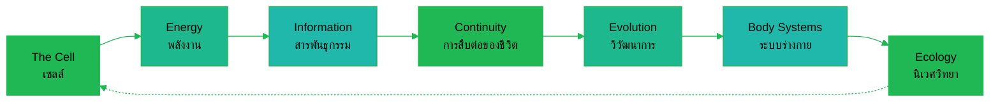

---
tags:
  - science
  - cheatsheet
  - biology
level: "Layer 3: the rules of the living"
sources:
  - "[[../Advance/Biology/01_Cell_Biology]]"
  - "[[../Advance/Biology/02_Cell_Membrane_and_Transport]]"
  - "[[../Advance/Biology/04_Cell_Energy]]"
  - "[[../Advance/Biology/06_Molecular_Biology]]"
  - "[[../Advance/Biology/07_Genetics]]"
  - "[[../Advance/Biology/08_Evolution]]"
  - "[[../Advance/Biology/09_Diversity_of_Life]]"
  - "[[../Advance/Biology/13_Human_Body_Systems]]"
  - "[[../Advance/Biology/16_Ecology]]"
created: 2026-10-07
---

# Biology: The Rules of the Living (กฎของโลกสิ่งมีชีวิต)

> *"Nothing in biology makes sense except in the light of evolution."* (Theodosius Dobzhansky)

Life is not magic; it is chemistry that learned to copy itself. Every organism runs on one rulebook: build cells (เซลล์), capture energy (พลังงาน), store information in DNA (สารพันธุกรรม), pass it to offspring (การสืบพันธุ์), and let the environment decide which copies survive (การคัดเลือกโดยธรรมชาติ). This is the operating manual of the living layer of reality.

---

## 1 | เซลล์: The Cell: The Unit of Life

### Rule 1.1: All life is cellular (ทฤษฎีเซลล์)

**The Rule.** Cell theory: (1) all organisms are made of cells (เซลล์), (2) the cell is the basic structural and functional unit of life, (3) all cells arise from pre-existing cells (*Omnis cellula e cellula*).

**WHY.** Life needs a bounded compartment where chemistry stays concentrated and controlled. Because cells only come from cells, an unbroken chain of life reaches back ~3.8 billion years: you descend directly from the first cell.

**Example.** One *Amoeba* is a single cell doing everything; a human is ~37 trillion cells that divided the labor: nerves signal, red blood cells carry oxygen.

*When to use: "which is NOT cell theory": the trap answer is "all cells have a nucleus" (prokaryotes don't).*

> 💡 **Deeper why:** A cell stays alive by holding disequilibrium across its membrane (ion and pH gradients). Life is a dissipative structure; it exports entropy to its surroundings, paid for with energy flow. An open system at equilibrium is dead.

### Rule 1.2: Prokaryote vs eukaryote: the great divide (โพรคาริโอต / ยูคาริโอต)

**The Rule.** Prokaryotes (แบคทีเรีย, อาร์เคีย) lack a membrane-bound nucleus: DNA is circular in the nucleoid (บริเวณนิวคลิออยด์), size 1–10 µm. Eukaryotes (สัตว์ พืช รา โพรทิสต์) have a true nucleus (นิวเคลียส) and organelles (ออร์แกเนลล์), linear DNA on histones (ฮิสโตน), size 10–100 µm.

**WHY.** Internal membranes let eukaryotes run incompatible chemistries in separate rooms: replication in the nucleus, ATP in mitochondria (ไมโทคอนเดรีย), digestion in lysosomes (ไลโซโซม). Compartmentalization buys size and efficiency.

**Example.** Mitochondria and chloroplasts (คลอโรพลาสต์) carry their own circular DNA and 70S ribosomes: evidence of endosymbiosis (ทฤษฎีเอ็นโดซิมไบโอติก): engulfed bacteria that stayed.

*When to use: "which organelle do prokaryotes have?" → ribosome (ไรโบโซม), the only one they share with eukaryotes.*

### Rule 1.3: The membrane is a selective gatekeeper (เยื่อเลือกผ่าน)

**The Rule.** The cell membrane (เยื่อหุ้มเซลล์) is a phospholipid bilayer (ชั้นฟอสโฟลิพิด) with embedded proteins: selectively permeable (เยื่อเลือกผ่าน): small nonpolar molecules ($\ce{O2}$, $\ce{CO2}$) pass freely; ions and polar molecules need transport proteins.

**WHY.** Hydrophobic tails face inward and exclude water-soluble substances: self-assembly driven by the hydrophobic effect. Selectivity lets the cell *choose* what enters; choice is the precondition of control, control of life.

**Example.** Transport ranked by energy cost: simple diffusion (การแพร่ธรรมดา) → facilitated diffusion (การแพร่แบบฟาซิลิเทต, channel/carrier proteins) → osmosis (ออสโมซิส, water) → active transport (การลำเลียงแบบแอกทีฟ, against gradient, ATP, e.g. Na⁺/K⁺ pump) → bulk transport (เอกโซไซโทซิส/เอนโดไซโทซิส).

*When to use: cell-in-solution questions: hypotonic (ไฮโพโทนิก) → swells/lyses; hypertonic (ไฮเพอร์โทนิก) → shrivels; isotonic → no change. Plant cells resist lysis, the cell wall (ผนังเซลล์) holds turgor pressure (แรงเต่ง).*

### Rule 1.4: Structure matches function at every scale (ออร์แกเนลล์)

**The Rule.** Nucleus stores DNA; rough ER (เอนโดพลาสมิกเรติคิวลัมแบบขรุขระ) makes export proteins; smooth ER makes lipids/detoxifies; Golgi apparatus (กอลจิบอดี) modifies, sorts, packages; mitochondria make ATP; lysosomes digest; chloroplasts photosynthesize; the central vacuole (แวคิวโอล) holds plant turgor.

**WHY.** The endomembrane system is an assembly line: rER → vesicle → Golgi → secretory vesicle → membrane. Each station adds one modification.

**Example.** A pancreas cell secreting enzymes is packed with rER and Golgi; a sperm is packed with mitochondria; a palisade cell is stuffed with chloroplasts. Count the organelles, read the lifestyle.

*When to use: "which organelle is abundant in cell X?", reason from the cell's job, never from memorized lists.*

---

## 2 | พลังงานแห่งชีวิต: The Energy of Life

### Rule 2.1: ATP is the universal energy currency (อะดีโนซีนไตรฟอสเฟต)

**The Rule.** ATP hydrolysis powers cellular work:

$$\text{ATP} + \ce{H2O} \rightarrow \text{ADP} + P_i \qquad \Delta G \approx -7.3\ \text{kcal/mol}$$

ATP is constantly recycled: a human turns over roughly their body weight in it per day.

**WHY.** One glucose holds ~686 kcal: like paying for candy with a gold bar. ATP is the small denomination. Energy coupling (การคู่ควบพลังงาน): exergonic hydrolysis pays for endergonic work, transport, movement, biosynthesis.

**Example.** The Na⁺/K⁺ pump spends 1 ATP per cycle to export 3 Na⁺ and import 2 K⁺ against their gradients.

*When to use: "immediate energy source of the cell" = ATP, never glucose, sunlight, or food.*

> 💡 **Deeper why:** ATP is the currency because its hydrolysis free energy sits mid-range, a thermodynamic *impedance match*. Much larger ΔG and it couldn't be regenerated cheaply by catabolism; much smaller and it couldn't drive endergonic reactions. Currencies settle at the exchange rate where both buyers and sellers can trade.

### Rule 2.2: Photosynthesis captures sunlight into sugar (การสังเคราะห์ด้วยแสง)

**The Rule.** In chloroplasts:

$$6\ce{CO2} + 12\ce{H2O} \xrightarrow{\text{light}} \ce{C6H12O6} + 6\ce{O2} + 6\ce{H2O}$$

Light reactions (ปฏิกิริยาใช้แสง) at the thylakoid membrane: photosystems (โฟโตซิสเต็ม) split water (photolysis, การสลายน้ำด้วยแสง), release $\ce{O2}$, make ATP + NADPH. Calvin cycle (วัฏจักรแคลวิน) in the stroma: RuBisCO (รูบิสโก) fixes $\ce{CO2}$ onto RuBP, spending ATP/NADPH to build G3P → glucose.

**WHY.** Sunlight is abundant but transient; it cannot be stored. Life converts photon energy into carrier energy (ATP, NADPH), then freezes it into stable carbon–carbon bonds: the entry ramp for nearly all energy in the biosphere.

**Example.** Variegated-leaf starch test: only green parts turn blue-black with iodine, chlorophyll (คลอโรฟิลล์) is required.

*When to use: the $\ce{O2}$ released comes from **water**, not $\ce{CO2}$ (¹⁸O labeling). No light → no ATP/NADPH → Calvin cycle stalls; the two stages are coupled.*

### Rule 2.3: Respiration burns sugar in small steps (การหายใจระดับเซลล์)

**The Rule.**

$$\ce{C6H12O6} + 6\ce{O2} \rightarrow 6\ce{CO2} + 6\ce{H2O} \qquad \Delta G \approx -686\ \text{kcal/mol}$$

Glycolysis (ไกลโคไลซิส, cytoplasm: glucose → 2 pyruvate, net 2 ATP + 2 NADH) → Krebs cycle (วัฏจักรเครปส์, matrix: releases $\ce{CO2}$, loads NADH/FADH₂) → electron transport chain (ห่วงโซ่การขนส่งอิเล็กตรอน, inner membrane: electrons fall to $\ce{O2}$, pumping H⁺). Chemiosmosis (เคมิออสโมซิส) spends the H⁺ gradient through ATP synthase (เอทีพีซินเทส) for ~32–34 more ATP. Total ≈ 36–38 ATP per glucose.

**WHY.** Burning glucose in one step would flash all 686 kcal out as heat: useless and lethal. Respiration is a controlled staircase: each small step captured in a carrier. Oxygen's extreme electronegativity makes the fall steep, ~19× more ATP than fermentation.

**Example.** Without $\ce{O2}$ the ETC backs up; cells switch to fermentation (การหมัก): lactic acid in overworked muscle, alcohol in yeast ($\ce{CO2}$ makes bread rise). Yield: only 2 ATP.

*When to use: locations: glycolysis = cytoplasm (the only stage NOT in mitochondria); Krebs = matrix; ETC = cristae. Cyanide blocks the ETC → ATP collapses while glycolysis still runs.*

> 💡 **Deeper why:** Respiration and photosynthesis run the same trick backwards, both build a proton gradient across a membrane and spend it through ATP synthase. Chemiosmosis is so universal it likely predates enzymes, powered by natural proton gradients at alkaline hydrothermal vents.

---

## 3 | สารสนเทศแห่งชีวิต: The Information of Life

### Rule 3.1: DNA stores information in base sequence (โครงสร้างดีเอ็นเอ)

**The Rule.** DNA (กรดดีออกซีไรโบนิวคลีอิก) is a double helix (เกลียวคู่): two antiparallel strands of nucleotides (นิวคลีโอไทด์ = sugar + phosphate + base), joined by complementary hydrogen bonds, **A–T (2 bonds), G–C (3 bonds)**.

**WHY.** Complementarity makes each strand a backup of the other: unzip, and each templates a perfect partner. Redundancy is built into the format, heredity can stay faithful for billions of copies. G≡C's third bond also makes GC-rich DNA more heat-stable.

**Example.** 5'-ATGCCG-3' pairs with 3'-TACGGC-5'. Chargaff's rules (กฎของชาร์กาฟ) follow: %A = %T, %G = %C, if A = 20%, then G = C = 30%.

*When to use: Chargaff problems are arithmetic once you set A=T, G=C; remember antiparallel direction when writing the complement.*

### Rule 3.2: The Central Dogma: DNA → RNA → protein (หลักกลางทางโมเลกุล)

**The Rule.**

$$\text{DNA} \xrightarrow{\text{transcription (การถอดรหัส)}} \text{mRNA} \xrightarrow{\text{translation (การแปลรหัส)}} \text{Protein}$$

Transcription in the nucleus: RNA polymerase builds mRNA (U replaces T). Translation at ribosomes: tRNA (ทีอาร์เอ็นเอ) anticodons match mRNA codons (โคดอน), 3 bases = 1 amino acid. The genetic code (รหัสพันธุกรรม) is triplet, non-overlapping, degenerate, near-universal.

**WHY.** DNA is the master archive: too precious to use directly, so cells work from disposable RNA copies; errors in RNA don't corrupt the archive. A triplet code is the minimum length for 20 amino acids ($4^2 = 16 < 20 \le 4^3 = 64$).

**Example.** DNA template 3'-TAC AAA-5' → mRNA 5'-AUG UUU-5' → Met–Phe. AUG = start; UAA, UAG, UGA = stop codons (รหัสหยุด).

*When to use: the #1 exam trap: is the given DNA strand the **template** (transcribe complementary) or the **coding** strand (same as mRNA, T→U)?*

### Rule 3.3: Gene expression is regulated (การควบคุมการแสดงออกของยีน)

**The Rule.** Every cell carries the same genome, yet cells differ because genes are switched on/off: the **lac operon** (แล็กโอเปอรอน) in bacteria turns on lactose genes only when lactose is present and glucose absent; eukaryotes use transcription factors and epigenetic marks (การดัดแปลงเหนือพันธุกรรม, DNA methylation, histone acetylation).

**WHY.** Making every protein all the time wastes enormous energy. Regulation lets one genome build hundreds of cell types (cell differentiation, การเปลี่ยนสภาพไปทำหน้าที่เฉพาะ): your cells differ not in DNA but in which genes are expressed.

**Example.** Lac operon logic: no lactose → repressor (รีเพรสเซอร์) blocks the operator → off. Lactose present → allolactose removes the repressor → on. Glucose present → weak activation (the cell prefers glucose).

*When to use: "why do identical-DNA cells look different?" = differential gene expression.*

### Rule 3.4: Mutations are the raw material of change (การกลายพันธุ์)

**The Rule.** A mutation (มิวเทชัน) changes DNA sequence. Gene level: substitution (การแทนที่, e.g. sickle-cell), insertion/deletion (frameshift, การเลื่อนกรอบรหัส: usually severe). Chromosome level (ระดับโครโมโซม): deletion, duplication, inversion, translocation. Causes: replication errors and mutagens (สารก่อกลายพันธุ์, radiation, chemicals).

**WHY.** Copying is faithful (proofreading + repair) but never perfect. Without the residual error rate there is no genetic variation (ความแปรผันทางพันธุกรรม), and no variation means nothing for selection to act on. Mutation is random; selection is not.

**Example.** Sickle-cell anemia (โรคโลหิตจางเซลล์รูปเคียว): one base substitution (A→T) in β-globin. Heterozygotes resist malaria, the allele persists by balancing selection in malarial regions, including parts of Thailand.

*When to use: frameshifts change EVERY codon downstream; a substitution changes at most one amino acid and may be silent (degenerate code).*

### Rule 3.5: Biotechnology rewrites the code (เทคโนโลยีชีวภาพ)

**The Rule.** Recombinant DNA (ดีเอ็นเอสายผสม): restriction enzymes (เอนไซม์ตัดจำเพาะ) cut DNA at specific sequences; ligase pastes genes into plasmids (พลาสมิด); transformation inserts them into bacteria. PCR (พีซีอาร์) amplifies DNA; gel electrophoresis (อิเล็กโทรฟอรีซิส) separates fragments by size; cloning (การโคลน) and DNA fingerprinting build on these.

**WHY.** The genetic code is near-universal: a human gene in a bacterium is *read correctly* because both use the same codon table. Life's shared information format makes genes portable; this single fact powers all genetic engineering.

**Example.** Human insulin (อินซูลิน): the gene is spliced into *E. coli* plasmids, and bacteria mass-produce it, replacing extraction from pig pancreases. DNA fingerprinting matches VNTR band patterns for forensics.

*When to use: PCR: $n$ cycles → $2^n$ copies (30 cycles ≈ 10⁹). Electrophoresis: DNA is negative → moves to the positive pole; small fragments travel farther.*

---

## 4 | ความต่อเนื่องของชีวิต: The Continuity of Life

### Rule 4.1: Mitosis copies, meiosis halves (ไมโทซิส / ไมโอซิส)

**The Rule.** Mitosis (ไมโทซิส): one diploid (2n) cell → two identical 2n daughters (prophase → metaphase → anaphase → telophase). Meiosis (ไมโอซิส): one 2n cell → four haploid (n) gametes (แกมีต), DNA replicates ONCE, division happens TWICE (meiosis I separates homologs; meiosis II separates sister chromatids).

**WHY.** Sexual reproduction fuses two gametes; if gametes were 2n, chromosomes would double every generation. Meiosis halves the count so fertilization (การปฏิสนธิ) restores it: n + n = 2n. Mitosis serves growth and repair, which demand genetic stability.

**Example.** Human 2n = 46: sperm and egg carry n = 23; the zygote (ไซโกต) is 46 again. In metaphase I, 23 *pairs* line up, not 46 individual chromosomes.

*When to use: after S phase: 46 chromosomes = 92 chromatids. Meiosis I is reductional, meiosis II equational. Nondisjunction (น็อนดิสจังชัน) → aneuploidy such as trisomy 21 (ดาวน์ซินโดรม).*

### Rule 4.2: Variation is manufactured in meiosis (ความแปรผันทางพันธุกรรม)

**The Rule.** Two shuffling mechanisms: **crossing over** (ครอสซิงโอเวอร์, prophase I, homologs swap segments at chiasmata) and **independent assortment** (การรวมกลุ่มอย่างอิสระ, metaphase I: each pair orients randomly).

**WHY.** Identical offspring are identical bets: one environmental shift could wipe out a clone line. Sex plus meiosis produces unique offspring, making a population a *portfolio* of bets against an uncertain future.

**Example.** Assortment alone gives $2^{23} \approx 8.4$ million gamete types in humans: before crossing over, and before multiplying both parents at fertilization.

*When to use: variation sources: mutation (ultimate source), crossing over, independent assortment, random fertilization. Crossing over happens in prophase I only.*

### Rule 4.3: Mendel's laws: inheritance is particulate (กฎของเมนเดล)

**The Rule.** **Segregation** (กฎการแยก): two alleles per gene separate into different gametes. **Independent assortment** (กฎการรวมกลุ่มอย่างอิสระ): alleles of different genes assort independently. Dominant (ลักษณะเด่น) masks recessive (ลักษณะด้อย). Monohybrid F₂ = 3 : 1 phenotype, 1 : 2 : 1 genotype; dihybrid F₂ = 9 : 3 : 3 : 1.

**WHY.** Traits travel as discrete particles, not blended fluids: blending would dilute any advantage within generations, while particles stay intact forever. Mendel's laws are meiosis seen from the outside: segregation = homologs separating in meiosis I.

**Example.** Tt × Tt → 1 TT : 2 Tt : 1 tt → 3 tall : 1 dwarf. Test cross (การทดสอบพันธุ์): tall × tt, any dwarf offspring proves the tall parent was Tt.

*When to use: write genotypes first, then the Punnett square (ตารางพันเนตต์). For dihybrids, check whether genes are unlinked (9:3:3:1) or linked (skewed toward parental types).*

### Rule 4.4: Inheritance has modes beyond Mendel (รูปแบบการถ่ายทอดลักษณะ)

**The Rule.** Incomplete dominance (ลักษณะเด่นไม่สมบูรณ์, red × white → pink, 1:2:1); codominance (ลักษณะร่วมเด่น, blood type AB shows both); multiple alleles (มัลติเปิลอัลลีล: ABO: $I^A$, $I^B$, $i$); sex-linked genes (ยีนบนโครโมโซมเพศ, color blindness ตาบอดสี, hemophilia ฮีโมฟีเลีย: X-linked recessive, commoner in males); polygenic traits (ลักษณะหลายยีน, height, skin color: continuous variation).

**WHY.** Mendel chose easy traits. Real genomes are messier: gene products blend in dosage (incomplete dominance), both copies can be expressed (codominance), and most traits combine many genes with environment. Each "exception" is a clue about the molecular mechanism underneath.

**Example.** Carrier mother $X^CX^c$ × normal father $X^CY$: sons are ½ colorblind. A colorblind *daughter* requires a colorblind father, the diagnostic giveaway.

*When to use: ABO paternity: a type O child (ii) means both parents gave i. An affected male inherits X-linked recessive alleles from his mother (father gives Y).*

### Rule 4.5: Populations evolve, individuals don't (สมดุลฮาร์ดี-ไวน์เบิร์ก)

**The Rule.** Allele frequencies stay constant only in a large, randomly mating population with no mutation, migration, or selection. Hardy–Weinberg equilibrium (สมดุลฮาร์ดี-ไวน์เบิร์ก):

$$p + q = 1 \qquad p^2 + 2pq + q^2 = 1$$

**WHY.** H–W is evolution's null hypothesis: the math of a population where nothing happens. Real populations violate it constantly, so real populations always evolve; any measured deviation tells you which force is at work. The five violations are the five agents of microevolution (วิวัฒนาการระดับจุลภาค).

**Example.** Albinism (ภาวะผิวเผือก) at 1/10,000: $q^2 = 0.0001$ → $q = 0.01$ → carriers $2pq \approx 1.98\%$, about 1 in 50. Rare recessives hide in healthy carriers, invisible to selection.

*When to use: always start from the recessive phenotype ($q^2$), the only frequency you can read directly, then $q = \sqrt{q^2}$.*

---

## 5 | ความหลากหลายและวิวัฒนาการ: Diversity and Evolution

### Rule 5.1: Classification reflects relationship (การจัดจำแนกสิ่งมีชีวิต)

**The Rule.** Hierarchy: domain → kingdom → phylum → class → order → family → genus → species (โดเมน อาณาจักร ไฟลัม คลาส ออร์เดอร์ แฟมิลี จีนัส สปีชีส์). Three domains: Bacteria, Archaea, Eukarya; the five-kingdom system (Monera, Protista, Fungi, Plantae, Animalia) is still taught. Binomial nomenclature (อนุกรมวิธานทวินาม): *Genus species*.

**WHY.** Classification is not filing convenience; it is the shape of the tree of life. Groups sharing a recent ancestor share derived traits, so a natural classification is a family tree, and the family tree is real.

**Example.** Human: Eukarya → Animalia → Chordata → Mammalia → Primates → Hominidae → *Homo* → *sapiens*. Fungi are closer to animals than to plants, a fact that surprises everyone once.

*When to use: rank-size questions: species = most specific; two organisms in the same family are necessarily in the same order.*

### Rule 5.2: Natural selection: design without a designer (การคัดเลือกโดยธรรมชาติ)

**The Rule.** Four ingredients: **variation** (ความแปรผัน), variation is **heritable** (ถ่ายทอดได้), organisms **overproduce** offspring, and survival/reproduction is **differential** by trait (fitness, ความเหมาะสม). Result: allele frequencies shift toward adaptive traits, evolution (วิวัฒนาการ) is change in allele frequencies over time.

**WHY.** Selection isn't a force imposed on life: it's a logical consequence of heritable variation plus limited resources. Whenever those hold, adaptation follows automatically: no intention, no goal, no "progress."

**Example.** Peppered moth (*Biston betularia*): industrial soot favored the dark morph; clean-air laws reversed it. Antibiotic resistance is the same rule running faster, resistance genes pre-exist; the drug only decides who survives.

*When to use: "explain via natural selection" needs all four ingredients named in order. Never write "the organism needed/wanted to adapt", individuals don't adapt; populations evolve.*

### Rule 5.3: Evidence converges from everywhere (หลักฐานเชิงวิวัฒนาการ)

**The Rule.** Fossils (ซากดึกดำบรรพ์, dated sequence in strata), homologous structures (อวัยวะที่มีต้นกำเนิดเดียวกัน: human arm, whale flipper, bat wing: same bones, different jobs), analogous structures (อวัยวะที่หน้าที่เหมือนกันแต่ต่างต้นกำเนิด, insect vs bird wings), vestigial organs (อวัยวะที่ไม่ทำหน้าที่, appendix, whale pelvis), embryology (คัพภะวิทยา), and molecular evidence (ชีววิทยาระดับโมเลกุล, universal code, cytochrome c).

**WHY.** Homology is the fingerprint of common descent: unrelated origins don't reuse the same five-fingered blueprint. DNA gives an independent clock: closer sequences mean a more recent shared ancestor. When fossils, anatomy, embryos, and molecules tell one story, the story is true.

**Example.** Cytochrome c differences from human: chimp 0, rhesus monkey 1, horse ~12, the molecular tree matches the fossil tree exactly.

*When to use: homologous = common ancestry (divergent); analogous = similar pressure, different ancestry (convergent). Bat and bird wings are homologous as forelimbs, analogous as wings.*

### Rule 5.4: Speciation: when one lineage becomes two (การเกิดสปีชีส์ใหม่)

**The Rule.** A species (สปีชีส์) interbreeds and produces fertile offspring. Speciation (สเปชีเอชัน) needs reproductive isolation (การแยกกันทางการสืบพันธุ์): prezygotic barriers (habitat, timing, behavior, gamete incompatibility) and postzygotic barriers (hybrid inviability/sterility). Modes: **allopatric** (แบบแยกถิ่นฐาน, geographic split) and **sympatric** (แบบไม่แยกถิ่นฐาน, e.g. polyploidy in plants).

**WHY.** Once gene flow (การไหลของยีน) stops, each population accumulates its own mutations under its own selection: divergence is then inevitable. Isolation is the engine; divergence is the exhaust.

**Example.** Darwin's finches: one mainland ancestor, a dozen isolated islands, different foods → ~14 species with signature beaks. A mule (horse 64 + donkey 62 → 63 chromosomes, unpairable in meiosis) is sterile, proof its parents are different species.

*When to use: new river/mountain/island splitting a population = allopatric. Polyploidy (โพลีพลอยดี), doubled chromosome sets, causes instant sympatric speciation, common in wheat and orchids.*

### Rule 5.5: Evolution has patterns (รูปแบบวิวัฒนาการ)

**The Rule.** **Divergent** (แบบแยกสาขา, one ancestor → many forms, adaptive radiation; homologous organs), **convergent** (แบบเข้าหากัน: unrelated species, similar traits in similar environments; analogous organs), **parallel** (แบบขนาน, related lineages evolve similar traits independently), **coevolution** (วิวัฒนาการร่วม, two species reciprocally shape each other).

**WHY.** Similar environments pose similar problems and physics limits the good solutions: streamlining for swimming, wings for flight. Convergence proves adaptation is real: form follows function regardless of ancestry. Coevolution proves life shapes life, species are each other's most important environment.

**Example.** Convergent: shark (fish), dolphin (mammal), ichthyosaur (reptile) share a torpedo shape. Coevolution: long-spurred orchid and long-tongued moth; *Acacia* ants defending their host tree.

*When to use: first ask "same ancestor?" (yes → divergent/parallel; no → convergent), then "mutual shaping between two species?" → coevolution. Adaptive radiation = rapid divergence into empty niches.*

---

## 6 | ระบบร่างกาย: Body Systems and Homeostasis

### Rule 6.1: Homeostasis: the body holds its setpoints (ภาวะธำรงดุล)

**The Rule.** Homeostasis (โฮมีโอสตาซิส) keeps internal variables near setpoints via **negative feedback** (การตอบกลับแบบลบ): receptor (ตัวรับ) → control center → effector → response opposing the change. Setpoints: ~37 °C, blood glucose ~70–110 mg/dL, blood pH ~7.35–7.45.

**WHY.** Enzymes (เอนไซม์) work only in narrow temperature/pH windows: their protein shape is delicate. Multicellular life answers a changing outside by building a stable inside. Positive feedback (การตอบกลับแบบบวก) is rare and time-limited; it amplifies a process to completion.

**Example.** Blood glucose: high → pancreas β-cells secrete insulin (อินซูลิน) → cells absorb glucose, liver stores glycogen → falls. Low → α-cells secrete glucagon (กลูคากอน) → glycogen breaks down → rises. Diabetes (โรคเบาหวาน) is this loop broken (type 1: no insulin; type 2: resistance).

*When to use: response *reverses* the stimulus = negative feedback; *amplifies* it = positive (clotting, childbirth oxytocin). Sweating/shivering are negative-feedback effectors.*

### Rule 6.2: Every system defends the same setpoints (ระบบอวัยวะ)

**The Rule.** Digestive (ระบบย่อยอาหาร, amylase → sugars, pepsin/trypsin → peptides, lipase → fatty acids; absorption at intestinal villi); circulatory (ระบบหมุนเวียนเลือด: heart's double loop; arteries out under high pressure, veins back with valves, capillaries exchange); respiratory (ระบบหายใจ, alveoli (ถุงลม) diffuse gases; $\ce{CO2}$ carried mostly as $\ce{HCO3-}$); excretory (ระบบขับถ่าย, nephron (เนฟรอน): filtration → reabsorption → secretion → urine); plus nervous, endocrine, immune (ระบบภูมิคุ้มกัน), skeletal, muscular, reproductive systems.

**WHY.** Division of labor at organism scale is the organelle principle repeated: specialize subsystems, connect them by transport and control, and every cell can reach Rule 6.1's setpoints. Each system exists to defend one or more of them.

**Example.** Trace glucose: mouth (amylase on starch) → stomach (acid, pepsin, no carb digestion) → small intestine (pancreatic amylase finishes; villi absorb) → portal vein → liver → blood → your muscle cell. Villi + microvilli give ≈ 200 m² of absorption area.

*When to use: "if organ X fails" questions: map organ → variable defended (kidney → water/pH; pancreas → glucose; lung → $\ce{O2}$/$\ce{CO2}$/pH). Enzyme–pH matching: pepsin at stomach pH ~2; pancreatic enzymes at pH ~8.*

### Rule 6.3: Nerves signal electrically, hormones chemically (ระบบประสาทและระบบต่อมไร้ท่อ)

**The Rule.** A neuron (เซลล์ประสาท) rests at ~ −70 mV (resting potential, ศักยะพัก) via the Na⁺/K⁺ pump. Stimulus past threshold → Na⁺ floods in → action potential (ศักยะงาน, ~ +40 mV), all-or-none → travels down the axon → Ca²⁺ triggers neurotransmitter (สารสื่อประสาท) release at the synapse (ไซแนปส์). Myelin (ปลอกไมอีลิน) speeds conduction by saltatory jumps between nodes of Ranvier. Hormones (ฮอร์โมน) ride blood to distant targets: peptide hormones bind surface receptors (fast); steroids enter the cell and change gene expression (slow, long-lasting).

**WHY.** Two control systems cover two time scales: nerves are wires (milliseconds, point-to-point); hormones are broadcasts (seconds to days, body-wide). Signaling is electrical because membranes store ion gradients like batteries; strength is coded by firing *frequency*, never amplitude.

**Example.** Hot pan: sensory neuron → spinal interneuron → motor neuron → hand pulls away before the brain feels pain, a reflex arc (วงจรรีเฟลกซ์) that routes through the spine to save milliseconds.

*When to use: dendrite receives, axon transmits, synapse is one-way (vesicles only presynaptic). Action potentials never vary in size, stronger stimuli = more frequent firing, more neurons recruited.*

---

## 7 | นิเวศวิทยา: Ecology: The Rules of the Whole

### Rule 7.1: Energy flows one way; matter cycles (การถ่ายทอดพลังงาน)

**The Rule.** Energy enters as sunlight and passes through trophic levels (ระดับชั้นอาหาร): producer (ผู้ผลิต) → primary consumer (ผู้บริโภคอันดับ 1) → secondary → tertiary, losing ~90% per step (กฎ 10 เปอร์เซ็นต์). Matter recycles indefinitely through biogeochemical cycles (วัฏจักรชีวธรณีเคมี).

**WHY.** The second law of thermodynamics: every transfer leaks heat, respiration, movement, undigested waste. With only ~10% passed on, food chains cap at 4–5 links; there is no energy left for more. Atoms, by contrast, are neither created nor destroyed: the carbon in your DNA has been in the air, in plants, in dinosaurs.

**Example.** 10,000 kcal of grass → 1,000 in grasshoppers → 100 in frogs → 10 in snakes → 1 in hawks. This is why eating lower on the chain feeds more people per hectare, and why apex predators are always rare.

*When to use: pyramid math: ×0.1 per level up, ×10 down. Pyramids of energy are ALWAYS upright, thermodynamics forbids inversion; pyramids of numbers can invert (one tree, thousands of insects).*

### Rule 7.2: Nutrients ride closed loops (วัฏจักรสาร)

**The Rule.** Carbon cycle (วัฏจักรคาร์บอน): photosynthesis pulls $\ce{CO2}$ from air; respiration, decomposition, combustion return it; fossil fuels are long-term storage. Nitrogen cycle (วัฏจักรไนโตรเจน): fixation (การตรึงไนโตรเจน) by bacteria (*Rhizobium* in legume roots) → $\ce{NH4+}$ → nitrification (ไนตริฟิเคชัน) → $\ce{NO3-}$ → plants → denitrification (ดีไนตริฟิเคชัน) returns N₂. Water cycle (วัฏจักรน้ำ): evaporation → condensation → precipitation → runoff.

**WHY.** Life's key elements are locked in unusable forms: N₂ is inert, carbon sits in rocks and the deep ocean. Microbes evolved an enzymatic key for each lock, so the biosphere depends on bacteria at every loop's gateway. Break a loop and the cycle rebalances at a new, often hostile, equilibrium.

**Example.** Crop rotation with legumes (พืชตระกูลถั่ว) fertilizes biologically: root-nodule bacteria fix atmospheric N₂ into ammonia for the next crop, free fertilizer powered by symbiosis.

*When to use: in cycle diagrams, locate the microbes first; they run every oxidation-state change. Fossil fuel carbon = ancient photosynthesis, returned in minutes, the speed mismatch is the climate problem.*

### Rule 7.3: Populations grow until something stops them (พลวัตประชากร)

**The Rule.** Exponential growth (แบบเอกซ์โพเนนเชียล, J-curve): $\frac{dN}{dt} = rN$. Logistic growth (แบบลอจิสติก, S-curve), slowing near carrying capacity (K, ความสามารถในการรองรับ):

$$\frac{dN}{dt} = rN\left(\frac{K-N}{K}\right)$$

Limiting factors (ปัจจัยจำกัด): density-dependent (competition, predation, disease) and density-independent (flood, fire, frost). Survivorship curves (เส้นโค้งการรอดชีวิต): Type I (few offspring, high care, humans), Type II (constant: birds), Type III (many offspring, low survival, fish, trees).

**WHY.** Biotic potential (ศักยภาพทางชีวภาพ) always exceeds environmental resistance: one bacterium dividing every 20 minutes would outweigh Earth in days if unchecked. Growth is never the question; *what stops it* is. Populations settle where birth rate = death rate at K.

**Example.** Yeast in a closed flask: rapid growth → sugar gone, ethanol accumulates → peak, then crash. Thailand's demography now shows Type I with falling birth rates, an aging society (สังคมผู้สูงอายุ) follows from the same mathematics.

*When to use: on the S-curve, fastest growth is at N = K/2, not at K (where growth = 0). r-selected: many small offspring, unstable habitats; K-selected: few large offspring, stable habitats.*

### Rule 7.4: Interactions structure communities (ความสัมพันธ์ระหว่างสิ่งมีชีวิต)

**The Rule.** +/− notation: mutualism (ภาวะพึ่งพากัน, +/+, bees and flowers), commensalism (ภาวะอิงอาศัย, +/0: orchids on trees), parasitism (ภาวะปรสิต, +/−, ticks, tapeworms), predation (การล่าเหยื่อ, +/−), competition (การแข่งขัน, −/−). Competition drives exclusion or niche partitioning; predation drives arms races (camouflage, warning coloration, mimicry).

**WHY.** Every population is limited by its interactions. A niche (นิช) is a job in the ecosystem's economy, and economic rules apply: two species can't hold an identical niche forever (หลักการกีดกันทางการแข่งขัน); they diverge, partition, or one goes extinct. Predators keep prey populations healthy.

**Example.** Keystone species (สปีชีส์หลัก): remove sea otters → urchins explode → kelp forests collapse. One predator rewires the whole community. In Thailand, elephants clear forest paths and disperse large seeds.

*When to use: memorize the four symbol pairs with one example each. "Remove species X" → trace the web up (predators starve) and down (prey explodes).*

### Rule 7.5: Biodiversity is the ecosystem's insurance (ความหลากหลายทางชีวภาพ)

**The Rule.** Three levels: genetic (พันธุกรรม), species (สปีชีส์), ecosystem (ระบบนิเวศ). High diversity → stability and resilience. Threats: **HIPPO**, Habitat loss, Invasive species, Pollution, Population growth, Overharvesting. Succession (การทดแทนทางนิเวศ): primary (bare rock, lichens pioneer) and secondary (soil intact: faster).

**WHY.** Diversity is functional redundancy: if ten species pollinate, losing one is survivable; losing the only one collapses the function. A monoculture is a single point of failure, the logic behind potato famines and shrimp-farm disease crashes. More species means more loops for energy and matter to reroute around damage.

**Example.** Thailand's mangroves (ป่าชายเลน) buffer storms, filter runoff, and nursery fish: converting them to shrimp ponds trades a multi-function ecosystem for a single product that fails within years.

*When to use: succession: primary = NO soil (volcanic island, retreating glacier), lichens first; secondary = soil intact (abandoned farm, post-fire), grasses first.*

---

## Chain Navigation

⬅ [[02_Chemistry_Matter_and_Reactions]] · ➡ [[04_Earth_Science_Systems_and_Cycles]] · 🗺 [[06_Roadmap]]
