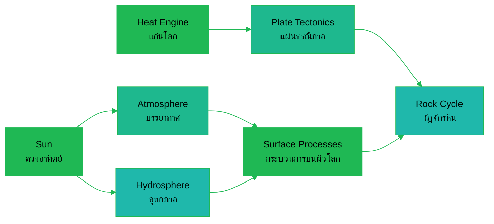

---
tags:
  - science
  - cheatsheet
  - earth-science
level: "Layer 4: the rules of our planet"
sources:
  - "[[../Advance/Earth Science/01_Minerals_and_Rocks]]"
  - "[[../Advance/Earth Science/02_Plate_Tectonics]]"
  - "[[../Advance/Earth Science/03_Earthquakes_and_Volcanoes]]"
  - "[[../Advance/Earth Science/04_Weathering_and_Erosion]]"
  - "[[../Advance/Earth Science/05_Earth_History]]"
  - "[[../Advance/Earth Science/06_Weather_and_Climate]]"
  - "[[../Advance/Earth Science/08_Water_Cycle_and_Hydrology]]"
  - "[[../Advance/Earth Science/09_Solar_System_and_Astronomy]]"
  - "[[../Advance/Earth Science/10_Climate_Change_and_Environment]]"
created: 2026-10-07
---

# Earth Science: The Rules of Our Planet (กฎของโลกของเรา)

> *"The present is the key to the past."* (Charles Lyell (uniformitarianism))

The ground under your feet looks solid and still. It is neither. Earth is a 4.6-billion-year-old heat engine wearing a thin crust of moving plates, wrapped in an ocean of air and water that never stop circulating, orbiting an ordinary star that sets every rhythm. This is the operating manual of the planet: the rules that build mountains, carve valleys, brew monsoons, and decide the climate your rice grows in.

---

## 1 | วัฏจักรหิน: The Rock Cycle

### Rule 1.1: Minerals build rocks (แร่และหิน)

**The Rule.** A mineral (แร่) is a naturally occurring inorganic solid with a fixed chemical formula and an ordered crystal structure (ผลึก). A rock (หิน) is an aggregate of one or more minerals. Hardness follows Mohs scale (มาตราความแข็งของโมส์, 1 talc → 10 diamond); other ID tools: streak (รอยขีด), luster (ความวาว), cleavage (แนวแตกเรียบ).

**WHY.** Crystals grow the way bricks stack: atoms arrange into the lowest-energy lattice their chemistry allows, and that lattice fixes every property: shape, hardness, cleavage. Identifying minerals by structure, not color (color varies with impurities), is what makes geology a science rather than rock collecting.

**Example.** Quartz (ควอตซ์, $\ce{SiO2}$) and calcite (แคลไซต์, $\ce{CaCO3}$) look alike but calcite fizzes in dilute HCl: one test, two minerals separated.

*When to use: mineral ID questions: never use color alone; hardness + streak + acid reaction are the reliable discriminators.*

### Rule 1.2: Three rock families, one cycle (หินสามประเภท)

**The Rule.** **Igneous** (หินอัคนี): cooled from magma (หินหนืด)/lava, granite แกรนิต (intrusive, slow-cooled, coarse crystals), basalt บะซอลต์ (extrusive, fast-cooled, fine). **Sedimentary** (หินตะกอน): compacted and cemented sediment, sandstone หินทราย, limestone หินปูน, shale หินดินดาน; the only rocks with fossils and bedding layers. **Metamorphic** (หินแปร): recrystallized by heat and pressure without melting, marble หินอ่อน (from limestone), gneiss หินไนส์ (from granite). The rock cycle (วัฏจักรหิน) connects all three: any rock type can become any other.

**WHY.** The cycle is driven by two engines: Earth's internal heat (melts and deforms rock, lifts mountains) and the Sun (weathering, erosion, sedimentation tear them down). Because both engines run forever, no rock is permanent; every stone is a snapshot of one moment in an endless loop.

**Example.** Limestone on a seabed → subducted, heated → marble → uplifted into a mountain → weathered to sand → cemented to sandstone. Follow any arrow on the cycle diagram; all are legal moves.

*When to use: crystal size tells cooling rate: coarse = slow = deep (intrusive); fine/glassy = fast = surface (extrusive). Fossils only survive sedimentary rock, heat destroys them.*

### Rule 1.3: Crystals form in a fixed order (อนุกรมปฏิกิริยาของโบเวน)

**The Rule.** Bowen's reaction series (อนุกรมปฏิกิริยาของโบเวน): as magma cools, minerals crystallize in sequence, olivine (โอลิวีน) first (~1200 °C), then pyroxene, amphibole, biotite; plagioclase feldspar shifts continuously from Ca-rich to Na-rich; quartz (ควอตซ์) crystallizes last (~650 °C).

**WHY.** Minerals that form at high temperature are furthest from surface conditions; so olivine weathers fastest and quartz is nearly immortal. The crystallization order literally predicts weathering resistance, linking the deep interior to the landscape above.

**Example.** Granite (quartz + feldspar + mica) weathers into sandy beaches of quartz grains: the quartz simply outlasts everything else.

*When to use: "which mineral is most resistant to weathering?" → quartz; "first to crystallize?" → olivine.*

---

## 2 | แผ่นธรณีภาค: Plate Tectonics

### Rule 2.1: The crust moves (ทฤษฎีแผ่นธรณีภาค)

**The Rule.** The lithosphere (ธรณีภาค) is broken into ~15 plates that glide on the ductile asthenosphere (อะธีโนสเฟียร์) at a few cm/year. Evidence chain: continental drift (การเคลื่อนที่ของทวีป, Wegener's Pangaea แพนเจีย, fossil and coastline fits) → seafloor spreading (การแผ่ขยายของพื้นมหาสมุทร: symmetric magnetic stripes, youngest crust at ridges) → plate tectonics.

**WHY.** Earth has too much internal heat to stay still: it cools by convection (การพาความร้อน), and the crust is the scum riding on that flow. Plates are the surface expression of a planet expelling heat, tectonics is Earth's cooling system.

**Example.** The Atlantic widens ~2.5 cm/year: about the rate your fingernails grow. In 200 million years the map will be unrecognizable.

*When to use: evidence questions: magnetic stripes (พาเลโอแมกเนติก) prove spreading; seafloor age increases away from ridges; no ocean crust older than ~180 Ma (it all gets recycled).*

> 💡 **Deeper why:** Plate tectonics is Earth's heat engine expelling primordial heat (leftover from planetary accretion) and radiogenic heat (decay of U, Th, K in the mantle). Without this thermostat the crust would stagnate like Venus's, no carbon burial, no long-term climate regulation, and possibly no complex life.

### Rule 2.2: Three boundary types, three signatures (ขอบเขตแผ่นธรณีภาค)

**The Rule.** **Divergent** (แยกจากกัน): plates split, magma fills, mid-ocean ridges (แนวเทือกเขากลางสมุทร), rift valleys. **Convergent** (ชนกัน): **ocean–ocean** → trench (ร่องลึกก้นสมุทร) + volcanic island arc; **ocean–continent** → trench + continental volcanoes (subduction, การมุดตัว); **continent–continent** → folded mountains, no volcanoes. **Transform** (เลื่อนผ่านกัน): plates slide, shallow earthquakes, no crust created or destroyed.

**WHY.** All of Earth's surface drama: quakes, volcanoes, mountains, trenches, happens at edges, not centers, because that's where plates mechanically interact. The boundary type determines the outcome: pull apart → magma rises; push together → crust sinks or piles up; slide → friction stores energy.

**Example.** The Himalayas: India colliding with Asia (continent–continent), 50 Ma and counting, no subduction, no volcanoes, just crust crumpling upward. The Andes: ocean–continent subduction, trench plus a volcanic chain.

*When to use: map questions: identify boundary by its landform (ridge = divergent, trench/arc = convergent, fault line with quakes but no volcanoes = transform). Thailand sits within the Sunda Plate, near convergent zones, the source of its rare but real earthquakes (แผ่นดินไหว).*

### Rule 2.3: Earthquakes are stored friction released (แผ่นดินไหว)

**The Rule.** Rocks on either side of a fault (รอยเลื่อน) lock, strain accumulates, then slip suddenly: releasing energy as seismic waves (คลื่นไหวสะเทือน): P-waves (คลื่นปฐมภูมิ, compressional, fastest, through solids and liquids), S-waves (คลื่นทุติยภูมิ, shear, slower, solids only), surface waves (slowest, most destructive). Size: magnitude (แมกนิจูด, Richter, logarithmic, each unit = 10× amplitude, ~32× energy); intensity (ความรุนแรง, Mercalli, damage observed). Focus (จุดกำเนิด) underground; epicenter (จุดเหนือศูนย์กำเนิด) on the surface.

**WHY.** Friction can't release energy smoothly; it fails in jumps (stick-slip). The wave hierarchy lets us probe the interior: S-waves vanishing below certain angles revealed Earth's liquid outer core (แก่นโลกชั้นนอก). One rule, two payoffs: hazard prediction and planetary anatomy.

**Example.** P-waves arrive first (the warning seconds), S-waves next, surface waves last and hardest: which is why early-warning systems key on P-wave detection.

*When to use: "why do we know the outer core is liquid?" → S-wave shadow zone. Distance to epicenter = time gap between P and S arrivals.*

### Rule 2.4: Volcanoes are pressure valves (ภูเขาไฟ)

**The Rule.** Magma rises because it is less dense than surrounding rock. Eruption style depends on viscosity (ความหนืด) and gas: low-viscosity basaltic magma → gentle shield volcanoes (ภูเขาไฟรูปโล่) and lava flows; high-viscosity silica-rich magma traps gas → explosive composite/stratovolcanoes (ภูเขาไฟกรวยสลับชั้น). Products: lava (ลาวา), pyroclastic flows (ไพรอคลาสติกโฟลว์), ash. Status: active, dormant, extinct.

**WHY.** Viscosity scales with silica content, and silica polymerizes into tangled chains that cage gas bubbles: like shaking a sealed soda that can't foam out until it bursts. The same chemistry that makes granite at depth makes explosions at the surface.

**Example.** Hawaiian Mauna Loa: basaltic, effusive, safe to watch. Mount Pinatubo 1991: andesitic, explosive, cooled the whole planet for two years, viscosity is destiny.

*When to use: predict eruption style from magma type: basalt = gentle; andesite/rhyolite = explosive. Ring of Fire (วงแหวนแห่งไฟ) = subduction-margin volcanoes around the Pacific.*

---

## 3 | กระบวนการบนผิวโลก: Surface Processes

### Rule 3.1: Weathering breaks rock down (การผุพัง)

**The Rule.** **Physical weathering** (การผุพังทางกายภาพ): frost wedging, thermal expansion, root pry, pressure release, rock breaks, chemistry unchanged. **Chemical weathering** (การผุพังทางเคมี): oxidation (rusting), hydrolysis, carbonation (limestone dissolving in acidic water), minerals transform. Rate rises with temperature and moisture.

**WHY.** Rocks crystallized at high temperature and pressure are unstable at the surface: weathering is just minerals relaxing toward surface conditions (Rule 1.3 again). Warm and wet maximizes both reaction rates, which is why tropical Thailand weathers fast and deep.

**Example.** Karst topography (ภูมิประเทศแบบคาสต์): rain + $\ce{CO2}$ → weak carbonic acid dissolves limestone into caves, sinkholes, and Thailand's iconic limestone islands at Phang Nga Bay.

*When to use: climate controls the balance: hot-wet tropics = chemical weathering dominates; cold/dry = physical. Frost wedging needs water to cycle through freezing.*

### Rule 3.2: Erosion moves the pieces; gravity never sleeps (การกร่อนและการสะสมตัว)

**The Rule.** Agents of erosion (การกร่อน): water (rivers, the biggest mover), wind, ice (glaciers), waves; gravity drives mass wasting (การเคลื่อนที่ของมวล: landslides, soil creep). Rivers erode in their upper course (V-shaped valleys, waterfalls), transport in the middle, deposit in the lower (floodplains ธารน้ำท่วมถึง, deltas ดินดอนสามเหลี่ยม, meanders). Deposition (การสะสมตัว) happens wherever the transporting agent slows.

**WHY.** The Sun lifts water uphill for free (evaporation → rain on mountains), and gravity then spends that potential energy carving the landscape on its way back to sea level. Every valley is the bill from that energy cycle; deposition is simply transport losing its power.

**Example.** The Chao Phraya delta (ดินดอนสามเหลี่ยมแม่น้ำเจ้าพระยา): sediment carried from northern mountains builds the central plain, and the rice bowl of Thailand, one flood at a time.

*When to use: sort landforms by course: V-valley/waterfall = upper; meander/floodplain = middle; delta = mouth. Particle size decreases with distance from the source.*

### Rule 3.3: Soil is the living skin (ดิน)

**The Rule.** Soil (ดิน) forms from parent rock plus climate, organisms, topography, and time. Profile (หน้าตัดดิน): O-horizon (organic), A (topsoil, humus-rich), B (subsoil, leached minerals accumulate), C (weathered parent material). Texture classes: sand, silt, clay (ทราย ตะกอน ดินเหนียว).

**WHY.** Soil is the interface where the rock cycle meets the biosphere: the only place plants can anchor and where decomposition recycles nutrients. Losing an inch of topsoil takes centuries; washing it away takes one bad decade.

**Example.** Clay holds water and nutrients (high surface area, negative charge binds cations) but drains poorly; sandy soil drains fast but leaches nutrients: loam (ดินร่วน), the mix, is why it's the agricultural standard.

*When to use: soil questions: match horizon to job (A = most fertile/humic; B = accumulation; C = parent). Thai context: paddy soils of the central plain vs sandy, poorer soils of the Isan plateau.*

---

## 4 | เวลาทางธรณีวิทยา: Deep Time

### Rule 4.1: The rock record is a dated calendar (ธรณีกาล)

**The Rule.** Geologic time scale (มาตราธรณีกาล): eon → era → period → epoch. From old: Precambrian (พรีแคมเบรียน, ~88% of Earth history, simple life) → Paleozoic (พาเลโอโซอิก, marine invertebrates → fish → amphibians → reptiles; ends with the Permian mass extinction ~90% of species) → Mesozoic (มีโซโซอิก, dinosaurs, ends with the K–Pg extinction 66 Ma) → Cenozoic (ซีโนโซอิก, mammals, us).

**WHY.** The scale is built from fossil succession: life changes irreversibly, so each stratum's fossil assemblage fingerprints its age worldwide. Deep time is not decoration: without billions of years, neither plate drift nor evolution has time to work.

**Example.** Compress Earth's 4.6 Ga into one day: life appears ~4 AM, complex cells ~5:40 PM, dinosaurs ~11 PM (gone by 11:40 PM), humans arrive in the final 2 seconds.

*When to use: ordering questions: memorize era sequence with fossil anchors (Paleozoic = trilobites/insects, Mesozoic = dinosaurs/ammonites, Cenozoic = mammals). Mass extinctions are era boundaries.*

### Rule 4.2: Two clocks date the rocks (การหาอายุหิน)

**The Rule.** **Relative dating** (การหาอายุสัมพัทธ์): law of superposition (กฎการวางซ้อน, lower strata are older), cross-cutting relationships (what cuts a rock is younger), fossils correlate layers. **Absolute dating** (การหาอายุสัมบูรณ์): radiometric clocks, parent isotope decays at a fixed half-life (ครึ่งชีวิต), e.g. carbon-14 (คาร์บอน-14, ~5,730 y, organic material, up to ~50,000 y) and uranium–lead (ยูเรเนียม–ตะกั่ว, billions of years, zircon crystals).

**WHY.** Relative dating gives sequence but no numbers; radioactive decay is nature's stopwatch: unaffected by heat, pressure, or chemistry, so the isotope ratio is a clock that started the moment the mineral crystallized. Together: sequence plus numbers equals history.

**Example.** A fossil has 25% of its original ¹⁴C → two half-lives → ~11,460 years old. (Each half-life halves the parent: 100% → 50% → 25%.)

*When to use: choose the isotope by material and age: ¹⁴C for recent organics ONLY (not rocks, not dinosaurs); uranium–lead or potassium–argon for ancient igneous rock. Half-life math: remaining fraction = $(1/2)^n$.*

### Rule 4.3: Fossils are snapshots with rules of preservation (ซากดึกดำบรรพ์)

**The Rule.** Fossils (ซากดึกดำบรรพ์): petrified remains, molds/casts, trace fossils (รอยทาง: footprints, burrows), and amber/ice preservation. Fossilization needs rapid burial and low oxygen; index fossils (ซากดึกดำบรรพ์ดัชนี) are short-lived, widespread species used to date strata.

**WHY.** The fossil record is biased toward hard-bodied, abundant, rapidly buried organisms: soft life is nearly invisible. Reading the record means correcting for that bias: absence of evidence is weak evidence of absence.

**Example.** Ammonites (แอมโมไนต์): fast-evolving, ocean-wide, shelled, a perfect index fossil. A limestone layer full of them pins that rock to a specific Mesozoic window anywhere on Earth.

*When to use: index fossil criteria: wide geographic range + short time range + abundant + easy to identify.*

---

## 5 | บรรยากาศ: The Atmosphere

### Rule 5.1: The atmosphere is layered by temperature (ชั้นบรรยากาศ)

**The Rule.** Five layers: troposphere (โทรโพสเฟียร์, 0–12 km, ALL weather, T falls ~6.5 °C/km), stratosphere (สตราโทสเฟียร์, 12–50 km, ozone layer ชั้นโอโซน absorbs UV, T rises), mesosphere (มีโซสเฟียร์, 50–85 km, coldest, meteors burn up), thermosphere (เทอร์โมสเฟียร์, 85–600 km, auroras, ISS), exosphere (เอกโซสเฟียร์, → space). The ionosphere (ไอโอโนสเฟียร์) overlaps the upper layers and reflects radio waves.

**WHY.** Layers exist wherever the temperature gradient flips, and it flips wherever a new energy-absorbing mechanism turns on: ozone heating the stratosphere from above is why weather never reaches there. Composition: 78% $\ce{N2}$, 21% $\ce{O2}$, ~1% everything else (including the greenhouse gases that matter most).

**Example.** The ozone layer ($\ce{O3}$) absorbs UV-B/C high in the stratosphere: life on land exists because of this one thin filter; CFCs (สารซีเอฟซี) nearly broke it, and the Montreal Protocol is the story of it healing.

*When to use: layer questions anchor on one fact each: troposphere = weather; stratosphere = ozone/jetliners; mesosphere = meteors; thermosphere = auroras.*

### Rule 5.2: Uneven heating drives all weather (ลมและความกดอากาศ)

**The Rule.** The equator receives more solar energy per unit area than the poles (curved surface, longer path). Warm air rises (low pressure, ความกดอากาศต่ำ), cold air sinks (high pressure): pressure gradients push wind; the Coriolis effect (ปรากฏการณ์คอริออลิส, Earth's rotation) deflects moving air: right in the Northern Hemisphere, left in the Southern. Global cells: Hadley, Ferrel, Polar, producing trade winds (ลมสินค้า), westerlies, and the doldrums at the equator.

**WHY.** Weather is the atmosphere's attempt to transport tropical heat toward the poles: the planet's air conditioning. Rotation then bends that flow into belts, so climate zones fall at predictable latitudes. No rotation, no Coriolis; no Coriolis, no cyclones.

**Example.** Tropical cyclones (พายุหมุนเขตร้อน, typhoon ไต้ฝุ่น in the Pacific): low-pressure centers, counterclockwise in the north; they cannot form within ~5° of the equator because Coriolis is zero there. Thailand's storms arrive as tropical depressions from the South China Sea and Andaman.

*When to use: wind direction questions: air flows high → low pressure, then deflects by hemisphere. Low pressure = rising air = clouds/rain; high = sinking air = clear skies.*

### Rule 5.3: Thailand lives on the monsoon clock (ลมมรสุม)

**The Rule.** Monsoons (มรสุม) are seasonal wind reversals driven by land–sea temperature contrast. Thailand: **SW monsoon** (มรสุมตะวันตกเฉียงใต้, mid-May to mid-October), moist air from the Indian Ocean → rainy season; **NE monsoon** (มรสุมตะวันออกเฉียงเหนือ, mid-October to mid-February): dry cool air from high-pressure over China → cool, dry season. ENSO modulates it: **El Niño (เอลนีโญ)** warms the eastern Pacific, weakens the SW monsoon → drought in Thailand; **La Niña (ลานีญา)** does the opposite → extra rain and floods.

**WHY.** Land heats and cools faster than ocean. In summer the Asian continent becomes a thermal low that pulls in ocean moisture; in winter it flips to a cold high that pushes dry air out. Thailand's agriculture: rice planting calendars, is synchronized to this reversal, which is why ENSO shifts hit the economy directly.

**Example.** The 2011 mega-flood: a strong La Niña plus late-season storms dumped record rain on the Chao Phraya basin, hundreds of billions of baht in damage. The 2015–16 El Niño drought emptied the same basin's reservoirs.

*When to use: Thai climate questions: rainy season = SW monsoon (onshore, moist); cool season = NE monsoon (offshore, dry); hottest period = March–May, between monsoons. El Niño = dry risk; La Niña = flood risk.*

---

## 6 | อุทกภาค: The Hydrosphere

### Rule 6.1: Water cycles endlessly (วัฏจักรน้ำ)

**The Rule.** Evaporation (การระเหย) and transpiration (การคายน้ำ) → condensation (การกลั่นตัว) → precipitation (หยาดน้ำฟ้า) → runoff/infiltration (น้ำท่า/การซึม) → ocean → repeat. Distribution: ~97% saltwater, ~2% ice caps/glaciers, ~1% fresh liquid, rivers and lakes hold a tiny sliver of the usable total.

**WHY.** The Sun lifts ~500,000 km³ of water per year against gravity: a free planetary conveyor that distributes both water and heat. Because the cycle is closed, water is never consumed, only moved and (sometimes) polluted: the same molecules the dinosaurs drank are in your glass.

**Example.** A raindrop on the Isan plateau: some infiltrates to groundwater (น้ำใต้ดิน), some runs off to the Mekong (แม่น้ำโขง), some evaporates back within days, the split depends on soil, slope, and vegetation, which is why deforestation converts infiltration into flash-flood runoff.

*When to use: water-balance questions: precipitation = runoff + infiltration + evapotranspiration. Thailand's rainy season recharges the aquifers that carry the dry season.*

### Rule 6.2: Ocean currents redistribute heat (กระแสน้ำในมหาสมุทร)

**The Rule.** Surface currents (กระแสน้ำผิวหน้า) are wind-driven and bent by Coriolis into giant gyres (ไจร์): warm water flows poleward on the west side of oceans, cold water equatorward on the east. Deep currents (thermohaline circulation, การหมุนเวียนเทอร์โมฮาไลน์) are density-driven, cold, salty water sinks at high latitudes and creeps through the deep ocean for ~1,000 years.

**WHY.** Warm water holds less gas; cold, salty water is denser; so heat loss at the poles literally powers a global deep conveyor. The surface gyres move climate: a warm current on a coast means mild, wet weather; a cold current means arid coasts and rich fisheries.

**Example.** The Gulf Stream carries tropical heat to NW Europe: London is milder than Labrador at the same latitude. The cold Humboldt Current makes the Atacama one of Earth's driest deserts while fertilizing one of its richest fisheries (cold water = nutrients upwelling).

*When to use: coastal climate questions: west coast of continent at mid-latitudes = cold current = dry; east coast = warm current = wet. El Niño = the warm current off Peru fails, and world weather stumbles.*

### Rule 6.3: Tides are gravitational (น้ำขึ้นน้ำลง)

**The Rule.** Tides (น้ำขึ้นน้ำลง) come from the Moon's (mostly) and Sun's differential gravity across Earth: two bulges, one facing the Moon, one opposite. Rotation carries any coast through two highs and two lows daily. Spring tides (น้ำเกิด, Sun–Moon aligned, new/full moon) have the greatest range; neap tides (น้ำตาย, quarter moons, forces at right angles) the least.

**WHY.** Gravity weakens with distance, so the near side of Earth is pulled harder than the far side: the planet stretches slightly along the Earth–Moon line. Two bulges, not one, is the giveaway that tides are about *differences* in pull, not the pull itself.

**Example.** The Gulf of Thailand has unusually small tides (semi-diurnal mixing), while the Andaman coast swings 2–3 m: enough that Phang Nga's sea caves are visitable only at low tide.

*When to use: phase-to-tide mapping: new/full moon → spring tide; first/third quarter → neap tide. Spring tides every ~14 days.*

---

## 7 | อวกาศ: Space

### Rule 7.1: The solar system has an architecture (ระบบสุริยะ)

**The Rule.** Sun (ดวงอาทิตย์) at center (~99.8% of system mass), eight planets in near-circular, near-coplanar orbits, all counterclockwise from above the north: rocky terrestrials inside (Mercury–Venus–Earth–Mars), asteroid belt (แถบดาวเคราะห์น้อย), gas/ice giants outside (Jupiter–Saturn–Uranus–Neptune); then Kuiper belt (Pluto ดาวพลูโต = dwarf planet ดาวเคราะห์แคระ) and the distant Oort cloud of comets (ดาวหาง).

**WHY.** The architecture is a fossil of formation: the solar nebula (เนบิวลาสุริยะ) collapsed and spun into a disk (conservation of angular momentum → flat, same-direction orbits), and temperature fell with distance from the young Sun, metals and rock condensed inside, ices and gases could only accumulate outside the frost line. Order in the system = memory of the disk.

**Example.** Jupiter (ดาวพฤหัสบดี) is 318 Earth masses; it swept and scattered the disk, likely limiting Mars's growth and deflecting comets; Earth's Moon (ดวงจันทร์) formed from a giant impact, and its size stabilizes our axial tilt: hence a stable climate.

*When to use: planet-order mnemonics; "why are inner planets rocky?" → frost line. Comets = dirty ice from the cold outer reservoirs; meteors (อุกกาบาต) = debris burning up in the mesosphere.*

### Rule 7.2: Stars live and die by mass (วิวัฒนาการของดาวฤกษ์)

**The Rule.** Stars (ดาวฤกษ์) fuse hydrogen to helium in their cores (ปฏิกิริยานิวเคลียร์ฟิวชัน) during the main sequence (ลำดับหลัก). Fate is set by mass: low-mass stars (like the Sun) → red giant (ดาวยักษ์แดง) → planetary nebula → white dwarf (ดาวแคระขาว); massive stars → red supergiant → supernova (ซูเปอร์โนวา) → neutron star (ดาวนิวตรอน) or black hole (หลุมดำ). Nebulae (เนบิวลา) are stellar nurseries fed by supernova debris.

**WHY.** A star is a balance: gravity crushing inward vs fusion pressure pushing out. Mass decides how hot the core runs, how fast fuel burns, and what ash remains: massive stars burn bright and die young (millions of years vs the Sun's ~10 billion). Supernovae forge and scatter elements heavier than iron, the calcium in your bones was made in one.

**Example.** The Sun is ~4.6 Ga into its main sequence; in ~5 Ga it swells into a red giant engulfing Mercury and Venus. Betelgeuse, 20× the Sun's mass, will go supernova within ~100,000 years: cosmically, any moment.

*When to use: "biggest mass = shortest life" is the counterintuitive exam favorite. Heavy elements beyond iron: supernova nucleosynthesis only.*

### Rule 7.3: Geometry makes seasons, phases, and eclipses (ฤดูกาล ข้างขึ้นข้างแรม สุริยุปราคา)

**The Rule.** **Seasons** (ฤดูกาล): Earth's axis tilts 23.5° (ความเอียงของแกนโลก), the hemisphere tilted toward the Sun gets more direct light and longer days (summer); tilt away (winter). Solstices (ครีษมายัน/เหมายัน) and equinoxes (วิษุวัต) mark extremes and balances. **Moon phases** (ข้างขึ้นข้างแรม): the Sun-lit half of the Moon seen from Earth as it orbits in ~29.5 days, new (แรม 15 ค่ำ/ขึ้น 1 ค่ำ) to full (ขึ้น 15 ค่ำ). **Eclipses**: solar (สุริยุปราคา, Moon between Sun and Earth, new moon only); lunar (จันทรุปราคา, Earth between, full moon only), not monthly because the Moon's orbit is tilted ~5°.

**WHY.** All three are pure geometry: no forces, no weather. Seasons exist because of tilt, not distance (Earth is actually closest to the Sun in January!). Eclipses are rare only because of that 5° orbital tilt; without it, every syzygy would eclipse.

**Example.** June solstice: Northern summer, Thai rainy season begins, Sun overhead at the Tropic of Cancer (23.5°N), Thailand at ~15°N gets near-vertical noon sun year-round, which is why "seasons" here mean wet/dry, not hot/cold.

*When to use: trap questions: seasons ≠ distance from Sun (it's tilt); solar eclipse = new moon, lunar = full moon; moon phases come from viewing geometry, NOT Earth's shadow (that's only eclipses).*

---

## 8 | การเปลี่ยนแปลงภูมิอากาศ: Climate Change

### Rule 8.1: The greenhouse effect is the baseline, enhancement is the problem (ปรากฏการณ์เรือนกระจก)

**The Rule.** Greenhouse gases (แก๊สเรือนกระจก): $\ce{CO2}$, $\ce{CH4}$, $\ce{N2O}$, water vapor, are transparent to incoming sunlight but absorb outgoing infrared, re-radiating heat downward. Natural effect: keeps Earth at ~15 °C instead of −18 °C. Enhanced effect (from burning fossil fuels, deforestation): $\ce{CO2}$ from ~280 ppm pre-industrial to ~420 ppm today → global warming (ภาวะโลกร้อน).

**WHY.** The atmosphere is a one-way optical valve: shortwave sunlight enters, longwave heat cannot freely leave. That valve has always existed, life depends on it. The danger is turning the valve too far, faster than oceans, ice, and ecosystems can adjust. $\ce{CO2}$ is the control knob because of both its abundance and its ~centuries-long atmospheric residence.

**Example.** Venus (96% $\ce{CO2}$, 460 °C surface) shows a runaway greenhouse; Mars (thin air, −60 °C) shows a failed one. Earth sits in a narrow, precious balance, and we are loading one side of the scale.

*When to use: distinguish: greenhouse effect = natural and necessary; enhanced greenhouse effect/global warming = human-caused problem. Rank gases by warming impact: $\ce{CH4}$ is ~25–80× more potent per molecule than $\ce{CO2}$ but shorter-lived.*

### Rule 8.2: The carbon cycle is out of balance (วัฏจักรคาร์บอนถูกรบกวน)

**The Rule.** Natural carbon fluxes roughly balanced for millennia: photosynthesis and ocean absorption in, respiration and volcanism out. Human adds ~10 Gt C/year from fossil combustion and land-use change; oceans and land absorb ~55%, the rest accumulates in the atmosphere. Result: warming, ocean acidification (มหาสมุทรเป็นกรด, absorbed $\ce{CO2}$ forms carbonic acid, lowering pH and dissolving carbonate shells), melting ice, sea-level rise.

**WHY.** The imbalance is one of *rate*, not amount: buried carbon took ~300 million years to sequester; we return it in ~300. Sinks (ocean, forests, soil) respond on slower timescales, so the excess stays airborne and active. Chemistry then follows physics: more dissolved $\ce{CO2}$ → lower pH → reefs and shellfish struggle.

**Example.** Coral bleaching (ปะการังฟอกขาว) in Thai waters (Similan, Andaman coast) during marine heatwaves; global sea level rising ~3–4 mm/year: the Gulf of Thailand's low central plain is among the world's most exposed rice lands.

*When to use: "where does emitted carbon go?" ≈ 45% stays in air, ~25–30% ocean, ~25–30% land. Evidence questions: ice cores (อากาศโบราณในน้ำแข็ง) give 800,000 years of $\ce{CO2}$–temperature lockstep.*

### Rule 8.3: Feedbacks amplify or damp change (วงจรป้อนกลับ)

**The Rule.** **Positive feedbacks** (ป้อนกลับแบบบวก, amplify): ice–albedo (ice melts → darker surface absorbs more heat → more melting), water vapor (warmer air holds more $\ce{GHG}$), permafrost methane release. **Negative feedbacks** (ป้อนกลับแบบลบ, damp): more $\ce{CO2}$ → more plant growth → more uptake; warmer Earth radiates more heat to space. Climate sensitivity is the net of both.

**WHY.** The climate system is a network of loops, not a single thermostat: whichever family of loops dominates decides whether change self-limits or self-accelerates. Today's concern: the amplifying loops are winning on human timescales, which is why projections are ranges, not certainties.

**Example.** Arctic amplification: the Arctic warms ~2–4× the global average because melting white ice (albedo ~0.8) exposes dark ocean (albedo ~0.06), the same physics as a black car in Thai sun.

*When to use: classify each named feedback by sign (ice-albedo, water vapor, permafrost = positive; plant growth, radiation = negative). "Tipping point" (จุดพลิกผัน) = when positive feedbacks run without further forcing.*

### Rule 8.4: Energy choices are climate choices (ทรัพยากรพลังงาน)

**The Rule.** Non-renewable (พลังงานสิ้นเปลือง): coal ถ่านหิน, oil น้ำมัน, natural gas ก๊าซธรรมชาติ, high density, dispatchable, carbon-emitting. Renewable (พลังงานหมุนเวียน): solar (แสงอาทิตย์, strongest in tropical Thailand), hydro (พลังน้ำ), wind, biomass (ชีวมวล: abundant from Thai agri-waste), geothermal. Nuclear (นิวเคลียร์): low-carbon, high density, waste and risk concerns. Mitigation (การบรรเทา): efficiency, renewables, carbon capture. Adaptation (การปรับตัว): seawalls, drought-resistant crops, flood management.

**WHY.** Every joule carries a carbon price tag or a land/material footprint: there is no free energy, only trade-offs. The physics target is net-zero emissions by mid-century; the engineering problem is that renewables are intermittent while demand is not, so storage and grid flexibility are the real battlegrounds.

**Example.** Thailand's PDP plan leans on natural gas (cleaner bridge fuel) plus fast-growing rooftop solar; rice paddies are themselves a methane source: water management can cut emissions from agriculture, Thailand's second-largest sector.

*When to use: compare sources on: carbon intensity, intermittency, energy density, land use. Mitigation vs adaptation is the classic distinction: fix the cause vs live with the effect, policy needs both.*

---

## Chain Navigation

⬅ [[03_Biology_Life_and_Evolution]] · ➡ [[05_Computer_Science_Logic_and_Information]] · 🗺 [[06_Roadmap]]
