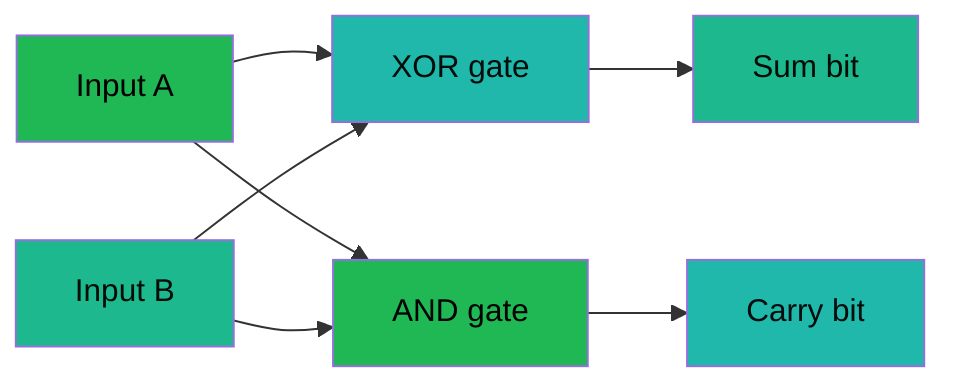

---
tags:
  - science
  - cheatsheet
  - computer-science
level: "Layer 5: the rules we invented"
sources:
  - "[[../Advance/Computer Science/01_Computational_Thinking]]"
  - "[[../Advance/Computer Science/02_Data_Representation]]"
  - "[[../Advance/Computer Science/03_Boolean_Logic]]"
  - "[[../Advance/Computer Science/04_Programming_Fundamentals]]"
  - "[[../Advance/Computer Science/06_Algorithms]]"
  - "[[../Advance/Computer Science/07_Data_Structures]]"
  - "[[../Advance/Computer Science/09_Computer_Systems_and_Networks]]"
  - "[[../Advance/Computer Science/10_Databases]]"
  - "[[../Advance/Computer Science/11_Artificial_Intelligence]]"
  - "[[../Advance/Computer Science/12_Digital_Citizenship]]"
created: 2026-10-07
---

# Computer Science — Rules of Logic and Information

> *"We built a machine that obeys only the rules we wrote — and then discovered the rules write back: what is computable, what is fast, what is safe, none of it is ours to choose anymore."*

Physics, chemistry, biology, and Earth science are rules we **discovered**. Computer science is the newest layer of reality: rules humans **constructed** — which then behave like laws. Accept that a bit has two values, and no machine can compare three conditions at once; accept an algorithm, and its speed class follows with mathematical certainty. These invented rules constrain what is computable (the halting problem), what is fast (Big-O), what can be transmitted (Shannon), and what is safe (cryptography). Information (สารสนเทศ) is the fifth layer of the universe — this is its rulebook.

---

## 1 | กฎแห่งความคิดเชิงคำนวณ — Computational Thinking

The meta-rule: before you code, reshape the problem into a form computation can hold.

### Rule 1.1 — Decomposition (การแบ่งแยก)
**The Rule:** Every large problem is a sum of smaller problems; solve the parts, compose the whole.
**WHY:** Working memory holds only a handful of items, but a solution must be exact. Splitting into subproblems (ปัญหาย่อย) is the only way a finite mind produces a finite, checkable specification — each part testable and reusable alone.
**Example:** "Build a school website" → layout, content, HTML/CSS coding, testing. Each subproblem has its own inputs and outputs.
**When to use:** *Any "outline an approach" question — list subproblems first, then order. Marks go to the split, not the prose.*

### Rule 1.2 — Pattern Recognition (การจดจำรูปแบบ)
**The Rule:** Problems that look alike are solved alike; find the repetition, name it once.
**WHY:** A pattern is a compression of experience. If a subproblem matches a known shape (searching? sorting? counting?), a proven algorithm already exists — re-deriving it wastes steps and invites bugs.
**Example:** Summing scores, prices, distances — one loop, different data:
```python
total = 0
for x in values:
    total += x
```
**When to use:** *Before designing, ask "seen this shape before?" — "find the maximum" is "count" with a different update rule.*

### Rule 1.3 — Abstraction (การสรุป/นามธรรม)
**The Rule:** Keep the essential, hide the irrelevant; a model is right when the removed details cannot change the answer.
**WHY:** Reality is infinite in detail; computation is finite by construction. Abstraction is the mandatory filter between the two — why a map guides you without every tree, and why a function's caller never needs its internals.
**Example:** A bus fare needs passenger count and category (student/adult), not hair colour. `def fare(n, is_student)` **is** the abstraction.
**When to use:** *Flowchart/pseudocode questions: draw only what changes the output; extra detail loses marks.*

### Rule 1.4 — Algorithm Design (การออกแบบขั้นตอนวิธี)
**The Rule:** A valid algorithm is finite, definite, has input and output, and every step is effectively doable.
**WHY:** These five properties are the definition of computability, not style tips. An infinite or ambiguous step cannot be executed — a machine can only follow instructions that terminate and admit exactly one reading.
**Example:** Pseudocode (รหัสเทียม):
```
BEGIN
    READ score
    IF score >= 80 THEN PRINT "Grade A"
    ELSE PRINT "Try again"
END IF
END
```
**When to use:** *Every "write an algorithm" answer — check against the five properties before submitting.*

---

## 2 | กฎแห่งการแทนข้อมูล — Information Representation

### Rule 2.1 — Everything is binary (เลขฐานสอง)
**The Rule:** All information — numbers, text, images, sound — is encoded as bits (บิต), sequences of 0 and 1.
**WHY:** Physical necessity, not convention. Electronics need a switch whose states survive noise; two stable states (on/off) are the cheapest reliable switch. Ten voltage levels would be constantly confused by noise. Base-2 is the base physics makes reliable.
**Example:** $25_{10} = 11001_2$ (divide by 2 repeatedly, read remainders bottom-up); group fours for hexadecimal (เลขฐานสิบหก): $1100\,1100_2 = \text{CC}_{16}$.

> 💡 **Deeper why:** Hexadecimal exists for humans — one hex digit is exactly 4 bits, so `CC` compresses `11001100` with zero ambiguity. Colour codes like `#FF8800` are readable only because base-16 is a power of base-2.

**When to use:** *Conversions: decimal→binary by repeated division; binary→decimal by place values; binary↔hex by grouping fours from the right.*

### Rule 2.2 — Units compound in powers of two (บิตและไบต์)
**The Rule:** A byte (ไบต์) = 8 bits; KB = $2^{10}$, MB = $2^{20}$, GB = $2^{30}$, TB = $2^{40}$ bytes.
**WHY:** Addresses are bit strings, so capacities are powers of two — while marketing uses $10^9$. The ~7% gap is why a "1 TB" drive shows 931 GB: the invented rule collides with the decimal habit.
**Example:** A 1024×768 grayscale image, 8 bits/pixel:
$$1024 \times 768 \times 8 \div 8 = 786{,}432 \text{ bytes} = 768 \text{ KB}$$
**When to use:** *File-size questions: size = width × height × bits-per-pixel ÷ 8; convert units once, at the end.*

### Rule 2.3 — Text is a number table (รหัสอักขระ)
**The Rule:** Every character maps to a code number. ASCII uses 7 bits (128 characters); Unicode (ยูนิโค้ด) covers all scripts, UTF-8 storing 1–4 bytes per character.
**WHY:** Computers store only bits, so meaning must be an agreed lookup table. `'A'` = 65 is pure convention — but once agreed it becomes law: mismatched tables produce mojibake. Thai lives in Unicode's block starting U+0E01, which is why UTF-8 ended ASCII's reign.
**Example:**
```python
ord('A')     # 65
chr(65 + 32) # 'a' — lowercase is exactly +32 in ASCII
ord('ก')     # 3585 = 0x0E01, first Thai code point
```
**When to use:** *"Why is 'a' − 'A' == 32?" and any "why Unicode?" essay → one agreed table for every script.*

### Rule 2.4 — Sampling must beat the signal (ทฤษฎีบทไนควิสต์)
**The Rule:** Digitising an analogue wave requires sampling at ≥ twice its highest frequency — the Nyquist rate (อัตราตัวอย่าง).
**WHY:** Mathematical necessity. Below $2f_{max}$, different waves give identical samples (aliasing) and no algorithm can tell them apart — information destroyed at capture. CD audio uses 44 100 Hz because hearing tops out near 20 kHz.
**Example:**
$$\text{bytes} = \text{rate} \times \frac{\text{bit depth}}{8} \times \text{channels} \times \text{seconds}$$
$$44100 \times 2 \times 2 \times 60 \approx 10.6 \text{ MB per minute of CD audio}$$
**When to use:** *Audio/image file-size calculations; "why 44.1 kHz?" → Nyquist for 20 kHz hearing plus filter margin.*

### Rule 2.5 — Compression trades exactness for size (การบีบอัดข้อมูล)
**The Rule:** Lossless (ไม่สูญเสีย) restores the exact original (PNG, ZIP, FLAC); lossy (สูญเสียบางส่วน) discards imperceptible detail forever (JPEG, MP3).
**WHY:** Shannon's source-coding theorem: lossless compression cannot beat the data's entropy — random data is incompressible. To go smaller you must delete something, and the only safe deletions are the ones human senses cannot detect.
**Example:** Run-length (lossless): `AAAABBB` → `4A3B`. JPEG (lossy): drops high-frequency colour detail the eye barely resolves.

> 💡 **Deeper why:** Shannon also proved the channel limit: a noisy link of bandwidth $B$ and signal-to-noise ratio SNR carries at most
> $$C = B \log_2(1 + \text{SNR}) \text{ bits per second}$$
> No coding scheme can beat $C$ — the ceiling is set by physics plus probability. Every Wi-Fi generation marches toward, never past, this law of the invented layer.

**When to use:** *"Choose a format": text/programs → lossless (exactness required); photos/music → lossy. Never lossy-compress a program — a flipped bit is a bug.*

---

## 3 | กฎแห่งตรรกศาสตร์ — Logic

### Rule 3.1 — Boolean algebra (พีชคณิตบูลีน)
**The Rule:** Truth values are True/False only, combined by AND ($\land$), OR ($\lor$), NOT ($\neg$). Every program condition reduces to these three.
**WHY:** Bits are two-state (Rule 2.1), so truth becomes two-state. Boolean algebra is the arithmetic of that world — invented in 1854, ~90 years before anyone could build a machine for it. We discovered that reasoning *is* computation.
**Example:** AND is true only in the last row; OR is false only in the first row:
```python
for a in (False, True):
    for b in (False, True):
        print(a, b, a and b, a or b, not a)
```
**When to use:** *Truth-table questions: enumerate rows as binary counting (00, 01, 10, 11) so no combination is missed.*

### Rule 3.2 — De Morgan's laws (กฎของเดอมอร์แกน)
**The Rule:**
$$\neg(A \land B) \equiv \neg A \lor \neg B \qquad \neg(A \lor B) \equiv \neg A \land \neg B$$
**WHY:** Not an arbitrary identity — it is what "not both" *means*: if both do not hold, at least one is false, which is exactly $\neg A \lor \neg B$. Any logic keeping that meaning keeps the law; it is forced by the semantics we chose.
**Example:**
```python
if not (passed and paid):        ...
if (not passed) or (not paid):   ...   # identical behaviour
```
**When to use:** *"Simplify / find the equivalent condition" — flip AND↔OR, push NOT inside; verify by truth table if unsure.*

### Rule 3.3 — Gates build arithmetic (วงจรลอจิก)
**The Rule:** AND, OR, NOT gates combine into any circuit; XOR plus AND make a half-adder, half-adders chain into a full ALU.
**WHY:** {AND, OR, NOT} is *functionally complete* — every possible truth table can be built from it. That is a theorem, not luck: millions of copies of one two-state switch suffice for all computation.
**Example:** Half-adder — sum = $A \oplus B$, carry = $A \land B$:



**When to use:** *Circuit tracing: compute each gate's output left-to-right, writing intermediate values. XOR = "different?" is the fastest mental check.*

---

## 4 | กฎแห่งการเขียนโปรแกรม — Programming Rules

### Rule 4.1 — Variables are typed names (ตัวแปรและชนิดข้อมูล)
**The Rule:** A variable (ตัวแปร) binds a name to a value of a type (ชนิดข้อมูล): int, float, str, bool. Operations obey types; mixing without conversion is an error.
**WHY:** Bits are meaningless without interpretation — `01000001` is 65, 'A', or nonsense depending on the agreed type. The type system translates raw bits into intent and catches errors early rather than at runtime.
**Example:**
```python
y = 5 / 2        # 2.5 — true division always floats
z = 5 // 2       # 2 — floor division stays int
s = "5" + "1"    # "51" — concatenation, not addition
n = int("5") + 1 # 6 — explicit conversion bridges types
```
**When to use:** *Output tracing: fix the type of every value before computing. `"5" + 1` errors; `"5" + "1"` is `"51"`.*

### Rule 4.2 — Control flow is only three shapes (โครงสร้างควบคุม)
**The Rule:** Every program is built from sequence, selection (การเลือก if/else), and iteration (การทำซ้ำ loops).
**WHY:** The Böhm–Jacopini theorem proves these three express any computable function — goto adds zero expressive power, only spaghetti. The rule is a theorem wearing a syntax.
**Example:**
```python
total = 0
for score in scores:     # iteration
    if score >= 50:      # selection
        total += score   # sequence
```
**When to use:** *Flowchart→code: oval=start/end, rectangle=process, diamond=if, parallelogram=input/output. Loop tracing: table of variable values per pass.*

### Rule 4.3 — Functions localise logic (ฟังก์ชันและขอบเขตตัวแปร)
**The Rule:** A function (ฟังก์ชัน) takes inputs, returns an output; its variables are local (scope — ขอบเขตตัวแปร) unless declared global.
**WHY:** Locality makes programs verifiable. If any line could change any variable, proving correctness would require reading everything. Scope walls let each function be reasoned about alone — decomposition (Rule 1.1) enforced by the language.
**Example:**
```python
def area(w, h):    # w, h are local
    return w * h
area(3, 4)         # 12 — caller never sees w or h
```
**When to use:** *"What does this print?" with same-named variables inside/outside a function — the inner one shadows; the outer is untouched.*

### Rule 4.4 — Recursion requires a base case (การเรียกซ้ำ)
**The Rule:** A recursive function must call itself on a *smaller* input and have a base case (กรณีฐาน) that returns without recursing.
**WHY:** Finiteness (Rule 1.4) again: without a base case, calls never stop and the stack overflows. Recursion works because each call shrinks the problem toward a case needing no recursion.
**Example:**
```python
def fact(n):
    if n <= 1:               # base case — MUST exist
        return 1
    return n * fact(n - 1)   # smaller input

fact(5)                      # 120
```
**When to use:** *Tracing: expand on paper — fact(3) → 3·fact(2) → 3·2·fact(1) → 6. "Base case removed?" → infinite recursion / stack overflow.*

### Rule 4.5 — Objects bundle state and behaviour (OOP)
**The Rule:** Classes group data (attributes) with the operations on it (methods). Four principles: encapsulation (การห่อหุ้ม), inheritance (การสืบทอด), polymorphism (พหุสัณฐาน), abstraction.
**WHY:** Programs model worlds full of things-that-change-together. Bundling state with the only code allowed to touch it makes invariants enforceable — a `BankAccount` can *refuse* to go negative because nothing outside can edit `balance` directly.
**Example:**
```python
class Animal:
    def speak(self): return "..."
class Dog(Animal):                 # inheritance
    def speak(self): return "Woof" # polymorphism
for a in [Animal(), Dog()]:
    print(a.speak())               # ... then Woof
```
**When to use:** *"Which principle?" — hiding data → encapsulation; reusing a parent → inheritance; one interface, many behaviours → polymorphism.*

---

## 5 | กฎแห่งอัลกอริทึมและความซับซ้อน — Algorithms and Complexity

### Rule 5.1 — Search cost depends on order (การค้นหา)
**The Rule:** Linear search (การค้นหาแบบลำดับ) is $O(n)$ on any list; binary search (การค้นหาแบบทวิภาค) is $O(\log n)$ but **requires sorted data**.
**WHY:** Binary search discards half the candidates per comparison — that halving *is* the logarithm. But "half is irrelevant" is only knowable when order guarantees it, so sortedness is the price of fast search: unsorted data offers nothing safe to discard.
**Example:**
```python
def binary_search(arr, target):
    lo, hi = 0, len(arr) - 1
    while lo <= hi:
        mid = (lo + hi) // 2
        if arr[mid] == target: return mid
        elif arr[mid] < target: lo = mid + 1
        else: hi = mid - 1
    return -1
```
One million items: linear needs up to 1 000 000 checks; binary needs at most $\log_2 10^6 \approx 20$.
**When to use:** *First check "sorted?" — yes → binary; no → linear, or pay $O(n \log n)$ to sort once and amortise over many searches.*

### Rule 5.2 — Comparison sorting floors at n log n (การเรียงลำดับ)
**The Rule:** Bubble, selection, insertion (ฟอง/เลือก/แทรก) are $O(n^2)$; merge sort (ผสาน) is $O(n \log n)$ — and no comparison sort can beat $O(n \log n)$.
**WHY:** A counting argument: $n!$ possible orders exist, each comparison yields one bit, halving possibilities at best. Isolating one order needs $\log_2(n!) = \Theta(n \log n)$ bits. Merge sort hits the bound by divide-and-conquer; quadratic sorts waste comparisons on neighbours only.
**Example:**
```python
def bubble_sort(a):
    a = a.copy()
    for i in range(len(a) - 1):
        for j in range(len(a) - 1 - i):
            if a[j] > a[j + 1]:
                a[j], a[j + 1] = a[j + 1], a[j]
    return a
```
**When to use:** *Nearly-sorted small data → insertion sort wins in practice (low overhead). Large data → merge sort.*

### Rule 5.3 — Big-O measures growth, not seconds (สัญกรณ์บิ๊กโอ)
**The Rule:** Rank algorithms by how cost grows with $n$, ignoring constants:

| Class | n = 10 | n = 1 000 | n = 1 000 000 | Typical |
|---|---|---|---|---|
| $O(1)$ | 1 | 1 | 1 | array index, hash lookup |
| $O(\log n)$ | ~3 | ~10 | ~20 | binary search |
| $O(n)$ | 10 | 1 000 | 10⁶ | linear search, sum |
| $O(n \log n)$ | ~33 | ~10 000 | ~2×10⁷ | merge sort |
| $O(n^2)$ | 100 | 10⁶ | 10¹² | bubble sort |
| $O(2^n)$ | 1 024 | astronomical | astronomical | subsets, naive recursion |

**WHY:** Constants depend on hardware; an invented layer needs machine-independent laws. Growth rate survives every upgrade — an $O(n^2)$ algorithm on a 100× faster machine still loses to $O(n \log n)$ once $n$ is big enough. The crossover is inevitable, not empirical.
**Example:** One loop = $O(n)$; nested loops = $O(n^2)$; halving inside a loop = $O(\log n)$.

> 💡 **Deeper why:** The **halting problem** is provably unsolvable. Suppose program `H` decides whether any program halts; build `D` that consults `H` about itself and does the opposite — halts if `H` says loop, loops if `H` says halt. `H` must be wrong about `D`, so no `H` exists: by diagonalization, some questions are beyond every algorithm. And **P vs NP** asks whether verifying fast implies solving fast; if P = NP, every invented lock — RSA, passwords, blockchains — falls. Most believe P ≠ NP, but nobody can prove it: our invented rules still contain rooms we cannot enter.

**When to use:** *"Which is better for n = 10⁶?" — count loops, name the class, compare growth only. Never answer "it depends on the computer."*

### Rule 5.4 — Time and space are traded, never free (การแลกเปลี่ยนเวลาและพื้นที่)
**The Rule:** Buy speed with memory (caching, hash tables) or memory with speed (recompute on demand) — every speedup costs something.
**WHY:** Both resources are finite, and precomputation is the universal trick: store the answer, pay space, skip time. A machine cannot conjure either resource, so the trade is structural.
**Example:** Fibonacci two ways:
```python
def fib_slow(n):                  # O(2^n) time — recomputes everything
    return n if n < 2 else fib_slow(n-1) + fib_slow(n-2)

def fib_fast(n):                  # O(n) time, O(1) space — remembers
    a, b = 0, 1
    for _ in range(n):
        a, b = b, a + b
    return a
```
**When to use:** *"Optimise this": find repeated work; the answer is usually "store it" — and mention the memory cost for full marks.*

---

## 6 | กฎแห่งโครงสร้างข้อมูล — Data Structures

### Rule 6.1 — Structure dictates speed (โครงสร้างข้อมูล)
**The Rule:** Choose by the dominant operation: array/list (อาร์เรย์/ลิสต์) for indexed access, stack (สแตก) for LIFO, queue (คิว) for FIFO, tree (ต้นไม้) for ordered fast search, hash table for $O(1)$ lookup, graph (กราฟ) for relationships.
**WHY:** Physical layout *is* algorithmic cost. Contiguous memory (array) makes index→address one multiplication: $O(1)$ access — but mid-list insertion shifts elements: $O(n)$. Linked structures insert in $O(1)$ yet must be walked to find anything. No layout serves all operations; the tradeoffs are geometric facts about memory.

| Structure | Access | Insert/Delete | Search | Use when |
|---|---|---|---|---|
| Array/list | $O(1)$ by index | $O(n)$ middle | $O(n)$, $O(\log n)$ sorted | fixed size, heavy indexing |
| Stack | top $O(1)$ | $O(1)$ at top | — | undo, backtracking, call frames |
| Queue | front $O(1)$ | $O(1)$ ends | — | scheduling, buffering, BFS |
| BST | $O(\log n)$ | $O(\log n)$ | $O(\log n)$ | dynamic sorted data |
| Hash table | — | $O(1)$ avg | $O(1)$ avg | counting, membership |
| Graph | — | — | BFS/DFS $O(V+E)$ | networks, maps, dependencies |

**Example:**
```python
stack = []; stack.append("edit1"); stack.pop()   # LIFO: last action undone first
queue = []; queue.append("job1"); queue.pop(0)   # FIFO: first in, first printed
```
**When to use:** *Keyword matching: "most recent" → stack; "fair order" → queue; "sorted + changing" → tree; "instant lookup" → hash; "routes/connections" → graph.*

### Rule 6.2 — Traversal order encodes meaning (การท่องต้นไม้และกราฟ)
**The Rule:** Trees: in-order (sorted output for BSTs), pre-order (copy structure), post-order (children first). Graphs: BFS (shortest unweighted path) or DFS (deep exploration).
**WHY:** A tree is a dependency order. Post-order *must* visit children first because evaluating the expression tree `3 + 4 × 5` needs the `×` subtree's value before the `+`. The orders are not styles — they are the only sequences consistent with the dependencies.
**Example:** In-order traversal of a BST always yields sorted values — one fact worth memorising; exams test it directly.
**When to use:** *Expression trees → post-order; "shortest path, unweighted" → BFS; "does a route exist / go deep" → DFS.*

---

## 7 | กฎแห่งระบบและเครือข่าย — Systems and Networks

### Rule 7.1 — Layers isolate change (ชั้นของเครือข่าย)
**The Rule:** Networks stack into layers — OSI 7 layers (physical, data link, network, transport, session, presentation, application), collapsed in practice to TCP/IP (link, internet, transport, application). Each layer serves the one above and hides its own details.
**WHY:** Scope (Rule 4.3) applied to machines: a layer needs only its neighbours' interface. Wi-Fi and Ethernet differ at the link layer yet carry identical IP packets — the internet exists because layering makes substitution invisible.
**Example:** A web request descends: browser (HTTP) → OS (TCP segment) → IP packet → frame (link) → bits on the wire. Each layer wraps the one above with its own header.
**When to use:** *"Which layer is X?" — IP/router → network/internet; TCP/port → transport; MAC/switch → data link; HTTP/browser → application.*

### Rule 7.2 — Protocols are agreements, and agreements are law (โปรโตคอล)
**The Rule:** A protocol is an agreed message format and sequence: HTTP for pages, TCP for reliable streams, IP for addressing/routing, DNS for name→IP. Communication follows client–server (ไคลเอนต์–เซิร์ฟเวอร์): the client requests, the server responds.
**WHY:** Two independent machines share nothing but the wire, so communication requires one binding specification. TCP's handshake and retransmission exist because the invented layer must *simulate* reliability over channels that are provably noisy (Shannon's world, Rule 2.5).
**Example:**
```
Browser --DNS--> www.school.ac.th → 203.150.x.x
Browser --TCP handshake--> server port 80
Browser --HTTP GET /index.html-->
Server  --HTTP 200 OK + HTML-->
```
**When to use:** *"Name the protocol": web page → HTTP(S); email → SMTP/IMAP; name lookup → DNS; file transfer → FTP.*

---

## 8 | กฎแห่งฐานข้อมูล — Databases

### Rule 8.1 — Relations are tables with keys (แบบจำลองเชิงสัมพันธ์)
**The Rule:** Data lives in tables; every row has a unique primary key (คีย์หลัก); tables link through foreign keys (คีย์นอก) pointing at another table's primary key.
**WHY:** Without unique identity, "update this row" is ambiguous — violating definiteness (Rule 1.4). Keys are how the invented layer re-obtains identity: the primary key makes each record a distinguishable individual; foreign keys make relationships queryable instead of duplicated.
**Example:**
```sql
CREATE TABLE students (
    student_id INTEGER PRIMARY KEY,
    name TEXT,
    room_id INTEGER REFERENCES rooms(room_id)  -- foreign key
);
SELECT s.name, r.building
FROM students s JOIN rooms r ON s.room_id = r.room_id;
```
**When to use:** *"Unique per row" → primary key; "points to another table" → foreign key. JOINs match on the key pair.*

### Rule 8.2 — Normalisation removes repetition (การนอร์มัลไลซ์)
**The Rule:** Store each fact once, in one place: 1NF atomic values, 2NF no partial key dependency, 3NF no transitive dependency.
**WHY:** Duplicated facts contradict themselves over time — update a lecturer's phone in one row, forget another, and the database asserts two realities. Anomalies are not bad luck; they are *guaranteed* wherever redundancy exists.
**Example:** Unnormalised `student, course, lecturer, lecturer_phone` — a lecturer change means hunting every row. Normalised: separate `lecturers` table; the phone lives in exactly one row, linked by key.
**When to use:** *"Find the anomaly / normalise": spot the repeated group, promote it to a table, link by foreign key; name the anomaly — insert, update, or delete.*

---

## 9 | กฎแห่งปัญญาประดิษฐ์และข้อมูล — AI and Data

### Rule 9.1 — Learning is fitting, not understanding (การเรียนรู้ของเครื่อง)
**The Rule:** Machine learning (การเรียนรู้ของเครื่อง) infers a function from examples: supervised (มีผู้สอน — labelled data), unsupervised (ไม่มีผู้สอน — find structure), reinforcement (การเสริมแรง — learn from reward).
**WHY:** For tasks like recognising cats, explicit rules exceed human articulation, so ML inverts programming: give data and answers, *search* for the rule. The model is only as lawful as its training distribution — it interpolates examples; it does not comprehend the world.
**Example:** Train/test split (การแบ่งข้อมูลฝึกและทดสอบ):
```python
from sklearn.model_selection import train_test_split
X_train, X_test, y_train, y_test = train_test_split(X, y, test_size=0.2)
# 80% to fit the model, 20% to measure it — never fit on the test set
```
**When to use:** *"Which ML type?" — labels → supervised; grouping without labels → unsupervised; trial-and-error reward → reinforcement.*

### Rule 9.2 — Generalisation is the only goal (การฟิตเกิน)
**The Rule:** A model must perform on *unseen* data. Overfitting (การฟิตเกิน) — memorising training noise — looks like success and is failure.
**WHY:** The test set is the only honest judge, because it was absent during fitting. 100% train / 60% test accuracy means the model learned the *examples*, not the *pattern* — the statistical form of Rule 1.3: abstraction keeps the essential and discards noise; overfitting keeps the noise.
**Example:** Warning sign: huge train–test accuracy gap. Fixes: more data, a simpler model, regularisation.

> 💡 **Deeper why:** AI ethics follows directly from Rule 9.1: a model trained on biased historical data will *faithfully* reproduce the bias, because faithfulness to data is exactly what it was built for. Garbage in, lawful garbage out — the invented layer amplifies whatever we feed it, which makes fairness auditing and explainability part of the discipline, not politics bolted onto it.

**When to use:** *"Why split train/test?" → to detect overfitting. "99% train, 55% test — diagnose?" → overfitting; suggest remedies.*

---

## 10 | กฎแห่งพลเมืองดิจิทัลและความปลอดภัย — Digital Citizenship and Security

### Rule 10.1 — Encryption needs key discipline (การเข้ารหัสลับ)
**The Rule:** Symmetric encryption (สมมาตร) uses one shared key both ways (AES — fast, but sharing the key safely is hard); asymmetric (อสมมาตร) encrypts with a public key and decrypts with a private key (RSA — solves sharing, slower). Real systems combine both: asymmetric to exchange a symmetric key, then symmetric for the data — exactly what HTTPS does.
**WHY:** Asymmetry rests on a mathematical one-way street: multiplying two large primes is instant; factoring their product is beyond any known algorithm (the hardness neighbourhood of P vs NP, Rule 5.3). Security is *borrowed* from unproven hardness — which is why key lengths must grow as factoring tricks improve.
**Example:**
```
Anyone:  ciphertext = encrypt(message, PUBLIC_key)
Owner:   message    = decrypt(ciphertext, PRIVATE_key)   # the only key that works
```
**When to use:** *Bulk data → symmetric; key exchange or digital signatures → asymmetric; "why is RSA secure?" → factoring large numbers is computationally infeasible.*

### Rule 10.2 — Hashing is one-way by design (แฮช)
**The Rule:** A hash maps any input to a fixed-size fingerprint: same input → same hash, and the hash cannot be reversed. Used for password storage, file integrity, digital signatures.
**WHY:** Reversibility would break the purpose — if you could recover a password from its hash, the hash *is* the password. One-wayness plus collision resistance lets a hash prove knowledge or integrity without revealing content, so a leaked table of salted hashes leaks nothing directly.
**Example:**
```python
import hashlib
hashlib.sha256(b"password").hexdigest()   # same input → same 64 hex chars
hashlib.sha256(b"passw0rd").hexdigest()   # one char different → totally different hash
```
**When to use:** *"Why hash instead of encrypt passwords?" → hashes can't be decrypted at all. Integrity checks → compare hashes, not whole files.*

### Rule 10.3 — Safety is a protocol, not a product (พลเมืองดิจิทัล)
**The Rule:** Strong unique passwords (รหัสผ่านที่แข็งแรง), two-factor authentication, scepticism toward phishing (ฟิชชิ่ง), respect for privacy and copyright, ethical behaviour online — the operating rules of digital citizenship.
**WHY:** Cryptography is only as strong as its weakest human endpoint. A perfect cipher defeated by a reused password or one clicked phishing link proves security lives at the *system* level, people included. The invented layer has no laws of physics to fall back on — its safety depends entirely on disciplined practice.
**Example:** Phishing test: unexpected urgency + a link + a request for credentials = phishing until proven otherwise; check the sender domain character by character.
**When to use:** *Safe-practice scenarios — justify with the endpoint principle: the attack targets the human, so the defence must include the human.*

---

## Chain Navigation

⬅ [[04_Earth_Science_Systems_and_Cycles]] · ➡ [[06_Roadmap]] · 🗺 [[06_Roadmap]]
