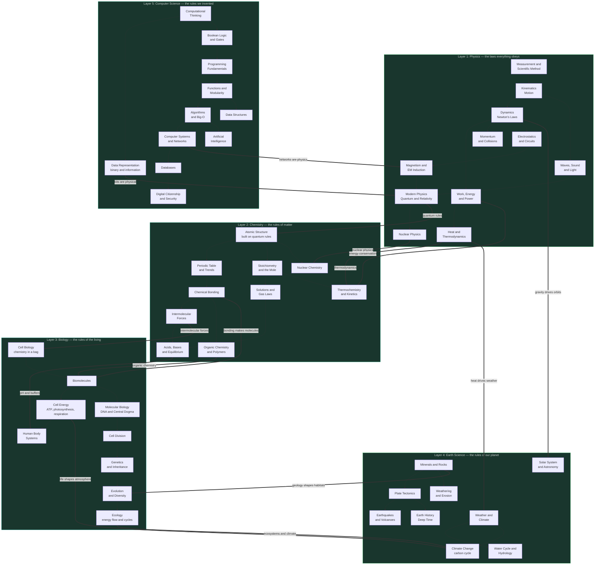

---
tags:
  - science
  - cheatsheet
  - roadmap
level: "Meta: the map of all layers"
sources: ["[[00_Index]]"]
created: 2026-10-07
---

# Science Roadmap: From Quarks to Computation

> *"The board on the box lid: five layers of reality, every piece, and the order you unlock them."*

This roadmap shows the whole journey as **one dependency map**: each node is a topic, each arrow means "learn this first", and each layer builds on the one below. Click any node to jump to its rulebook.

---

## The Full Map

**Reading the map:**
- Thin arrows `-->` = learn this first (within a layer)
- Thick arrows `==>` = cross-layer dependencies (why the stack is real)

---

## The Unlock Order

| Stage | Rulebook | Why it comes here |
|---|---|---|
| 1 | [[01_Physics_Motion_and_Energy]] | The substrate: matter, energy, forces. Nothing above works without it |
| 2 | [[02_Chemistry_Matter_and_Reactions]] | Physics applied to atoms: quantum rules + EM force = bonding behavior |
| 3 | [[03_Biology_Life_and_Evolution]] | Chemistry that self-replicates: molecules → cells → organisms → evolution |
| 4 | [[04_Earth_Science_Systems_and_Cycles]] | All three lower layers running on one planet for 4.6 billion years |
| 5 | [[05_Computer_Science_Logic_and_Information]] | The layer we built: logic made physical with electrons from Layer 1 |

---

## Three Rules That Cross Every Layer

The deepest patterns repeat at every scale — these are the "meta-rules" of the world:

### Conservation (การอนุรักษ์)
- **Physics:** energy, momentum, charge are conserved
- **Chemistry:** mass is conserved in reactions (Lavoisier)
- **Biology:** energy flows through ecosystems, never created or destroyed
- **Earth:** the rock cycle recycles matter; plate tectonics conserves surface area
- **CS:** information is conserved in reversible computation; bits can't be copied perfectly (no-cloning in quantum)

### Cycles (วัฏจักร)
- **Physics:** oscillations, waves, orbits
- **Chemistry:** equilibrium, reaction cycles (Calvin, Krebs)
- **Biology:** cell cycle, biogeochemical cycles, life cycles
- **Earth:** rock cycle, water cycle, carbon cycle
- **CS:** the fetch-decode-execute loop, event loops

### Emergence (การอุบัติใหม่)
- **Physics:** thermodynamics emerges from particle statistics
- **Chemistry:** wetness, color, reactivity emerge from electron arrangements
- **Biology:** life emerges from non-living chemistry; consciousness from neurons
- **Earth:** climate emerges from atmosphere-ocean-land interactions
- **CS:** intelligence emerges from simple gates; the internet emerges from protocols

> 💡 **Deeper why:** The reason the same three patterns appear at every layer is that each layer is a *complex system* built from the one below. Conservation comes from symmetries in the laws (Noether), cycles come from feedback (restoring forces), and emergence comes from many interacting parts producing behavior no single part has.

---

## Suggested Reading Paths

**Exam sprint (ม.6):** Read each rulebook's Section 1–2 only, plus the `When to use` lines. Two hours total.

**Deep understanding:** Read 01 → 05 in order, stopping at every `💡 Deeper why` callout. One week.

**Curiosity path:** Start at [[03_Biology_Life_and_Evolution]] (evolution patterns), then [[04_Earth_Science_Systems_and_Cycles]] (deep time), then work down to [[01_Physics_Motion_and_Energy]] to find the foundations.

---

## Chain Navigation

⬅ [[05_Computer_Science_Logic_and_Information]] · 🏠 [[00_Index]] · ➡ *(end of chain)*
