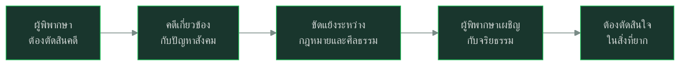

# คำพิพากษา

> นวนิยายที่ตั้งคำถามเกี่ยวกับความยุติธรรมและสังคมไทย

---

## เกี่ยวกับผลงาน

| รายละเอียด | ข้อมูล |
|---|---|
| **ชื่อผลงาน** | คำพิพากษา |
| **ผู้แต่ง** | ชาติ กอบจิตติ |
| **ช่วงเวลา** | พ.ศ. ๒๕๒๔ |
| **ประเภท** | นวนิยาย |
| **เนื้อหา** | เล่าเรื่องของผู้พิพากษาที่ต้องตัดสินปัญหาสังคมที่ซับซ้อน |
| **ความสำคัญ** | วรรณกรรมที่วิจารณ์สังคมและตั้งคำถามเรื่องความยุติธรรม |
| **รางวัล** | วรรณกรรมสร้างสรรค์ยอดเยี่ยมอาเซียน (ซีไรต์) |

---

## เนื้อหาสาระ

---

## วรรณศิลป์

| วิธีการ | รายละเอียด |
|---|---|
| **ร้อยแก้ว** | นวนิยายภาษาเขียน |
| **โวหารวิเคราะห์** | วิเคราะห์ปัญหาสังคม |
| **ภาษาสมัยใหม่** | ภาษาเขียนสมัยใหม่ |
| **การสร้างตัวละคร** | ตัวละครมีความขัดแย้งภายใน |

---

## คติธรรมและคุณค่า

| ประเภท | รายละเอียด |
|---|---|
| **คุณค่าทางวรรณศิลป์** | วรรณกรรมวิจารณ์สังคมที่ดีเยี่ยม |
| **คุณค่าทางสังคม** | ตั้งคำถามเรื่องความยุติธรรมและจริยธรรม |
| **ข้อคิด** | ความยุติธรรมไม่ใช่แค่กฎหมาย แต่รวมถึงศีลธรรมและความรู้สึก |

---

## สรุปสำคัญ

1. **คำพิพากษา** เป็นนวนิยายโดยชาติ กอบจิตติ
2. **แก่นเรื่อง** ความยุติธรรม จริยธรรม ความขัดแย้งในสังคม
3. **วิจารณ์สังคม** ตั้งคำถามเรื่องกฎหมายและศีลธรรม
4. **รางวัลซีไรต์** วรรณกรรมสร้างสรรค์ยอดเยี่ยมอาเซียน

---

## ดูเพิ่มเติม

- [[ภาษาไทย/วรรณคดีและวรรณกรรม/วรรณกรรมสมัยใหม่/00_overview|← กลับไปภาพรวมวรรณกรรมสมัยใหม่]]
